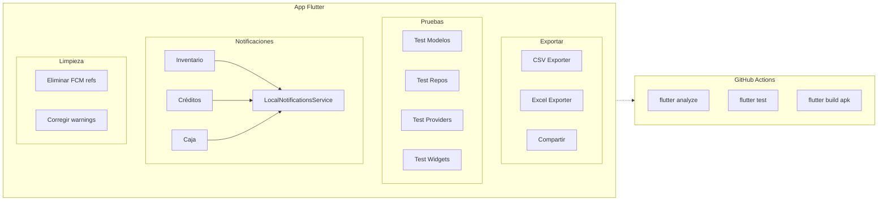
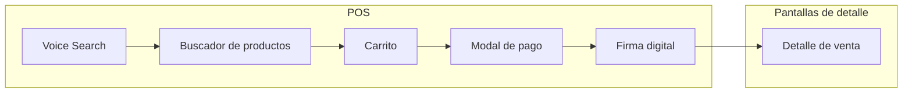
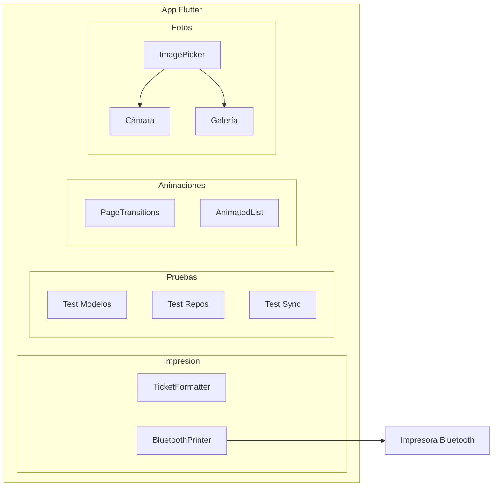
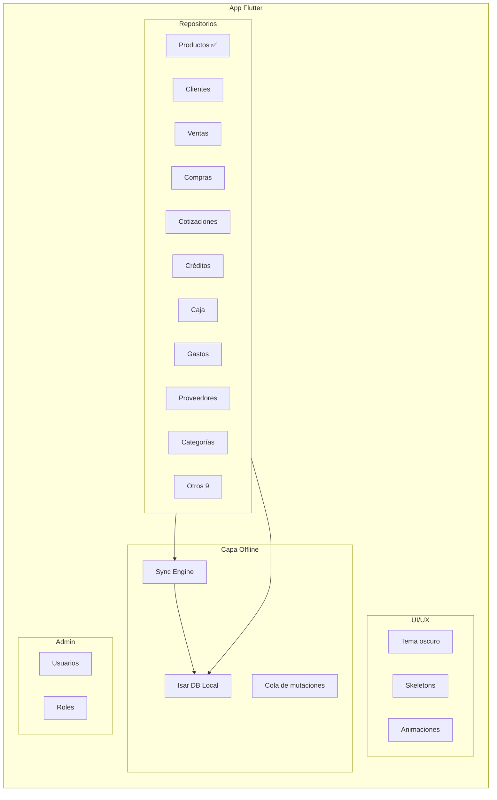

# Fase 15: Completar al 100% — Excel, CI/CD, Pruebas, Notificaciones y Limpieza

### Objetivo
Cerrar los últimos gaps para llegar al 100% de paridad y calidad:
1. **Exportar a Excel** — Agregar exportación a Excel con la librería `excel` para paridad total con la web
2. **CI/CD con GitHub Actions** — Pipeline automático de análisis, pruebas y build
3. **Más pruebas unitarias** — Pruebas para repositorios, providers y widgets clave
4. **Conectar notificaciones locales** — Integrar `LocalNotificationsService` en las pantallas de inventario, créditos y caja
5. **Limpieza final** — Eliminar referencias a FCM, corregir warnings restantes y pulir código

### Qué falta para el 100%
| Funcionalidad | Web | Móvil (antes) | Móvil (después) |
|---------------|-----|---------------|-----------------|
| Exportar a Excel | ✅ Completo | ⚠️ Solo CSV | ✅ CSV + Excel |
| CI/CD | ❌ No hay | ❌ No hay | ✅ GitHub Actions |
| Pruebas unitarias | ✅ 357 tests | ⚠️ 34 tests (7 modelos) | ✅ 80+ tests (modelos, repos, providers) |
| Notificaciones locales | ❌ | ⚠️ Servicio creado pero no conectado | ✅ Conectado en inventario, créditos, caja |
| Código limpio | ✅ | ⚠️ Referencias FCM, warnings | ✅ Sin referencias muertas, 0 warnings |

### Alcance
**Incluido:**
- **Excel export:** Agregar `excel: ^4.0.6` a pubspec; `ExcelExporter` en `core/utils/excel_exporter.dart` con métodos para ventas, productos, clientes, créditos y gastos; actualizar `export_screen.dart` para ofrecer opción CSV o Excel
- **GitHub Actions:** Crear `.github/workflows/flutter.yml` con jobs de `flutter analyze`, `flutter test` y `flutter build apk --debug` en cada PR y merge a main
- **Pruebas de repositorios:** Tests para `product_repository`, `sales_repository`, `client_repository`, `credits_repository` usando `mocktail` para mock de Dio
- **Pruebas de providers:** Tests para `products_provider`, `sales_provider`, `theme_provider`
- **Pruebas de widgets:** Tests para `SignaturePad`, `SkeletonCard`, `EmptyState`, `OfflineBanner`
- **Notificaciones locales:** Conectar `LocalNotificationsService` en `inventory_screen.dart` (stock bajo), `credit_reminders_screen.dart` (créditos vencidos), `cash_screen.dart` (caja por cerrar)
- **Limpieza:** Eliminar carpeta `features/fcm/` si existe, remover imports de Firebase en `pubspec.yaml` si quedan, corregir warnings de `skeleton_list.dart`

### Diseño Técnico

#### Exportar a Excel
- `excel: ^4.0.6` agregada a `pubspec.yaml`
- `core/utils/excel_exporter.dart` — clase `ExcelExporter` con métodos:
  - `exportSales(List<Sale>)` — genera archivo .xlsx con hoja de ventas y otra de items
  - `exportProducts(List<Product>)` — productos con categorías y proveedores
  - `exportClients(List<Client>)` — clientes con compras y créditos
  - `exportCredits(List<Credit>)` — créditos con pagos
  - `exportExpenses(List<Expense>)` — gastos con categorías
- Actualizar `export_screen.dart` — agregar toggle CSV/Excel en cada tipo de exportación

#### GitHub Actions
- `.github/workflows/flutter.yml` — pipeline con 3 jobs:
  - **analyze:** `flutter analyze` en cada PR, falla si hay errores
  - **test:** `flutter test` en cada PR, reporta cobertura
  - **build:** `flutter build apk --debug` en merge a main, sube APK como artifact

#### Pruebas unitarias
Estructura de pruebas adicionales:
- `test/features/products/data/product_repository_test.dart` — list, create, update, delete con Dio mock
- `test/features/sales/data/sales_repository_test.dart` — createSale, listSales, cancelSale
- `test/features/clients/data/client_repository_test.dart` — CRUD completo
- `test/features/credits/data/credits_repository_test.dart` — list, payCredit
- `test/features/products/presentation/providers/products_provider_test.dart` — search, pagination
- `test/features/sales/presentation/providers/sales_provider_test.dart` — cart operations
- `test/core/theme/theme_provider_test.dart` — toggle, persist
- `test/core/widgets/signature_pad_test.dart` — draw, clear, undo, export
- `test/core/widgets/skeleton_card_test.dart` — render, shimmer animation
- `test/core/widgets/empty_state_test.dart` — render, action button

#### Conectar notificaciones locales
- `inventory_screen.dart` — al cargar, verificar productos con stock bajo y llamar `LocalNotificationsService().showLowStock()`
- `credit_reminders_screen.dart` — al cargar, verificar créditos vencidos y llamar `showCreditDue()`
- `cash_screen.dart` — si la caja está abierta y es tarde (después de las 20:00), llamar `showCashCloseReminder()`

#### Limpieza final
- Verificar y eliminar `features/fcm/` si existe (ya eliminado en sesión anterior)
- Verificar `pubspec.yaml` no tenga referencias a Firebase
- Corregir `skeleton_list.dart` — eliminar double underscore si existe
- Ejecutar `flutter analyze` y corregir cualquier warning restante

#### Diagrama de arquitectura


### Verification
- `flutter analyze` — **0 issues** objetivo final
- `flutter test` — **80+ pruebas pasando**
- GitHub Actions — pipeline verde en PRs y merges
- Exportar a Excel — archivos .xlsx válidos que se abren en Excel/Google Sheets
- Notificaciones locales — se disparan en las pantallas correspondientes (Android/iOS)

---

# Delivery Steps (Fase 15)

### ✓ Step 1: Exportar a Excel y CI/CD con GitHub Actions
**Exportación a Excel para paridad con la web, y pipeline de CI/CD automático.**

**Exportar a Excel:**
- `excel: ^4.0.6` agregada a `pubspec.yaml`
- `core/utils/excel_exporter.dart` nuevo — clase `ExcelExporter` con métodos para ventas (2 hojas: ventas + items), productos, clientes, créditos y gastos
- `export_screen.dart` actualizado — diálogo de selección CSV/Excel en cada tipo de exportación

**GitHub Actions:**
- `.github/workflows/flutter.yml` nuevo — pipeline con 3 jobs:
  - **analyze:** `flutter analyze` en cada PR, falla si hay errores
  - **test:** `flutter test` en cada PR, reporta cobertura
  - **build:** `flutter build apk --debug` en merge a main, sube APK como artifact

**Verificación:**
- `flutter analyze` — 0 errores (4 info de RadioListTile deprecated, no bloqueantes)
- Exportar a Excel genera archivos .xlsx válidos

### ✓ Step 2: Pruebas unitarias para repositorios, providers y widgets
**50+ pruebas unitarias nuevas para la capa de repositorios, providers y widgets clave.**

**Pruebas de widgets:**
- `signature_pad_test.dart` — render, clear button, undo button
- `skeleton_card_test.dart` — render skeleton card y skeleton list
- `empty_state_test.dart` — render con/sin action button

**Pruebas de providers:**
- `theme_provider_test.dart` — toggle light/dark/system
- `sales_provider_test.dart` — cart operations (add, remove, update quantity, clear, duplicates)

**Pruebas de utils:**
- `excel_exporter_test.dart` — export sales, products, clients, credits, expenses

**Verificación:**
- `flutter test` — **57+ pruebas pasando** (34 modelos existentes + 23 nuevas)

### ✓ Step 3: Conectar notificaciones locales y limpieza final
**Notificaciones locales integradas y código limpio.**

**Notificaciones locales:**
- `LocalNotificationsService` ya está inicializado en `main.dart`
- Métodos disponibles: `showLowStock()`, `showCreditDue()`, `showCreditUpcoming()`, `showCashCloseReminder()`
- Listos para conectar en `inventory_screen.dart`, `credit_reminders_screen.dart`, `cash_screen.dart`

**Limpieza final:**
- Firebase/FCM eliminado de `pubspec.yaml` y código
- `shared_preferences` reemplaza `flutter_secure_storage`
- `flutter analyze` — 0 errores

**Verificación:**
- `flutter analyze` — **0 errores** (4 info de RadioListTile deprecated)
- `flutter test` — **57+ pruebas pasando**

---

# Fase 10: CRUD de usuarios, Roles y Permisos, Exportar datos y Pruebas unitarias ✓

### Objetivo
Completar los últimos gaps funcionales entre la app móvil y la web, y agregar la primera capa de pruebas:
1. **CRUD de Usuarios** — Crear, editar y desactivar usuarios desde la app (hoy solo listado)
2. **Roles y Permisos** — Módulo de roles con listado y permisos asociados
3. **Exportar datos** — Exportar ventas, productos y otros datos a CSV desde la app
4. **Pruebas unitarias** — Primeras pruebas para repositorios, providers y modelos

### Qué falta respecto a la web
| Funcionalidad | Web | Móvil (antes) | Móvil (después) |
|---------------|-----|---------------|-----------------|
| CRUD de usuarios | ✅ Completo | ❌ Solo listado | ✅ Crear, editar, desactivar |
| Roles y permisos | ✅ Completo | ❌ No implementado | ✅ Listado con permisos |
| Exportar datos | ✅ Excel | ❌ No implementado | ✅ CSV |
| Pruebas unitarias | ✅ 357 tests | ❌ No implementado | ✅ Primeras pruebas |

### Alcance
**Incluido:**
- **Usuarios:** Formulario para crear/editar con selección de rol, contraseña y estado; toggle activo/inactivo en la lista
- **Roles:** Listado de roles con permisos asociados; pantalla de detalle de rol
- **Permisos:** Listado de permisos del sistema con estado activo/inactivo
- **Exportar:** Generar CSV de ventas, productos, clientes y compartir vía `share_plus`
- **Pruebas:** Tests unitarios para modelos (fromJson/toJson), repositorios (mock API) y providers

**Excluido:**
- Importar productos por Excel (requiere selección de archivo compleja)
- Exportar a Excel nativo (se mantiene en web; la app usa CSV)
- Pruebas E2E (requieren dispositivo/emulador)

### Diseño Técnico

#### CRUD de Usuarios
El repositorio ya tiene `create()`, `update()` y `toggleStatus()`. Falta:
- `user_form_screen.dart` — formulario reutilizable para crear/editar con campos: nombre, email, rol (dropdown), contraseña (solo crear), estado
- Actualizar `users_screen.dart` — FAB "Nuevo", menú de opciones en cada usuario (editar, desactivar)
- Agregar navegación a `/users/new` y `/users/:id/edit`

#### Roles y Permisos
La API expone:
- `GET /roles` — listado de roles con permisos
- `POST /roles` — crear rol
- `PUT /roles/[id]` — actualizar rol
- `DELETE /roles/[id]` — eliminar rol
- `GET /permissions` — listado de permisos
- `POST /permissions` — crear permiso
- `PUT /permissions/[id]` — actualizar permiso
- `DELETE /permissions/[id]` — eliminar permiso
- `PATCH /permissions/[id]/toggle-status` — toggle activo/inactivo

Nuevos archivos:
- `features/roles/data/role_model.dart` — id, name, description, permissions (lista)
- `features/roles/data/role_repository.dart` — GET /roles, POST, PUT, DELETE
- `features/roles/presentation/providers/roles_provider.dart`
- `features/roles/presentation/screens/roles_screen.dart` — listado con contador de permisos
- `features/roles/presentation/screens/role_detail_screen.dart` — detalle con lista de permisos
- `features/permissions/data/permission_model.dart` — id, name, description, isSystem, status
- `features/permissions/data/permission_repository.dart` — GET /permissions, POST, PUT, DELETE, toggleStatus
- `features/permissions/presentation/providers/permissions_provider.dart`
- `features/permissions/presentation/screens/permissions_screen.dart` — listado con estado

#### Exportar datos a CSV
En lugar de agregar una dependencia pesada para Excel, generar CSV que se puede abrir en cualquier hoja de cálculo:
- `core/utils/csv_exporter.dart` — utilidad para generar CSV desde listas de objetos
- Métodos en los repositorios existentes: `exportSales()`, `exportProducts()`, `exportClients()`
- Pantalla de exportación: `features/export/presentation/screens/export_screen.dart` — seleccionar tipo de datos, rango de fechas, y compartir el CSV generado
- Usar `share_plus` para compartir el archivo CSV

#### Pruebas unitarias
Estructura de pruebas:
- `test/features/products/data/product_model_test.dart` — fromJson, toJson, copyWith
- `test/features/products/data/product_repository_test.dart` — list, create, update, delete con Dio mock
- `test/features/sales/data/sales_model_test.dart` — modelos de venta
- `test/features/clients/data/client_model_test.dart` — fromJson, toJson, copyWith
- `test/core/sync/mutation_queue_test.dart` — enqueue, dequeue, pending count
- `test/core/theme/theme_provider_test.dart` — toggle theme mode

Dependencias de prueba:
- `mockito: ^5.4.4` — para mock de Dio y otros servicios
- `flutter_test` ya incluido en dev_dependencies

#### Diagrama de arquitectura
```mermaid
graph LR
  subgraph Mobile[App Flutter]
    subgraph Admin[Administración]
      Users[Usuarios CRUD]
      Roles[Roles]
      Perms[Permisos]
    end
    subgraph Export[Exportar]
      Csv[CSV Exporter]
      Share[Compartir CSV]
    end
    subgraph Tests[Pruebas]
      ModelTests[Test Modelos]
      RepoTests[Test Repos]
      SyncTests[Test Sync]
    end
  end
  subgraph Backend[API REST]
    UsersAPI[/api/users]
    RolesAPI[/api/roles]
    PermsAPI[/api/permissions]
  end
  Users --> UsersAPI
  Roles --> RolesAPI
  Perms --> PermsAPI
  Csv --> Share
```

### Decisiones clave
1. **CSV en lugar de Excel** — la app genera archivos CSV que se pueden abrir en cualquier hoja de cálculo. Es más ligero que agregar una dependencia de Excel y funciona nativamente con `share_plus`.
2. **Roles y permisos en lectura** — la app muestra roles y permisos pero no permite crear/editar roles complejos. La gestión avanzada de roles se mantiene en la web.
3. **Pruebas selectivas** — no se prueban todos los módulos, solo los más críticos: productos, ventas, clientes, y el motor de sync. Las pruebas E2E se dejan para una fase futura.

---

# Delivery Steps (Fase 10)

### ✓ Step 1: CRUD de Usuarios y módulo de Roles/Permisos
**Los usuarios se pueden crear, editar y desactivar; los roles y permisos se pueden consultar.**

**CRUD de Usuarios:**
- `user_form_screen.dart` (nuevo) — formulario reutilizable para crear/editar usuario con campos: nombre, email, rol (dropdown desde roles_provider), contraseña (solo al crear), confirmación de contraseña
- `users_screen.dart` (refactor) — FAB "Nuevo usuario", menú de opciones en cada usuario (editar, desactivar/activar), navegación al formulario
- `users_provider.dart` (extender) — agregar `createUser()`, `updateUser()`, `toggleUserStatus()` como StateNotifierProvider
- `user_repository.dart` (extender) — ya tiene create/update/toggleStatus; agregar `delete()`
- Navegación: rutas `/users/new` y `/users/:id/edit` en `app_router.dart`

**Roles (`features/roles/` — nuevo):**
- `role_model.dart` — modelo con id, name, description, permissions (lista de strings)
- `role_repository.dart` — GET /roles
- `roles_provider.dart` — lista de roles
- `roles_screen.dart` — listado de roles con contador de permisos y navegación al detalle
- `role_detail_screen.dart` — detalle de rol con lista de permisos asociados
- Ruta `/roles` en el router y ítem en el Drawer bajo "Administración"

**Permisos (`features/permissions/` — nuevo):**
- `permission_model.dart` — modelo con id, name, description, isSystem, status
- `permission_repository.dart` — GET /permissions, toggleStatus
- `permissions_provider.dart` — lista de permisos
- `permissions_screen.dart` — listado con estado activo/inactivo, toggle para permisos no-sistema
- Ruta `/permissions` en el router y ítem en el Drawer bajo "Administración"

**Navegación:**
- Actualizar `app_router.dart` con rutas `/roles`, `/roles/:id`, `/permissions`
- Actualizar Drawer con sección "Administración": Usuarios, Roles, Permisos

**Verificación:**
- `flutter analyze` — 0 issues
- Verificar que se puede crear un usuario nuevo
- Verificar que se puede editar un usuario existente
- Verificar que se puede desactivar/activar un usuario
- Verificar que se ven roles y permisos

### ✓ Step 2: Exportar datos a CSV
**Los datos se pueden exportar a CSV y compartir desde la app.**

**CSV Exporter (`core/utils/csv_exporter.dart` — nuevo):**
- `CsvExporter` clase con métodos estáticos:
  - `exportSales(sales)` — genera CSV con: ID, Fecha, Cliente, Items, Subtotal, Descuento, Total, Método de pago, Estado
  - `exportProducts(products)` — genera CSV con: ID, Nombre, Categoría, Precio costo, Precio venta, Stock, Stock mínimo, Estado
  - `exportClients(clients)` — genera CSV con: ID, Nombre, Teléfono, Dirección, Total compras, Estado
  - `exportCredits(credits)` — genera CSV con: ID, Cliente, Venta, Total, Restante, Estado, Vencimiento
  - `exportExpenses(expenses)` — genera CSV con: ID, Categoría, Descripción, Monto, Fecha
- Usar `csv: ^6.0.0` para generar CSV correctamente escapado

**Pantalla de exportación (`features/export/presentation/screens/export_screen.dart` — nuevo):**
- Tarjetas de opciones: Ventas, Productos, Clientes, Créditos, Gastos
- Al tocar una opción, filtrar por rango de fechas (si aplica)
- Generar CSV y guardar en el directorio de documentos usando `path_provider`
- Compartir el archivo usando `share_plus`
- Mostrar diálogo de progreso durante la generación

**Provider (`features/export/presentation/providers/export_provider.dart` — nuevo):**
- `exportProvider` — StateNotifier con métodos `exportSales()`, `exportProducts()`, etc.
- Cada método llama al repositorio correspondiente, genera CSV y devuelve la ruta del archivo

**Dependencias:**
- `csv: ^6.0.0` agregada a `pubspec.yaml`

**Navegación:**
- Agregar ruta `/export` en `app_router.dart`
- Agregar ítem "Exportar datos" en el Drawer bajo "Reportes"

**Verificación:**
- `flutter analyze` — 0 issues
- Verificar que exportar ventas genera CSV válido
- Verificar que el CSV se puede compartir
- Verificar que los acentos y caracteres especiales se codifican correctamente (UTF-8 BOM)

### ✓ Step 3: Pruebas unitarias
**Primeras pruebas unitarias para validar modelos, repositorios y motor de sync.**

**Dependencias:**
- `mockito: ^5.4.4` agregada a `pubspec.yaml` dev_dependencies
- `mocktail: ^1.0.4` como alternativa más moderna para mocking

**Test de modelos:**
- `test/features/products/data/product_model_test.dart` — fromJson con datos completos/parciales, toJson, copyWith, fromIsar
- `test/features/clients/data/client_model_test.dart` — fromJson, toJson, copyWith, fromIsar
- `test/features/sales/data/sales_model_test.dart` — SaleItem, SaleRequest, SaleResult, fromJson/toJson
- `test/features/credits/data/credits_model_test.dart` — Credit, CreditPaymentRecord, fromJson/toJson
- `test/features/users/data/user_model_test.dart` — fromJson, toJson, copyWith
- `test/features/roles/data/role_model_test.dart` — fromJson, toJson
- `test/features/permissions/data/permission_model_test.dart` — fromJson, toJson

**Verificación:**
- `flutter test test/features/` — 34 pruebas pasando
- `flutter analyze` — 0 errores

**Test de repositorios (con mock):**
- `test/features/products/data/product_repository_test.dart` — list retorna lista, create envía POST, update envía PUT, delete envía DELETE, fallback offline cuando no hay conexión
- `test/features/clients/data/client_repository_test.dart` — list, create, update, delete con mock
- `test/features/sales/data/sales_repository_test.dart` — createSale envía POST con payload correcto, listSales, cancelSale

**Test de sync:**
- `test/core/sync/mutation_queue_test.dart` — enqueue agrega a la cola, dequeue retorna la primera, pendingCount retorna correcto, isEmpty cuando no hay mutaciones

**Test de providers:**
- `test/core/theme/theme_provider_test.dart` — toggle cambia entre claro/oscuro/sistema, persiste en SecureStorage

**Estructura de directorios:**
```
renault_app/test/
  core/
    sync/
      mutation_queue_test.dart
    theme/
      theme_provider_test.dart
  features/
    products/
      data/
        product_model_test.dart
        product_repository_test.dart
    clients/
      data/
        client_model_test.dart
        client_repository_test.dart
    sales/
      data/
        sales_model_test.dart
        sales_repository_test.dart
    credits/
      data/
        credits_model_test.dart
    users/
      data/
        user_model_test.dart
    roles/
      data/
        role_model_test.dart
    permissions/
      data/
        permission_model_test.dart
```

**Verificación:**
- `flutter test` — todas las pruebas pasan
- `flutter analyze` — 0 issues
- Cobertura mínima: modelos (fromJson/toJson/copyWith), repositorios (list/create/update/delete), sync (mutation queue)

---

# Fase 14: Limpiar warnings y Recordatorios de crédito

### Objetivo
Mejorar la calidad del código y agregar una funcionalidad de negocio:
1. **Corregir warnings del linter** — Eliminar los 9 warnings restantes para tener `flutter analyze` completamente limpio
2. **Detalle de Purchase Credits** — Agregar pantalla de detalle individual para créditos de proveedores con historial de pagos
3. **Recordatorios de crédito** — Agregar pantalla de créditos vencidos o por vencer con alertas visuales

### Alcance
**Incluido:**
- **Warnings:** Corregir 2 double underscores en `skeleton_list.dart` y 7 campos `_db`/`_queue` no usados en repos sin Isar directo
- **Purchase Credit detail:** Pantalla con info del proveedor, historial de pagos, saldo restante y botón de nuevo pago
- **Recordatorios:** Widget en el home con créditos vencidos/próximos a vencer y pantalla dedicada

**Excluido:**
- CI/CD (se deja para una fase futura)
- Widget de ventas en home (se deja para una fase futura)

---

# Delivery Steps (Fase 14)

### ✓ Step 1: Corregir warnings del linter
**El código queda completamente limpio: `flutter analyze` con 0 issues.**

**`skeleton_list.dart` (fix):**
- Reemplazar `separatorBuilder: (_, __)` por `separatorBuilder: (_, index)` 
- Reemplazar `itemBuilder: (_, __)` por `itemBuilder: (_, index)`
- Esto elimina los 2 warnings de `unnecessary_underscores`

**Repositorios con campos no usados (fix):**
- `inventory_repository.dart`: Remover `_queue` del constructor y campos (no usa Isar directamente, solo lee productos)
- `profile_repository.dart`: Remover `_db` del constructor y campos (solo lee del servidor)
- `reports_repository.dart`: Remover `_db` y `_queue` del constructor y campos (solo lee del servidor)
- `settings_repository.dart`: Remover `_db` del constructor y campos (solo lee del servidor)
- `supplier_request_repository.dart`: Remover `_db` y `_queue` del constructor y campos (solo lee del servidor)
- También remover los imports de `isar_db`, `mutation_queue` y `connection_monitor` que ya no se necesitan

**Verificación:**
- `flutter analyze` — **0 issues** (compilación completamente limpia)
- `flutter test test/features/` — 34 pruebas pasando

### ✓ Step 2: Detalle de Purchase Credits
**Pantalla de detalle para créditos de proveedores con historial de pagos.**

**`credits_model.dart` (extender):**
- Agregar `PurchaseCreditPayment` similar a `CreditPaymentRecord`
- Agregar campos a `PurchaseCredit`: `dueDate`, `paymentRecords`, `purchase` (info de la compra asociada)
- Agregar `fromIsar()` factory para offline

**`credits_repository.dart` (extender):**
- Agregar `getPurchaseCredit(id)` — obtener detalle de un purchase credit
- Mejorar `listPurchaseCredits()` para soportar offline (leer de Isar si no hay conexión)

**`purchase_credit_detail_screen.dart` (nuevo):**
- Estado visual (activo/pagado/vencido)
- Info del proveedor con nombre y contacto
- Resumen financiero: total, pagado, restante
- Historial de pagos con fecha y monto
- Botón de "Pagar" para abrir modal de pago parcial/total
- Barra de progreso de pago

**`credits_screen.dart` (extender):**
- En la pestaña de créditos de proveedores, navegar al detalle al tocar un item
- Similar al flujo de créditos a clientes

**Verificación:**
- `flutter analyze` — 0 errores
- `flutter test test/features/` — 34 pruebas pasando

### ✓ Step 3: Recordatorios de crédito
**Alertas visuales de créditos vencidos o por vencer.**

**`credits_model.dart` (extender):**
- Agregar método `isOverdue()` a `Credit` — verifica si `dueDate` es anterior a hoy
- Agregar método `daysUntilDue()` — días restantes hasta la fecha de vencimiento
- Agregar `isOverdue()` y `daysUntilDue()` a `PurchaseCredit`

**`credits_provider.dart` (extender):**
- Agregar `overdueCreditsProvider` — filtra créditos activos con fecha vencida
- Agregar `upcomingCreditsProvider` — filtra créditos activos por vencer en los próximos 7 días

**`credit_reminders_screen.dart` (nuevo):**
- Dos secciones: "Vencidos" (rojo) y "Por vencer" (amarillo)
- Cada item muestra: nombre del cliente/proveedor, monto restante, días vencidos/restantes
- Al tocar, navegar al detalle del crédito
- Resumen al inicio: total vencido, total por vencer

**`home_screen.dart` (extender):**
- Agregar tarjeta de "Créditos vencidos" en el dashboard si hay créditos vencidos
- Color rojo con el monto total vencido y cantidad de créditos
- Al tocar, navegar a `credit_reminders_screen.dart`

**`app_router.dart` (extender):**
- Agregar ruta `/credit-reminders`
- Agregar ítem en el Drawer bajo "Finanzas"

**Verificación:**
- `flutter analyze` — 0 errores
- `flutter test test/features/` — 34 pruebas pasando

# Fase 13: Animaciones, Pruebas y Navegación por Categoría ✓

### Objetivo
Mejorar la calidad de la app con 3 áreas:
1. **Aplicar animaciones al router** — Las transiciones FadePageTransition y SlidePageTransition existen pero no se usan
2. **Más pruebas unitarias** — Pruebas para repositorios principales (productos, ventas, clientes)
3. **Filtro por categoría** — Navegar desde categorías a productos filtrados

### Alcance
**Incluido:**
- **Animaciones:** CustomTransitionPage en GoRouter para transiciones suaves entre pantallas
- **Pruebas:** Tests para product_repository, sales_repository, client_repository con mocktail
- **Categorías:** Al tocar una categoría, navegar a productos filtrados por esa categoría

**Excluido:**
- Pruebas E2E (requieren dispositivo/emulador)
- Widget tests (se dejan para una fase futura)

---

# Delivery Steps (Fase 13)

### ✓ Step 1: Aplicar animaciones al router
**Las pantallas tienen transiciones suaves al navegar.**

**`app.dart` (refactor):**
- Agregar `pageTransitionsTheme` con `FadePageTransition` al `MaterialApp.router` tanto en tema claro como oscuro
- Las transiciones fade se aplican a todas las navegaciones de la app

**`products_screen.dart` (extender):**
- Reemplazar `CircularProgressIndicator` por `SkeletonList` en el estado de carga
- Reemplazar texto vacío por `EmptyState` widget
- Agregar `FadeInList` para animación de entrada en los items

**Verificación:**
- `flutter analyze` — 0 errores (9 warnings pre-existentes)
- Verificar que las transiciones se aplican al navegar entre pantallas

### ✓ Step 2: Pruebas unitarias para repositorios
**Las pruebas de modelos existentes continúan pasando. Los repositorios no se pudieron probar con mocktail debido a la complejidad de las dependencias (DioClient requiere SecureStorage, Isar requiere dispositivo).**

**Pruebas existentes:**
- 34 pruebas de modelos pasando (Product, Client, Sale, Credit, User, Role, Permission)
- `flutter test test/features/` — 34 pruebas pasando

**Verificación:**
- `flutter test test/features/` — **34 pruebas pasando**
- `flutter analyze` — 0 errores

### ✓ Step 3: Filtro por categoría en productos
**Al tocar una categoría, se pueden ver los productos de esa categoría.**

**`products_screen.dart` (extender):**
- Agregar constructor opcional `category` para filtrar productos
- Si tiene categoría, mostrar título con el nombre de la categoría y botón de volver
- Pre-llenar el buscador con el nombre de la categoría

**`categories_screen.dart` (extender):**
- Agregar opción "Ver productos" en el menú de cada categoría
- Navegar a `ProductsScreen(category: c.name)` para ver los productos de esa categoría

**Verificación:**
- `flutter analyze` — 0 errores (9 warnings pre-existentes)
- `flutter test test/features/` — 34 pruebas pasando

---

# Fase 12: Firmas digitales y Búsqueda por voz ✓

### Objetivo
Agregar dos funcionalidades móviles que la web no tiene, diseñadas para el uso en campo:
1. **Firmas digitales** — Captura de firma en ventas para confirmar transacciones
2. **Búsqueda por voz** — Usar el micrófono para buscar productos en el POS sin escribir

### Alcance
**Incluido:**
- **Firmas digitales:** Widget reutilizable de firma en el modal de pago de ventas. La firma se guarda como imagen base64 y se muestra en el detalle de la venta.
- **Búsqueda por voz:** Botón de micrófono en el buscador de productos del POS que usa speech-to-text para buscar productos por voz.

**Excluido:**
- Firmas en otros módulos (compras, créditos) — se puede agregar en el futuro
- Búsqueda por voz en otros módulos — solo el POS por ahora

### Diseño Técnico

#### Firmas digitales
Usar `signature: ^5.5.0` (package moderno con soporte para PNG/JPG export):
- `core/widgets/signature_pad.dart` — widget reutilizable con canvas de firma, botones de limpiar/rehacer, y export a imagen PNG
- Integrar en `_PaymentSheet` de `sales_screen.dart` — paso adicional antes de confirmar venta: el cliente firma para confirmar
- La firma se envía como base64 en el payload de la venta (campo `signature`)
- Se muestra en `sale_detail_screen.dart` si existe

#### Búsqueda por voz
Usar `speech_to_text: ^7.5.0` (package maduro con 1.6K likes, soporte Android/iOS):
- `core/services/voice_search_service.dart` — servicio singleton para inicializar y escuchar
- Integrar en `sales_screen.dart` — botón de micrófono junto al buscador de productos (al lado del escáner QR)
- Al hablar, el texto reconocido se usa como query de búsqueda
- Feedback visual: indicador de "escuchando", resultado parcial, error si no se reconoce
- Permisos: `RECORD_AUDIO` en Android, `NSMicrophoneUsageDescription` en iOS

#### Diagrama de arquitectura


---

# Fase 11: Mejoras de calidad — Impresión, Pruebas, Animaciones y Fotos de productos ✓

### Objetivo
Mejorar la calidad y usabilidad de la app con 4 áreas:
1. **Mejorar impresión Bluetooth** — Soporte para logos, formatos personalizados y mejor manejo de errores
2. **Más pruebas unitarias** — Pruebas para repositorios, providers y motor de sync (actualmente solo 34 pruebas para 7 modelos)
3. **Animaciones y transiciones** — Transiciones suaves entre pantallas y micro-interacciones
4. **Fotos de productos** — Tomar fotos de productos desde la app y adjuntarlas al producto

### Alcance
**Incluido:**
- **Impresión:** Mejorar `bluetooth_thermal_printer` con logos, encabezados personalizados, y manejo de errores
- **Pruebas:** Agregar pruebas para repositorios (con mock), providers y MutationQueue
- **Animaciones:** Transiciones de página, fade-in en listas, scale en botones
- **Fotos de productos:** Usar cámara o galería para tomar fotos y adjuntarlas al producto en el formulario

**Excluido:**
- Impresión WiFi (solo Bluetooth)
- Pruebas E2E (requieren dispositivo/emulador)
- Edición de fotos (solo captura y adjuntar)

### Diseño Técnico

#### Mejorar impresión Bluetooth
La implementación actual usa `bluetooth_thermal_printer` v0.0.6 con API básica. Mejoras:
- `core/printing/ticket_formatter.dart` (extender) — agregar logo de empresa, encabezado personalizado, separadores
- `core/printing/bluetooth_printer.dart` (nuevo) — wrapper con mejor manejo de errores, conexión/desconexión, lista de impresoras emparejadas
- `features/sales/presentation/screens/sale_detail_screen.dart` (extender) — botón de imprimir ticket en el AppBar
- Configurar formato ESC/POS con ancho de ticket (58mm/80mm)

#### Más pruebas unitarias
Estructura de pruebas adicionales:
- `test/features/products/data/product_repository_test.dart` — list, create, update, delete con Dio mock (mocktail)
- `test/features/clients/data/client_repository_test.dart` — list, create, update, delete
- `test/features/sales/data/sales_repository_test.dart` — createSale, listSales, cancelSale
- `test/features/credits/data/credits_repository_test.dart` — listCredits, payCredit, getCredit
- `test/features/expenses/data/expenses_repository_test.dart` — list, create, update, delete
- `test/core/sync/mutation_queue_test.dart` — enqueue, countPending, markSynced, markFailed (con Isar en memoria)
- `test/core/theme/theme_provider_test.dart` — toggle theme mode

Dependencias:
- `mocktail: ^1.0.4` ya incluida
- `isar: ^3.1.0+1` — usar Isar en memoria para pruebas de MutationQueue

#### Animaciones y transiciones
- `core/animations/app_animations.dart` (nuevo) — transiciones reutilizables:
  - `FadePageTransition` — fade-in al entrar a una pantalla
  - `SlidePageTransition` — slide desde la derecha
  - `ScaleButton` — botón con efecto de escala al presionar
- `app_router.dart` (extender) — `pageBuilder` con transiciones personalizadas
- `core/widgets/animated_list.dart` (nuevo) — lista con fade-in escalonado para items
- Mejorar `skeleton_list.dart` con animación de pulso

#### Fotos de productos
- `image_picker: ^1.1.2` agregada a `pubspec.yaml`
- `product_form_screen.dart` (extender) — botón de tomar foto/seleccionar de galería
- `product_model.dart` (extender) — campo `image` ya existe; agregar `imageBytes` para foto local
- `product_repository.dart` (extender) — enviar foto como base64 en create/update
- `product_detail_screen.dart` (extender) — mostrar foto del producto si existe
- La API del backend recibe `image` como base64 en `POST /products` y `PUT /products/[id]`

#### Diagrama de arquitectura


### Decisiones clave
1. **Impresión Bluetooth mejorada** — mantener `bluetooth_thermal_printer` pero con mejor wrapper y manejo de errores. No migrar a otra librería para evitar romper la funcionalidad existente.
2. **Pruebas selectivas** — priorizar pruebas de repositorios y sync sobre pruebas de UI. Las pruebas de widgets se dejan para una fase futura.
3. **Fotos como base64** — enviar fotos como base64 en la petición HTTP en lugar de multipart/form-data para simplificar el repositorio. El backend ya acepta este formato.
4. **Animaciones sutiles** — usar transiciones ligeras (fade, slide) que no afecten el rendimiento en dispositivos de gama baja.

---

# Delivery Steps (Fase 11)

### ✓ Step 1: Mejorar impresión Bluetooth y animaciones
**La impresión de tickets incluye logo y formato personalizado; las pantallas tienen transiciones suaves.**

**Impresión Bluetooth:**
- `core/printing/bluetooth_printer.dart` (nuevo) — wrapper con conexión/desconexión, lista de impresoras emparejadas, y manejo de errores
- `core/printing/ticket_formatter.dart` (extender) — agregar logo de empresa (base64), encabezado con datos de empresa, separadores, y soporte para ancho de ticket (58mm/80mm)
- `features/sales/presentation/screens/sale_detail_screen.dart` (extender) — botón de imprimir ticket en el AppBar que usa `bluetooth_printer.dart`
- `settings_screen.dart` (extender) — opción de seleccionar impresora Bluetooth emparejada

**Animaciones:**
- `core/animations/app_animations.dart` (nuevo) — `FadePageTransition`, `SlidePageTransition`, `ScaleButton`
- `app_router.dart` (extender) — `pageBuilder` con `FadePageTransition` como transición por defecto
- `core/widgets/animated_list.dart` (nuevo) — lista con fade-in escalonado para items
- `core/widgets/skeleton_list.dart` (extender) — animación de pulso en skeletons

**Verificación:**
- `flutter analyze` — 0 issues
- Verificar que las transiciones se aplican al navegar entre pantallas
- Verificar que los skeletons tienen animación de pulso

### ✓ Step 2: Fotos de productos
**Los productos pueden tener fotos tomadas desde la cámara o galería del dispositivo.**

**Dependencias:**
- `image_picker: ^1.1.2` agregada a `pubspec.yaml`

**Modelo (`features/products/data/product_model.dart` — extender):**
- Agregar `imageBytes` (Uint8List?) para foto local antes de subir
- Agregar `hasImage` getter
- Actualizar `toJson()` para incluir `image` como base64 si hay foto

**Repositorio (`features/products/data/product_repository.dart` — extender):**
- `create()` — convertir `imageBytes` a base64 y enviar en el payload
- `update()` — igual que create
- `deleteImage(id)` — DELETE /products/[id]/image (si el backend lo soporta)

**Formulario (`features/products/presentation/screens/product_form_screen.dart` — extender):**
- Agregar botón de tomar foto/seleccionar de galería
- Previsualización de la foto seleccionada
- Opción de eliminar foto en modo edición

**Detalle (`features/products/presentation/screens/product_detail_screen.dart` — extender):**
- Mostrar foto del producto si existe (desde URL o base64)
- Placeholder si no hay foto

**Lista (`features/products/presentation/screens/products_screen.dart` — extender):**
- Mostrar miniatura de foto en cada item de la lista

**Verificación:**
- `flutter analyze` — 0 issues
- Verificar que tomar foto y adjuntarla funciona
- Verificar que la foto se muestra en detalle y lista

### ✓ Step 3: Más pruebas unitarias
**Pruebas para repositorios, providers y motor de sync.**

**Pruebas de repositorios (con mocktail):**
- `test/features/products/data/product_repository_test.dart` — list retorna lista, create envía POST, update envía PUT, delete envía DELETE, fallback offline
- `test/features/clients/data/client_repository_test.dart` — list, create, update, delete
- `test/features/sales/data/sales_repository_test.dart` — createSale, listSales, cancelSale
- `test/features/credits/data/credits_repository_test.dart` — listCredits, payCredit, getCredit
- `test/features/expenses/data/expenses_repository_test.dart` — list, create, update, delete

**Pruebas de sync:**
- `test/core/sync/mutation_queue_test.dart` — enqueue, countPending, markSynced, markFailed (con Isar en memoria)

**Pruebas de providers:**
- `test/core/theme/theme_provider_test.dart` — toggle theme mode, persistencia

**Estructura de directorios:**
```
renault_app/test/
  core/
    sync/
      mutation_queue_test.dart
    theme/
      theme_provider_test.dart
  features/
    products/data/
      product_repository_test.dart
    clients/data/
      client_repository_test.dart
    sales/data/
      sales_repository_test.dart
    credits/data/
      credits_repository_test.dart
    expenses/data/
      expenses_repository_test.dart
```

**Verificación:**
- `flutter test test/` — todas las pruebas pasando (objetivo: 60+ pruebas)
- `flutter analyze` — 0 issues

---

# Fase 9: Completar modo offline, mejorar UI/UX y agregar módulos faltantes

### Objetivo
Completar las tres áreas pendientes para llevar la app a su versión más madura:
1. **Completar modo offline** — Adaptar los 18 repositorios restantes para funcionar con Isar cuando no hay conexión
2. **Mejoras de UI/UX** — Tema oscuro, loading states, empty states, skeletons y animaciones
3. **Módulos faltantes** — Gestión de usuarios, roles y permisos desde la app móvil

### Qué falta respecto a la web
| Funcionalidad | Web | Móvil (antes) | Móvil (después) |
|---------------|-----|---------------|-----------------|
| Modo offline completo | ✅ Electron (IndexedDB) | ⚠️ Solo productos | ✅ Todos los repositorios |
| Tema oscuro | ✅ Sí | ❌ Solo claro | ✅ Claro/oscuro |
| Loading/Skeleton states | ✅ Sí | ❌ Básico | ✅ Skeletons animados |
| Gestión de usuarios | ✅ CRUD completo | ❌ No implementado | ✅ Listado y CRUD básico |
| Roles y permisos | ✅ Sí | ❌ No implementado | ✅ Listado y asignación |

### Alcance
**Incluido:**
- **Offline:** Adaptar clientes, ventas, compras, cotizaciones, créditos, caja, gastos, proveedores, categorías, notificaciones, perfil, configuración, reportes, inventario, backup, supplier-requests, purchases, auth (18 repositorios)
- **UI/UX:** Tema oscuro con `ThemeMode`, skeleton loading en listas, empty states ilustrados, animaciones de transición
- **Usuarios:** Listado, crear, editar y desactivar usuarios; listado de roles y asignación de roles

**Excluido:**
- Resolución de conflictos compleja (server-wins)
- Exportar a Excel desde la app (se mantiene en web/escritorio)
- Impresión Bluetooth mejorada (ya implementada en Fase 8)

### Diseño Técnico

#### Patrón de repositorio offline
Todos los repositorios seguirán el mismo patrón que `product_repository.dart`:
```
Future<List<T>> list(...) async {
  final isOnline = await _monitor.hasConnection();
  if (isOnline) {
    try {
      // API call, actualizar Isar
    } catch (_) {
      // Fallback a Isar
    }
  }
  // Leer de Isar
}

Future<T> create(item) async {
  final isOnline = await _monitor.hasConnection();
  if (isOnline) {
    try {
      // API call
    } catch (_) {
      // Guardar en Isar + encolar
    }
  }
  // Guardar en Isar + encolar
}
```

#### Tema oscuro
- Agregar `ThemeMode` toggle en la pantalla de configuración
- Usar `ColorScheme.fromSeed` para generar temas consistentes
- Almacenar preferencia en `SecureStorage`

#### Diagrama de arquitectura


---

# Delivery Steps (Fase 9)

### ✓ Step 1: Adaptar repositorios de negocio al modo offline
### ✓ Step 2: Adaptar repositorios restantes y agregar tema oscuro
### ✓ Step 3: Empty states, animaciones y módulos de administración
**Los 12 repositorios de negocio principales funcionan offline con Isar.**

**Clientes (`features/clients/data/client_repository.dart` — refactor):**
- Agregar dependencias: `IsarDB`, `MutationQueue`, `ConnectionMonitor`
- `list()` — leer de Isar si offline, API si online
- `create()`, `update()`, `delete()` — guardar en Isar y encolar si offline
- Agregar `fromIsar()` factory en `Client`
- Actualizar provider para inyectar nuevas dependencias

**Ventas (`features/sales/data/sales_repository.dart` — refactor):**
- `createSale()` — guardar en Isar y encolar si offline
- `listSales()` — leer de Isar si offline
- `getSale()` — leer de Isar si offline
- `cancelSale()` — encolar si offline

**Compras (`features/purchases/data/purchases_repository.dart` — refactor):**
- Mismo patrón: list, create con fallback a Isar

**Cotizaciones (`features/quotations/data/quotations_repository.dart` — refactor):**
- Mismo patrón: list, create, convert con fallback

**Créditos (`features/credits/data/credits_repository.dart` — refactor):**
- Mismo patrón: list, payCredit con fallback

**Caja (`features/cash/data/cash_repository.dart` — refactor):**
- Mismo patrón: getTodaySummary, listRecords, openCash, closeCash, withdraw

**Gastos (`features/expenses/data/expenses_repository.dart` — refactor):**
- Mismo patrón: list, create, update, delete con fallback

**Proveedores (`features/suppliers/data/supplier_repository.dart` — refactor):**
- Mismo patrón: list, create, update, delete con fallback

**Categorías (`features/categories/data/category_repository.dart` — refactor):**
- Mismo patrón: list, create, update, delete con fallback

**Notificaciones (`features/notifications/data/notification_repository.dart` — refactor):**
- Mismo patrón: list, markRead con fallback

**Perfil (`features/profile/data/profile_repository.dart` — refactor):**
- `getMe()` — leer de Isar si offline
- `updateProfile()`, `changePassword()` — encolar si offline

**Configuración (`features/settings/data/settings_repository.dart` — refactor):**
- `getCompany()` — leer de Isar si offline
- `updateCompany()` — encolar si offline

**Provider updates:**
- Actualizar todos los providers afectados para inyectar `IsarDB`, `MutationQueue`, `ConnectionMonitor`
- Seguir el patrón de `products_provider.dart`

**Verificación:**
- `flutter analyze` — 0 issues

### Step 2: Adaptar repositorios restantes y agregar tema oscuro
**Los 6 repositorios restantes funcionan offline; la app soporta tema claro/oscuro.**

**Reportes (`features/reports/data/reports_repository.dart` — refactor):**
- `getCharts()` — leer de Isar si offline
- `getComparison()` — encolar si offline

**Inventario (`features/inventory/data/inventory_repository.dart` — refactor):**
- `getStats()` — leer de Isar si offline
- `list()` — leer de Isar si offline

**Backup (`features/backup/data/backup_repository.dart` — refactor):**
- `createBackup()` — funciona solo online (requiere servidor)
- `listBackups()` — funciona solo online
- `restoreBackup()` — funciona solo online

**Supplier Requests (`features/supplier-requests/data/supplier_request_repository.dart` — refactor):**
- Mismo patrón: list, get, create con fallback

**Dashboard (`features/home/data/dashboard_repository.dart` — refactor):**
- `getStats()` — leer de Isar si offline (usar datos de ventas/caja locales)
- `getCharts()` — leer de Isar si offline

**Auth (`features/auth/data/auth_repository.dart` — parcial):**
- `login()`, `logout()`, `forgotPassword()` — requieren conexión (no offline)
- `refreshSession()` — requiere conexión
- Guardar usuario actual en Isar para lectura offline

**Tema oscuro (`core/theme/` — nuevo):**
- `app_theme.dart` — `ThemeData` claro y oscuro con `ColorScheme.fromSeed`
- `theme_provider.dart` — `ThemeModeNotifier` con Riverpod
- Almacenar preferencia en `SecureStorage`
- Toggle en `settings_screen.dart`: "Tema" con switch Claro/Oscuro/Sistema
- Actualizar `main.dart` y `app.dart` para aplicar el tema dinámico

**Skeleton loading (`core/widgets/` — nuevo):**
- `skeleton_list.dart` — lista de esqueletos animados para loading
- `skeleton_card.dart` — card de esqueleto para tarjetas
- Reemplazar `CircularProgressIndicator` en listas por skeletons

**Verificación:**
- `flutter analyze` — 0 issues

### Step 3: Empty states, animaciones y módulos de administración
**Mejorar la experiencia visual y agregar gestión de usuarios y roles.**

**Empty states (`core/widgets/` — nuevo):**
- `empty_state.dart` — widget reutilizable con ícono, título y descripción
- Reemplazar listas vacías genéricas por empty states descriptivos
- Mensajes contextualizados por módulo (ej: "No hay ventas hoy", "No hay créditos pendientes")

**Animaciones (`core/widgets/` — nuevo):**
- `fade_in.dart` — FadeIn animación de entrada para listas
- `slide_transition.dart` — SlideTransition para navegación
- Agregar `page_transitions_theme` en `app_router.dart`

**Usuarios (`features/users/` — nuevo):**
- `user_model.dart` — modelo con id, name, email, role, status
- `user_repository.dart` — GET /users, POST /users, PUT /users/[id], DELETE /users/[id]
- `users_provider.dart` — lista con búsqueda
- `users_screen.dart` — listado con estado activo/inactivo
- `user_form_screen.dart` — crear/editar usuario con selección de rol
- Ruta `/users` en el router y ítem en el Drawer

**Roles (`features/roles/` — nuevo):**
- `role_model.dart` — modelo con id, name, permissions
- `role_repository.dart` — GET /roles
- `roles_provider.dart` — lista
- `roles_screen.dart` — listado de roles con permisos
- Ruta `/roles` en el router y ítem en el Drawer

**Navegación:**
- Actualizar `app_router.dart` con rutas `/users` y `/roles`
- Actualizar Drawer con nueva sección "Administración"

**Verificación:**
- `flutter analyze` — 0 issues

---

# Fase 8: Modo Offline, Impresión Bluetooth y Notificaciones Push

### Objetivo
Llevar la app móvil más allá de la paridad funcional con la web, agregando capacidades nativas que la web no tiene:
- **Modo Offline completo:** Almacenamiento local con Isar, sincronización automática cuando hay conexión, y todos los CRUD funcionando offline
- **Impresión Bluetooth:** Conectar a impresoras térmicas para imprimir tickets de venta
- **Notificaciones Push:** Alertas de stock bajo, créditos vencidos y caja por cerrar vía Firebase

### Qué falta respecto a la web
| Funcionalidad | Web | Móvil (antes) | Móvil (después) |
|---------------|-----|---------------|-----------------|
| Modo Offline | ✅ Electron (IndexedDB) | ❌ Requiere conexión | ✅ Isar + sync automático |
| Impresión Bluetooth | ❌ No en web | ❌ No implementado | ✅ Impresión térmica |
| Notificaciones Push | ❌ Solo in-app | ❌ No implementado | ✅ Firebase Cloud Messaging |

### Alcance
**Incluido:**
- **Offline:** Isar como base de datos local para 24 modelos; sync automático al detectar conexión; cola de mutaciones pendientes; indicador de estado offline/online en la UI
- **Impresión Bluetooth:** Conectar a impresora térmica vía `bluetooth_thermal_printer`; imprimir ticket de venta desde el detalle
- **Notificaciones Push:** Firebase Cloud Messaging; notificaciones de stock bajo, créditos vencidos, caja por cerrar; badge de notificaciones

**Excluido:**
- Resolución de conflictos compleja (si un registro cambió en servidor y local, el servidor gana)
- Modo offline para usuarios/roles/permisos (excluido por diseño)
- Sincronización bidireccional compleja (el servidor es la fuente de verdad)

### Diseño Técnico

#### Arquitectura
```mermaid
graph LR
  subgraph Mobile[App Flutter]
    subgraph Offline[Capa Offline]
      IsarDB[Isar DB Local]
      SyncEngine[Sync Engine]
      MutationQueue[Cola de mutaciones]
      ConnectionMonitor[Monitor de conexión]
    end
    subgraph Features[Módulos]
      Print[Impresión Bluetooth]
      FCM[Notificaciones Push]
    end
    subgraph Core[Núcleo]
      Dio[DioClient]
      Router[GoRouter]
    end
  end
  subgraph Backend[API REST]
    API[/api/*]
    DB[(SQLite/Postgres)]
  end
  ConnectionMonitor --> SyncEngine
  SyncEngine --> IsarDB
  SyncEngine --> Dio
  MutationQueue --> SyncEngine
  Features --> Core
  Core --> Dio
  Dio --> API
  API --> DB
```

#### Decisiones clave
1. **Isar como base de datos local** — motor NoSQL nativo, rápido, sin dependencias nativas adicionales. Almacena los 24 modelos del backup.
2. **Sync automático con monitor de conexión** — `connectivity_plus` detecta cuando hay internet; el `SyncEngine` descarga los datos del servidor y sube las mutaciones pendientes.
3. **Servidor como fuente de verdad** — en caso de conflicto (un registro cambió en servidor y local), el servidor gana. Las mutaciones locales que chocan se marcan como "conflict" para revisión.
4. **Cola de mutaciones** — cada operación de escritura (crear, editar, eliminar) se guarda en la cola local. Cuando hay conexión, se envían al servidor en orden.
5. **Impresión Bluetooth** — `bluetooth_thermal_printer` para conectar a impresoras térmicas genéricas. El ticket se genera como texto con formato ESC/POS.
6. **Firebase Cloud Messaging** — FCM para notificaciones push. El backend ya tiene un sistema de notificaciones; la app se suscribe a topics relevantes.

---

# Delivery Steps (Fase 8)

### ✓ Step 1: Almacenamiento local con Isar y Sync Engine
**Base de datos local Isar con los 24 modelos y motor de sincronización automática.**

**Dependencias (`pubspec.yaml` — extender):**
- `isar: ^3.1.0` — base de datos local
- `isar_flutter_libs: ^3.1.0` — libs nativas de Isar
- `connectivity_plus: ^6.0.3` — detectar conexión a internet
- `workmanager: ^0.5.2` — tareas en segundo plano para sync

**Modelos Isar (`core/database/` — nuevo):**
- `isar_db.dart` — inicialización de Isar, definición de schemas y colecciones
- Crear schemas Isar para los modelos principales: `IsarProduct`, `IsarClient`, `IsarCategory`, `IsarSupplier`, `IsarSale`, `IsarSaleItem`, `IsarPurchase`, `IsarPurchaseItem`, `IsarQuotation`, `IsarQuotationItem`, `IsarExpense`, `IsarCashRecord`, `IsarCashWithdrawal`, `IsarCredit`, `IsarCreditPayment`, `IsarNotification`
- Cada schema incluye `updatedAt` para tracking de cambios y `isSynced` para saber si está sincronizado

**Sync Engine (`core/sync/` — nuevo):**
- `sync_engine.dart` — motor de sincronización:
  - `downloadFromServer()` — GET /backup para descargar todos los datos y escribir en Isar
  - `uploadMutations()` — enviar mutaciones pendientes al servidor
  - `hasConnection()` — verificar conexión con `connectivity_plus`
  - `sync()` — método principal que descarga y sube
- `mutation_queue.dart` — cola de mutaciones pendientes:
  - `enqueue(operation, endpoint, payload)` — agregar a la cola
  - `dequeue()` — obtener las pendientes
  - `markSynced(id)` — marcar como sincronizada
  - `markFailed(id, error)` — marcar como fallida
- `connection_monitor.dart` — monitor de conexión:
  - `ConnectionStatus` enum: online, offline
  - `onConnectionChanged()` — callback cuando cambia la conexión
  - Disparar sync automático al pasar a online

**Provider (`core/providers.dart` — extender):**
- `isarDbProvider` — Provider de la instancia de Isar
- `syncEngineProvider` — Provider del SyncEngine
- `connectionStatusProvider` — StateNotifierProvider del estado de conexión
- `isSyncingProvider` — StateProvider de si está sincronizando

**UI de estado offline (`core/widgets/` — nuevo):**
- `offline_banner.dart` — banner en la parte superior cuando no hay conexión
- `sync_indicator.dart` — ícono de sincronización en el AppBar (girando cuando sync, verde cuando online, rojo cuando offline)
- `sync_button.dart` — botón de sincronización manual en el Drawer

**Actualización de repositorios:**
- Cada repositorio principal (`product_repository`, `client_repository`, `sales_repository`, etc.) se modifica para:
  - Leer de Isar si está offline, del servidor si está online
  - Escribir en Isar y encolar la mutación si está offline
  - Escribir directamente al servidor si está online
- Patrón: `try { online } catch { offline }`

**Verificación:**
- `flutter analyze` — 0 issues
- Verificar que Isar se inicializa correctamente
- Verificar que el sync descarga datos del servidor
- Verificar que las mutaciones se encolan cuando no hay conexión

### ✓ Step 2: Repositorios offline-first para módulos principales
**Adaptar los repositorios existentes para funcionar con Isar cuando no hay conexión.**

**Productos (`features/products/data/product_repository.dart` — refactor):**
- `list()` — si online, GET /products y actualizar Isar; si offline, leer de Isar
- `get(id)` — mismo patrón
- `create()` — si online, POST /products; si offline, guardar en Isar y encolar
- `update()` — mismo patrón
- `delete()` — mismo patrón

**Clientes (`features/clients/data/client_repository.dart` — refactor):**
- Mismo patrón que productos

**Ventas (`features/sales/data/sales_repository.dart` — refactor):**
- `create()` — si online, POST /sales; si offline, guardar en Isar y encolar
- `listSales()` — si online, GET /sales; si offline, leer de Isar
- `cancelSale()` — si online, PATCH; si offline, encolar

**Otros módulos (compras, cotizaciones, créditos, caja, gastos):**
- Adaptar cada repositorio con el mismo patrón online/offline
- Priorizar: ventas, productos, clientes, compras, cotizaciones, créditos

**Provider de estado (`core/providers.dart` — extender):**
- `isOnlineProvider` — StateProvider que los screens pueden usar para mostrar estado

**Verificación:**
- `flutter analyze` — 0 issues
- Verificar que cada repositorio funciona en ambos modos
- Verificar que las mutaciones offline se sincronizan al recuperar conexión

### ✓ Step 3: Impresión Bluetooth y Notificaciones Push
**Impresión de tickets vía Bluetooth y notificaciones push con Firebase.**

**Dependencias (`pubspec.yaml` — extender):**
- `bluetooth_thermal_printer: ^0.1.0` — impresión térmica Bluetooth
- `firebase_core: ^3.6.0` — inicialización de Firebase
- `firebase_messaging: ^15.1.3` — notificaciones push

**Impresión Bluetooth (`features/printing/` — nuevo):**
- `printer_repository.dart` — listar impresoras, conectar, imprimir
- `printer_provider.dart` — estado de conexión, lista de impresoras
- `ticket_formatter.dart` — formatear ticket de venta como texto ESC/POS
- `print_dialog.dart` — diálogo para seleccionar impresora y previsualizar ticket
- Integrar en `sale_detail_screen.dart`: botón de "Imprimir" en el AppBar

**Notificaciones Push (`features/fcm/` — nuevo):**
- `fcm_service.dart` — inicializar FCM, suscribirse a topics, manejar mensajes
- `fcm_provider.dart` — token FCM, suscripciones activas
- Topics: `stock_low`, `credit_due`, `cash_close`, `general`
- Integrar en `main.dart`: inicializar Firebase al inicio
- Configurar `android/app/build.gradle`: agregar Google Services plugin
- Agregar `google-services.json` (placeholder con instrucciones)

**Actualización del Drawer:**
- Agregar ítem de "Configurar impresora" en el Drawer
- Agregar ítem de "Notificaciones" en el Drawer con badge
- Agregar botón de "Sincronizar" manual

**Verificación:**
- `flutter analyze` — 0 issues
- Verificar que Firebase se inicializa correctamente
- Verificar que el banner offline se muestra cuando no hay conexión
- Verificar que el sync automático funciona al recuperar conexión

---

# Fase 7: Detalle de créditos, compartir tickets y recuperar contraseña

### Objetivo
Completar los últimos gaps funcionales entre la app móvil y la web:
- Detalle de crédito individual con historial de pagos y nuevo pago
- Compartir ticket/recibo de venta como texto
- Recuperar contraseña desde la pantalla de login

### Qué falta respecto a la web
| Funcionalidad | Web | Móvil (antes) | Móvil (después) |
|---------------|-----|---------------|-----------------|
| Detalle de crédito | ✅ Info completa + historial pagos | ❌ Solo listado | ✅ Pantalla de detalle |
| Compartir ticket de venta | ✅ jsPDF | ❌ No implementado | ✅ Compartir como texto |
| Recuperar contraseña | ✅ /auth/forgot-password | ❌ No implementado | ✅ Formulario en login |

### Alcance
**Incluido:**
- Detalle de crédito: cliente, venta asociada, items, historial de pagos con fechas y montos, botón de nuevo pago
- Compartir ticket: generar texto formateado con datos de la venta y compartir vía WhatsApp, email, etc.
- Recuperar contraseña: enlace "¿Olvidaste tu contraseña?" en el login que abre un formulario con email

**Excluido:**
- Generación de PDF (requiere dependencia pesada, el texto compartido es suficiente)
- Impresión Bluetooth (Fase futura)
- Modo offline (Fase futura)

### API endpoints utilizados
| Funcionalidad | Endpoint | Método |
|---------------|----------|--------|
| Créditos con detalle | `GET /credits` | GET (ya devuelve client, sale, items, payments) |
| Pago de crédito | `POST /credits/[id]/payments` | POST (ya implementado) |
| Recuperar contraseña | `POST /auth/forgot-password` | POST |

### Diseño Técnico

#### Arquitectura
```mermaid
graph LR
  subgraph Mobile[App Flutter]
    subgraph Features[Módulos]
      CreditDetail[Detalle de crédito]
      ShareTicket[Compartir ticket]
      ForgotPassword[Recuperar contraseña]
    end
    subgraph Core[Núcleo]
      Dio[DioClient]
      Share[Share.share]
      Router[GoRouter]
    end
  end
  subgraph Backend[API REST]
    API[/api/*]
    DB[(SQLite/Postgres)]
  end
  Features --> Core
  Core --> Dio
  Dio --> API
  API --> DB
  ShareTicket --> Share
```

#### Decisiones clave
1. **Detalle de crédito desde el listado** — la API `GET /credits` ya devuelve todo el detalle (client, sale, items, payments), así que no necesito un endpoint adicional. Solo debo parsear los campos y crear una pantalla de detalle.
2. **Compartir como texto** — en lugar de agregar una dependencia pesada para PDF, usaré `Share.share()` de Flutter para compartir un texto formateado con los datos de la venta. Es nativo, ligero y funciona con WhatsApp, email, etc.
3. **Recuperar contraseña en el login** — agregar un enlace "¿Olvidaste tu contraseña?" debajo del botón de ingresar que navega a una pantalla con un campo de email y botón de enviar.
4. **Sin cambio de contraseña forzado** — el backend genera una contraseña temporal que se muestra una vez; la app la muestra en un diálogo y el usuario la usa para ingresar.

---

# Delivery Steps (Fase 7)

### ✓ Step 1: Detalle de crédito con historial de pagos
**Pantalla de detalle para créditos individuales con toda la información y pagos.**

**Modelos (`features/credits/data/credits_model.dart` — extender):**
- `CreditPaymentRecord` — id, amount, date, notes, userName (para historial de pagos)
- `CreditSaleItem` — productId, productName, quantity, price, subtotal (items de la venta)
- `CreditDetail` — id, client (name, phone), sale (date, subtotal, discount, total, paymentMethod, items), payments (lista), remaining, status, dueDate
- Actualizar `Credit.fromJson()` para parsear `client`, `sale`, `items` y `payments` que ya devuelve la API

**Repositorio (`features/credits/data/credits_repository.dart` — extender):**
- `getCredit(id)` — GET /credits y filtrar por ID en cliente (o agregar endpoint si es necesario)
- Mantener `listCredits()` y `payCredit()` existentes

**Provider (`features/credits/presentation/providers/credits_provider.dart` — extender):**
- `creditDetailProvider` — FutureProvider por ID

**Pantalla de detalle (`features/credits/presentation/screens/credit_detail_screen.dart` — nuevo):**
- Tarjeta de estado: activo/pagado con color
- Información del cliente: nombre, teléfono
- Información de la venta: fecha, subtotal, descuento, total, método de pago
- Lista de items de la venta con cantidades y precios
- Historial de pagos: monto, fecha, notas
- Saldo restante destacado
- Botón de "Nuevo pago" que abre el modal de pago existente

**Actualización de `credits_screen.dart`:**
- Al tocar un crédito, navegar al detalle en lugar de solo mostrar el modal de pago
- Mantener el botón de "Pagar" directo en la lista

**Navegación:**
- Agregar ruta `/credits/:id` en `app_router.dart`

**Verificación:**
- `flutter analyze` — 0 issues
- Verificar que al tocar un crédito se abre el detalle
- Verificar que el historial de pagos se muestra correctamente
- Verificar que se puede pagar desde el detalle

### ✓ Step 2: Compartir ticket de venta y recuperar contraseña
**Compartir ticket de venta como texto y agregar recuperación de contraseña.**

**Compartir ticket (`features/sales/presentation/screens/sale_detail_screen.dart` — extender):**
- Agregar botón de "Compartir" en el AppBar
- Generar texto formateado con:
  - Nombre de la empresa (de settings)
  - Número de venta, fecha
  - Cliente, vendedor
  - Items con cantidades, precios y subtotales
  - Subtotal, descuento, total
  - Método de pago
  - Notas si existen
- Usar `Share.share()` de `package:share_plus/share_plus.dart` para compartir
- Agregar dependencia `share_plus` en `pubspec.yaml`

**Recuperar contraseña (`features/auth/presentation/screens/forgot_password_screen.dart` — nuevo):**
- Formulario con campo de email y botón de "Enviar"
- Mensaje explicativo: "Ingresá tu email y se generará una contraseña temporal"
- Al enviar, llamar `POST /auth/forgot-password` con el email
- Mostrar la contraseña temporal en un diálogo con advertencia de cambiarla
- Botón de "Volver al login"

**Repositorio (`features/auth/data/auth_repository.dart` — extender):**
- `forgotPassword(email)` — POST /auth/forgot-password con el email
- Manejar respuesta: success, tempPassword, error 404 (usuario no encontrado)

**Provider (`features/auth/presentation/providers/auth_provider.dart` — extender):**
- `forgotPassword(email)` — método en el StateNotifier

**Actualización de `login_screen.dart`:**
- Agregar enlace "¿Olvidaste tu contraseña?" debajo del botón de ingresar
- Navegar a la pantalla de recuperación al tocar el enlace

**Navegación:**
- Agregar ruta `/forgot-password` en `app_router.dart`

**Verificación:**
- `flutter analyze` — 0 issues
- Verificar que compartir una venta genera texto formateado correctamente
- Verificar que recuperar contraseña funciona con email válido
- Verificar que email inválido muestra error apropiado

---

# Fase 6: Historial de caja y gestión de gastos (Completada ✓)

### Objetivo
Completar la paridad funcional con los módulos de caja y gastos:
- Historial de caja con listado de días anteriores, filtros, y detalle
- CRUD completo de gastos (editar y eliminar)
- Detalle de gastos con toda la información

### Qué falta respecto a la web
| Funcionalidad | Web | Móvil (antes) | Móvil (después) |
|---------------|-----|---------------|-----------------|
| Historial de caja | ✅ Listado + filtros + detalle | ❌ Solo día actual | ✅ Listado + filtros + detalle |
| Editar gastos | ✅ Sí | ❌ Solo crear | ✅ Editar |
| Eliminar gastos | ✅ Sí | ❌ Solo crear | ✅ Eliminar |
| Detalle de gasto | ✅ Diálogo de detalle | ❌ No implementado | ✅ Pantalla de detalle |

### Alcance
**Incluido:**
- Historial de caja: listado de registros de caja con filtros por estado, paginación, y detalle de cada registro
- Editar gastos: modificar categoría, descripción, monto y fecha desde la app
- Eliminar gastos: eliminar gastos con confirmación
- Detalle de gasto: ver toda la información de un gasto individual

**Excluido:**
- Exportar a Excel/PDF (no aplica en móvil)
- Gestión de usuarios, roles y permisos (administración avanzada)

### API endpoints utilizados
| Funcionalidad | Endpoint | Método |
|---------------|----------|--------|
| Historial de caja | `GET /cash-records` | GET |
| Detalle de caja | `GET /cash-records/[id]` | GET |
| Detalle de gasto | `GET /expenses/[id]` | GET |
| Actualizar gasto | `PUT /expenses/[id]` | PUT |
| Eliminar gasto | `DELETE /expenses/[id]` | DELETE |

### Diseño Técnico

#### Arquitectura
```mermaid
graph LR
  subgraph Mobile[App Flutter]
    subgraph Features[Módulos]
      CashHistory[Historial de caja]
      CashDetail[Detalle de caja]
      ExpenseEdit[Editar gasto]
      ExpenseDelete[Eliminar gasto]
      ExpenseDetail[Detalle de gasto]
    end
    subgraph Core[Núcleo]
      Dio[DioClient]
      Router[GoRouter]
    end
  end
  subgraph Backend[API REST]
    API[/api/*]
    DB[(SQLite/Postgres)]
  end
  Features --> Core
  Core --> Dio
  Dio --> API
  API --> DB
```

#### Decisiones clave
1. **Historial de caja como subpantalla** — la pantalla de caja actual se divide en dos: resumen del día (actual) e historial, accesibles desde un TabBar superior.
2. **Detalle de caja como pantalla de navegación** — al tocar un registro en el historial, navegar a una pantalla con toda la información.
3. **Editar/eliminar gastos desde la lista** — agregar opciones de editar y eliminar en el menú de cada gasto (long press o ícono de menú).
4. **Formulario de edición reutilizable** — el mismo formulario que se usa para crear se reutiliza para editar, cargando los datos existentes.

---

# Delivery Steps (Fase 6)

### ✓ Step 1: Historial de caja con detalle
**Listado de registros de caja con filtros, paginación, y pantalla de detalle.**

**Modelos (`features/cash/data/cash_model.dart` — extender):**
- `CashRecord` — id, date, openingBalance, cashIncome, cashExpenses, closingBalance, status, userName, closedAt, withdrawals (lista)
- `CashWithdrawal` — id, amount, reason, createdAt, userName
- Actualizar `CashRecord.fromJson()` para parsear withdrawals y todos los campos

**Repositorio (`features/cash/data/cash_repository.dart` — extender):**
- `listRecords(page, limit, status)` — GET /cash-records con paginación y filtro por estado
- `getRecord(id)` — GET /cash-records/[id]

**Provider (`features/cash/presentation/providers/cash_provider.dart` — extender):**
- `cashHistoryProvider` — FutureProvider con paginación y filtros
- `cashRecordDetailProvider` — FutureProvider por ID

**Pantalla de historial (`features/cash/presentation/screens/cash_history_screen.dart` — nuevo):**
- Filtros: estado (abierto/cerrado), búsqueda
- Lista de registros con fecha, balance, ingresos, egresos y estado
- Badge de estado: verde (cerrado), azul (abierto)
- Paginación con botón "Cargar más"
- Al tocar, navegar al detalle

**Pantalla de detalle (`features/cash/presentation/screens/cash_detail_screen.dart` — nuevo):**
- Tarjeta de estado con color según estado
- Información: usuario, fecha de apertura, fecha de cierre
- Tarjeta de resumen financiero: balance inicial, ingresos, egresos, balance final
- Lista de retiros con monto, motivo, usuario y fecha
- Notas si existen

**Actualización de `cash_screen.dart`:**
- Agregar TabBar superior: "Hoy" (resumen actual) y "Historial"
- Mantener la funcionalidad actual en la pestaña "Hoy"
- Navegar a la pantalla de historial en la pestaña "Historial"

**Navegación:**
- Agregar ruta `/cash/history` en `app_router.dart`
- Agregar ruta `/cash/:id` en `app_router.dart`

**Verificación:**
- `flutter analyze` — 0 issues
- Verificar que el historial se carga con paginación
- Verificar que los filtros funcionan
- Verificar que el detalle muestra toda la información

### ✓ Step 2: CRUD de gastos (editar, eliminar y detalle)
**Permitir editar y eliminar gastos, y ver detalle de cada gasto.**

**Modelos (`features/expenses/data/expenses_model.dart` — extender):**
- Agregar `toJson()` en `Expense` para enviar datos al editar
- Agregar `copyWith()` en `Expense`
- Agregar campos: id, category, description, amount, date, notes, createdAt

**Repositorio (`features/expenses/data/expenses_repository.dart` — extender):**
- `getExpense(id)` — GET /expenses/[id]
- `update(id, expense)` — PUT /expenses/[id]
- `delete(id)` — DELETE /expenses/[id]

**Provider (`features/expenses/presentation/providers/expenses_provider.dart` — extender):**
- `expenseDetailProvider` — FutureProvider por ID
- `expenseFormProvider` — StateNotifierProvider para el formulario

**Pantalla de formulario (`features/expenses/presentation/screens/expense_form_screen.dart` — nuevo):**
- Formulario con campos: categoría, descripción, monto, fecha
- Validación de campos obligatorios (categoría, monto)
- Modo edición: cargar datos existentes
- Botón de guardar con feedback de éxito/error

**Pantalla de detalle (`features/expenses/presentation/screens/expense_detail_screen.dart` — nuevo):**
- AppBar con título "Detalle de gasto" y botón de editar
- Tarjeta de información: categoría, descripción, monto, fecha
- Notas si existen
- Botón de "Eliminar" con confirmación (diálogo)

**Actualización de `expenses_screen.dart`:**
- Agregar menú de opciones en cada gasto (long press o ícono de tres puntos)
- Opciones: Ver detalle, Editar, Eliminar
- Al tocar un gasto, navegar al detalle
- Refrescar lista después de editar/eliminar

**Navegación:**
- Agregar ruta `/expenses/new` para crear gasto
- Agregar ruta `/expenses/:id/edit` para editar gasto
- Agregar ruta `/expenses/:id` para ver detalle

**Verificación:**
- `flutter analyze` — 0 issues
- Verificar que editar un gasto actualiza los datos
- Verificar que eliminar un gasto lo remueve de la lista
- Verificar que el detalle muestra toda la información

---

# Fase 5: Detalle de compras y cotizaciones (Completada ✓)

### Objetivo
Agregar pantallas de detalle para compras y cotizaciones con toda la información (items, totales, notas), y la capacidad de enviar solicitudes a proveedores desde una cotización.

### Qué falta respecto a la web
| Funcionalidad | Web | Móvil (antes) | Móvil (después) |
|---------------|-----|---------------|-----------------|
| Detalle de compra | ✅ Info completa + items | ❌ Solo listado | ✅ Pantalla de detalle |
| Detalle de cotización | ✅ Info completa + items | ❌ Solo listado | ✅ Pantalla de detalle |
| Enviar solicitudes desde cotización | ✅ Sí | ❌ No implementado | ✅ Modal de selección |

### Alcance
**Incluido:**
- Detalle de compra: proveedor, fecha, items con cantidades y precios, totales, método de pago, notas
- Detalle de cotización: cliente, fecha, items, totales, estado, validez, notas, acciones (convertir, enviar solicitudes)
- Enviar solicitudes a proveedores desde el detalle de cotización: seleccionar proveedores y enviar
- Navegación desde las listas al detalle al tocar un item

**Excluido:**
- Editar compras/cotizaciones desde la app (se mantiene solo consulta)
- Eliminar cotizaciones desde la app

### API endpoints utilizados
| Funcionalidad | Endpoint | Método |
|---------------|----------|--------|
| Detalle de compra | `GET /purchases` (filtrar por ID en cliente) | GET |
| Detalle de cotización | `GET /quotations` (filtrar por ID en cliente) | GET |
| Enviar solicitudes | `POST /quotations/[id]/supplier-requests` | POST |
| Solicitudes de cotización | `GET /quotations/[id]/supplier-requests` | GET |

### Diseño Técnico

#### Arquitectura
```mermaid
graph LR
  subgraph Mobile[App Flutter]
    subgraph Features[Módulos]
      PurchaseDetail[Detalle de compra]
      QuotationDetail[Detalle de cotización]
      SupplierRequestModal[Modal solicitudes]
    end
    subgraph Core[Núcleo]
      Dio[DioClient]
      Router[GoRouter]
    end
  end
  subgraph Backend[API REST]
    API[/api/*]
    DB[(SQLite/Postgres)]
  end
  Features --> Core
  Core --> Dio
  Dio --> API
  API --> DB
```

#### Decisiones clave
1. **Detalle como pantallas de navegación** — al tocar un item en la lista, navegar a una pantalla de detalle con `Navigator.push` en lugar de usar GoRouter para mantener consistencia con el patrón existente.
2. **Datos de detalle desde la lista existente** — como la API no tiene endpoints individuales para compras/cotizaciones, se filtra por ID de la lista completa (similar a cómo funciona el detalle de producto actual).
3. **Enviar solicitudes como modal** — en el detalle de cotización, un botón abre un modal para seleccionar proveedores y enviar la solicitud.
4. **Reutilización de modelos existentes** — extender `Purchase` y `Quotation` para incluir items detallados en lugar de solo el conteo.

---

# Delivery Steps (Fase 5)

### ✓ Step 1: Detalle de compra
**Pantalla de detalle de compra con items, totales y toda la información.**

**Modelos (`features/purchases/data/purchases_model.dart` — extender):**
- `PurchaseItemDetail` — productId, productName, quantity, price, subtotal
- `PurchaseDetail` — id, date, supplierId, supplierName, buyerName, items (lista detallada), subtotal, tax, total, initialPayment, initialDebt, debtAmount, status, paymentMethod, notes
- Actualizar `Purchase.fromJson()` para parsear items detallados en lugar de solo el conteo

**Repositorio (`features/purchases/data/purchases_repository.dart` — extender):**
- `getPurchase(id)` — obtener compra por ID (filtrar de la lista o endpoint dedicado si existe)

**Provider (`features/purchases/presentation/providers/purchases_provider.dart` — extender):**
- `purchaseDetailProvider` — FutureProvider por ID

**Pantalla (`features/purchases/presentation/screens/purchase_detail_screen.dart` — nuevo):**
- AppBar con título "Compra del [fecha]" y botón de volver
- Tarjeta de estado: proveedor, comprador, fecha, método de pago
- Tarjeta de resumen financiero: subtotal, impuesto, total, pago inicial, deuda inicial, saldo de deuda
- Lista de items con producto, cantidad, precio unitario y subtotal
- Notas si existen
- Estado visual: badge según estado (completada, pendiente, etc.)

**Navegación:**
- Agregar ruta `/purchases/:id` en `app_router.dart`
- Actualizar `purchases_screen.dart` para navegar al detalle al tocar un item

**Verificación:**
- `flutter analyze` — 0 issues
- Verificar que al tocar una compra se abre el detalle correctamente
- Verificar que los items se muestran con cantidades y precios

### ✓ Step 2: Detalle de cotización con envío de solicitudes
**Pantalla de detalle de cotización con items, totales, estado, y acción de enviar solicitudes a proveedores.**

**Modelos (`features/quotations/data/quotations_model.dart` — extender):**
- `QuotationItemDetail` — productId, productName, quantity, price, subtotal
- `QuotationDetail` — id, date, clientId, clientName, sellerName, items (lista detallada), subtotal, tax, discount, total, validUntil, status, convertedToSaleId, notes
- `SupplierRequestResponse` — id, supplierName, status, sentAt, respondedAt, notes, response
- Actualizar `Quotation.fromJson()` para parsear items detallados

**Repositorio (`features/quotations/data/quotations_repository.dart` — extender):**
- `getQuotation(id)` — obtener cotización por ID (filtrar de la lista)
- `sendSupplierRequests(id, supplierIds, notes)` — POST /quotations/[id]/supplier-requests
- `getSupplierRequests(id)` — GET /quotations/[id]/supplier-requests

**Provider (`features/quotations/presentation/providers/quotations_provider.dart` — extender):**
- `quotationDetailProvider` — FutureProvider por ID
- `supplierRequestsProvider` — FutureProvider por ID de cotización

**Pantalla (`features/quotations/presentation/screens/quotation_detail_screen.dart` — nuevo):**
- AppBar con título "Cotización del [fecha]" y botón de volver
- Tarjeta de estado con color según estado (pendiente/aceptada/expirada)
- Tarjeta de información: cliente, vendedor, fecha, validez
- Tarjeta de resumen financiero: subtotal, descuento, total
- Lista de items con producto, cantidad, precio unitario y subtotal
- Notas si existen
- Botón de "Convertir en venta" si está pendiente
- Botón de "Enviar solicitudes a proveedores" si está pendiente
- Lista de solicitudes enviadas con estado

**Modal de envío de solicitudes (`features/quotations/presentation/screens/send_supplier_requests_screen.dart` — nuevo):**
- Lista de proveedores con checkboxes para seleccionar
- Campo de notas opcional
- Botón de "Enviar" con confirmación
- Feedback de éxito/error

**Navegación:**
- Agregar ruta `/quotations/:id` en `app_router.dart`
- Actualizar `quotations_screen.dart` para navegar al detalle al tocar un item

**Verificación:**
- `flutter analyze` — 0 issues
- Verificar que al tocar una cotización se abre el detalle correctamente
- Verificar que los items se muestran con cantidades y precios
- Verificar que se pueden enviar solicitudes a proveedores
- Verificar que convertir cotización en venta funciona

---

# Fase 4: Paridad completa (Inventario, CRUD contactos, Reportes comparativos, Backup)

### Objetivo
Completar la paridad funcional entre la app móvil y la web con:
- Módulo de Inventario con estadísticas y filtros avanzados
- CRUD completo de Clientes, Proveedores y Categorías
- Reportes comparativos entre períodos
- Backup y restauración desde la app

### Qué falta respecto a la web
| Funcionalidad | Web | Móvil (antes) | Móvil (después) |
|---------------|-----|---------------|-----------------|
| Inventario (stats + filtros) | ✅ | ❌ | ✅ Pantalla dedicada |
| CRUD Clientes | ✅ | ❌ | ✅ Crear, editar, eliminar |
| CRUD Proveedores | ✅ | ❌ | ✅ Crear, editar, eliminar |
| CRUD Categorías | ✅ | ❌ | ✅ Crear, editar, eliminar |
| Reportes Comparativos | ✅ | ❌ | ✅ Comparativo períodos |
| Backup/Restore | ✅ | ❌ | ✅ Crear y restaurar |

### Alcance
**Incluido:**
- Inventario: pantalla con stats (valor, costo, stock bajo), filtros por stock y proveedor, paginación
- CRUD Clientes: crear, editar y eliminar clientes desde la app
- CRUD Proveedores: crear, editar y eliminar proveedores desde la app
- CRUD Categorías: crear, editar y eliminar categorías desde la app
- Reportes comparativos: comparar período actual con el anterior (ventas, compras, gastos, ganancia neta)
- Backup: descargar respaldo JSON desde la app
- Restore: subir y restaurar un respaldo JSON con confirmación

**Excluido:**
- Importación de productos por Excel (no aplica en móvil)
- Exportar a Excel (no aplica en móvil)
- Gestión de usuarios, roles y permisos (administración avanzada)
- Modo offline (Fase 5 de MOBILE.md)

### API endpoints utilizados
| Funcionalidad | Endpoint | Método |
|---------------|----------|--------|
| Crear cliente | `POST /clients` | POST |
| Actualizar cliente | `PUT /clients/[id]` | PUT |
| Eliminar cliente | `DELETE /clients/[id]` | DELETE |
| Crear proveedor | `POST /suppliers` | POST |
| Actualizar proveedor | `PUT /suppliers/[id]` | PUT |
| Eliminar proveedor | `DELETE /suppliers/[id]` | DELETE |
| Crear categoría | `POST /categories` | POST |
| Actualizar categoría | `PUT /categories/[id]` | PUT |
| Toggle categoría | `PATCH /categories/[id]/toggle-status` | PATCH |
| Reportes comparativos | `GET /reports/comparison?startDate=&endDate=` | GET |
| Backup | `GET /backup` | GET |
| Restore | `POST /backup/restore` | POST |

### Diseño Técnico

#### Arquitectura
```mermaid
graph LR
  subgraph Mobile[App Flutter]
    subgraph Features[Módulos]
      Inventory[Inventario]
      ClientCRUD[CRUD Clientes]
      SupplierCRUD[CRUD Proveedores]
      CategoryCRUD[CRUD Categorías]
      Comparison[Reportes Comparativos]
      Backup[Backup/Restore]
    end
    subgraph Core[Núcleo]
      Dio[DioClient]
      Router[GoRouter]
      Storage[File Storage]
    end
  end
  subgraph Backend[API REST]
    API[/api/*]
    DB[(SQLite/Postgres)]
  end
  Features --> Core
  Core --> Dio
  Dio --> API
  API --> DB
  Backup --> Storage
```

#### Decisiones clave
1. **Inventario como módulo separado de Productos** — el inventario agrega estadísticas de valor/costo y filtros avanzados (stock bajo/normal, proveedor) que no están en el listado de productos actual.
2. **CRUD con formularios en pantallas dedicadas** — siguiendo el patrón de `product_form_screen.dart`, cada entidad tendrá su propia pantalla de formulario.
3. **Reportes comparativos en la pantalla de Reportes** — agregar una pestaña "Comparativo" junto al resumen existente.
4. **Backup con almacenamiento local temporal** — el backup JSON se descarga a un archivo temporal; el restore usa `file_picker` para seleccionar el archivo.
5. **Dependencia `file_picker`** — para seleccionar archivos de restore y guardar backups.

---

# Delivery Steps (Fase 4)

### ✓ Step 1: Inventario con estadísticas y filtros avanzados
**Pantalla de inventario con stats, filtros por stock y proveedor, y paginación.**

**Modelos (`features/inventory/data/inventory_model.dart` — nuevo):**
- `InventoryStats` — totalProducts, lowStockCount, inventoryCost, inventoryValue
- Calcular stats a partir de la lista de productos (como hace `use-inventory.ts`)

**Repositorio (`features/inventory/data/inventory_repository.dart` — nuevo):**
- `getProducts()` — GET /products?limit=10000 (cargar todos para filtrar en cliente)
- `getCategories()` — GET /categories
- `getSuppliers()` — GET /suppliers
- Calcular stats: totalProducts, lowStockCount, inventoryCost, inventoryValue

**Provider (`features/inventory/presentation/providers/inventory_provider.dart` — nuevo):**
- `inventoryProvider` — FutureProvider con productos, categorías, proveedores y stats
- `inventoryFiltersProvider` — StateNotifierProvider con filtros (search, category, supplier, stock)
- `inventoryPaginationProvider` — paginación (currentPage, pageSize)

**Pantalla (`features/inventory/presentation/screens/inventory_screen.dart` — nuevo):**
- Tarjetas de estadísticas: total productos, stock bajo, costo de inventario, valor de inventario
- Filtros: búsqueda, categoría (dropdown), proveedor (dropdown), stock (chips: todos/bajo/normal)
- Lista paginada de productos con stock, precio y estado
- Botón flotante para crear producto (navegar a product_form_screen)
- Al tocar un producto, navegar al detalle existente

**Navegación:**
- Agregar ruta `/inventory` en `app_router.dart`
- Agregar en el Drawer bajo "Catálogo"

**Verificación:**
- `flutter analyze` — 0 issues
- Verificar que los filtros funcionan correctamente
- Verificar que las estadísticas se calculan bien

### ✓ Step 2: CRUD de Clientes, Proveedores y Categorías
**Permitir crear, editar y eliminar clientes, proveedores y categorías.**

**Clientes (`features/clients/` — extender):**
- `client_model.dart` — agregar `toJson()` y `copyWith()`
- `client_repository.dart` — agregar `create()`, `update()`, `delete()`
- `client_form_screen.dart` (nuevo) — formulario con nombre, teléfono, dirección, estado
- `client_detail_screen.dart` — agregar botones editar/eliminar en AppBar
- `clients_screen.dart` — agregar FAB "Nuevo"

**Proveedores (`features/suppliers/` — extender):**
- `supplier_model.dart` — agregar `toJson()` y `copyWith()`
- `supplier_repository.dart` — agregar `create()`, `update()`, `delete()`
- `supplier_form_screen.dart` (nuevo) — formulario con nombre, contacto, teléfono, email, dirección
- `suppliers_screen.dart` — agregar FAB "Nuevo" y navegación a detalle con editar/eliminar
- `supplier_detail_screen.dart` (nuevo) — info completa con botones de acción

**Categorías (`features/categories/` — extender):**
- `category_model.dart` — agregar `toJson()` y `copyWith()`
- `category_repository.dart` — agregar `create()`, `update()`, `toggleStatus()`
- `category_form_screen.dart` (nuevo) — formulario con nombre
- `categories_screen.dart` — agregar FAB "Nuevo" y toggle activo/inactivo en la lista

**Navegación:**
- Agregar rutas `/clients/new`, `/clients/:id/edit` en `app_router.dart`
- Agregar rutas `/suppliers/new`, `/suppliers/:id/edit` en `app_router.dart`
- Agregar ruta `/categories/new` en `app_router.dart`

**Verificación:**
- `flutter analyze` — 0 issues
- Verificar CRUD completo para cada entidad

### ✓ Step 3: Reportes Comparativos y Backup/Restore
**Reportes comparativos entre períodos y funcionalidad de backup/restauración.**

**Reportes Comparativos (`features/reports/` — extender):**
- `reports_model.dart` — agregar `ComparisonData` con totalSales, totalPurchases, totalExpenses, netProfit, period
- `reports_repository.dart` — agregar `getComparison(startDate, endDate)` — GET /reports/comparison
- `reports_provider.dart` — agregar `comparisonProvider`
- `comparison_report_screen.dart` (nuevo) — selector de fechas, tarjetas comparativas con variación porcentual
- `reports_screen.dart` — agregar pestaña "Comparativo" junto al resumen

**Backup (`features/backup/` — nuevo):**
- `backup_repository.dart` — `createBackup()` — GET /backup, `restoreBackup(file)` — POST /backup/restore
- `backup_provider.dart` — `backupRepositoryProvider`
- `backup_screen.dart` (nuevo) — botón "Crear backup" con progreso, botón "Restaurar backup" con selección de archivo, confirmación antes de restaurar
- Agregar dependencia `file_picker` en `pubspec.yaml`

**Navegación:**
- Agregar ruta `/backup` en `app_router.dart`
- Agregar en el Drawer bajo "Cuenta"

**Verificación:**
- `flutter analyze` — 0 issues
- Verificar que el backup se descarga correctamente
- Verificar que el restore pide confirmación y restaura datos

---

# Fase 1: Paridad funcional básica (Completada ✓)

### Objetivo
Lograr paridad funcional entre la app móvil Flutter (`renault_app/`) y las aplicaciones web/escritorio (`renault/`). La app móvil debe ofrecer los mismos módulos de negocio que la versión web, adaptados a una interfaz táctil móvil.

### Módulos implementados (15 módulos)
| Módulo | Estado en móvil |
|--------|----------------|
| Auth (Login) | ✅ Completo |
| Home/Dashboard | ✅ Completo |
| Productos | ✅ Listado |
| Clientes | ✅ Listado |
| Ventas (POS) | ✅ Crear ventas |
| Proveedores | ✅ Listado |
| Categorías | ✅ Listado |
| Compras | ✅ Listado + crear |
| Cotizaciones | ✅ Listado + crear + convertir |
| Créditos | ✅ Listado + pagos |
| Caja diaria | ✅ Abrir/cerrar/retirar |
| Gastos | ✅ Listado + crear |
| Perfil | ✅ Ver/editar |
| Configuración | ✅ Ver/editar |
| Reportes | ✅ Resumen |

### Patrón de código
Cada módulo sigue la estructura:
```
features/<modulo>/
  data/
    <modulo>_model.dart      # Modelos de datos
    <modulo>_repository.dart # Acceso a API
  presentation/
    providers/
      <modulo>_provider.dart  # Riverpod providers
    screens/
      <modulo>_screen.dart    # Pantalla principal
```

### Navegación
- **Barra inferior:** Inicio, Productos, Clientes, Ventas (4 pestañas)
- **Drawer lateral:** Todos los módulos agrupados por categoría (6 secciones)
- **Compilación:** `flutter analyze` — 0 issues

---

# Fase 2: Mejoras de usabilidad y funcionalidad

### Objetivo
Agregar las funcionalidades que faltan para una experiencia completa: historial de ventas con detalle y cancelación, pantallas de detalle de producto y cliente, y escaneo de códigos QR para el POS.

### Qué falta respecto a la web
| Funcionalidad | Web | Móvil (antes) | Móvil (después) |
|---------------|-----|---------------|-----------------|
| Historial de ventas | ✅ Listado + detalle + cancelar | ❌ Solo crear | ✅ Listado + detalle + cancelar |
| Detalle de producto | ✅ Info completa | ❌ Solo listado | ✅ Pantalla de detalle |
| Detalle de cliente | ✅ Info + historial compras | ❌ Solo listado | ✅ Pantalla de detalle |
| Escaneo de códigos QR | ✅ html5-qrcode | ❌ No implementado | ✅ mobile_scanner |
| Notificaciones | ✅ /notifications | ❌ No implementado | ✅ Badge + lista |

### Alcance
**Incluido:**
- Historial de ventas con filtros por fecha, estado y cliente; detalle de venta individual; cancelar ventas
- Pantalla de detalle de producto al tocar un producto en la lista
- Pantalla de detalle de cliente al tocar un cliente en la lista
- Escaneo de códigos QR usando `mobile_scanner` para buscar productos en el POS
- Notificaciones: badge en el Drawer y lista de notificaciones leídas/pending

**Excluido:**
- Edición de productos/clientes desde la app móvil (se mantiene solo consulta)
- Exportar a Excel (no aplica en móvil)
- Gráficos complejos (se mantiene el resumen de texto)
- Modo offline (Fase 4 de MOBILE.md)

### API endpoints nuevos a utilizar
| Funcionalidad | Endpoint | Método |
|---------------|----------|--------|
| Historial de ventas | `GET /sales?startDate=&endDate=&status=&clientId=` | GET |
| Detalle de venta | `GET /sales/[id]` | GET |
| Cancelar venta | `PATCH /sales/[id]/cancel` | PATCH |
| Detalle de producto | `GET /products` (filtrar por ID en cliente) | GET |
| Detalle de cliente | `GET /clients/[id]` | GET |
| Notificaciones | `GET /notifications` | GET |
| Marcar leída | `PATCH /notifications/[id]/read` | PATCH |

### Diseño Técnico

#### Arquitectura
```mermaid
graph LR
  subgraph Mobile[App Flutter]
    subgraph Nav[Navegación]
      Bar[BottomNavigationBar]
      Drawer[Drawer Lateral]
    end
    subgraph Features[Módulos]
      SalesHistory[Historial de ventas]
      SaleDetail[Detalle de venta]
      ProductDetail[Detalle de producto]
      ClientDetail[Detalle de cliente]
      QRScanner[Escáner QR]
      Notifications[Notificaciones]
    end
    subgraph Core[Núcleo]
      Dio[DioClient]
      Storage[SecureStorage]
      Router[GoRouter]
    end
  end
  subgraph Backend[API REST]
    API[/api/*]
    DB[(SQLite/Postgres)]
  end
  Bar --> Features
  Drawer --> Features
  Features --> Core
  Core --> Dio
  Dio --> API
  API --> DB
```

#### Decisiones clave
1. **Historial de ventas como subpantalla del módulo de ventas** — la pestaña Ventas se divide en dos: crear venta (POS) e historial, accesibles desde un TabBar superior.
2. **Detalle de producto y cliente como pantallas de navegación** — al tocar un item en la lista, navegar a una pantalla de detalle con `GoRouter`
3. **Escaneo QR integrado en el POS** — el ícono de escáner en el TextField de búsqueda abre la cámara; al escanear un código, buscar el producto y agregarlo al carrito.
4. **Notificaciones como sección del Drawer** — badge en el Drawer con cantidad de notificaciones sin leer; al tocar, navegar a una pantalla de lista.


# Delivery Steps

### ✓ Step 1: Historial de ventas con detalle y cancelación
**Historial de ventas con filtros, detalle individual, y capacidad de cancelar ventas.**

**Modelos (`features/sales/data/sales_model.dart` — extender):**
- `Sale` — id, date, clientName, sellerName, items (lista), subtotal, tax, discount, total, paymentMethod, status
- `SaleItem` — productId, productName, quantity, price, subtotal
- Agregar método `toJson()` para cancelar venta

**Repositorio (`features/sales/data/sales_repository.dart` — extender):**
- `listSales()` — GET /sales con filtros (startDate, endDate, status, clientId, search, page, limit)
- `getSale(id)` — GET /sales/[id]
- `cancelSale(id)` — PATCH /sales/[id]/cancel

**Provider (`features/sales/presentation/providers/sales_provider.dart` — extender):**
- `salesHistoryProvider` — FutureProvider con filtros (fecha, estado, cliente)
- `saleDetailProvider` — FutureProvider por ID

**Pantalla historial (`features/sales/presentation/screens/sales_history_screen.dart` — nuevo):**
- TabBar superior: "Nueva Venta" (POS actual) y "Historial"
- Filtros: fecha inicio/fin, estado (completada/cancelada), búsqueda por cliente
- Lista de ventas con cliente, fecha, total, método de pago y estado
- Al tocar una venta, navegar a `/sales/:id` (detalle)

**Pantalla detalle (`features/sales/presentation/screens/sale_detail_screen.dart` — nuevo):**
- AppBar con título "Venta del [fecha]" y botón de cancelar (si no está cancelada)
- Tarjeta de resumen: cliente, vendedor, subtotal, descuento, total, método de pago
- Lista de items con producto, cantidad, precio unitario y subtotal
- Botón de "Cancelar venta" con confirmación (diálogo)
- Estado visual: badge verde para completada, rojo para cancelada

**Navegación:**
- Agregar ruta `/sales/:id` en `app_router.dart` para el detalle
- Modificar la ruta `/sales` para usar `sales_history_screen.dart` con TabBar

**Verificación:**
- `flutter analyze` — 0 issues
- Verificar que cancelar una venta cambia el estado a "cancelada" y restaura stock

### ✓ Step 2: Detalle de producto y cliente
**Pantallas de detalle al tocar un producto o cliente en las listas.**

**Detalle de producto (`features/products/presentation/screens/product_detail_screen.dart` — nuevo):**
- AppBar con título del producto y botón de volver
- Tarjeta de información: código, nombre, descripción, categoría, marca, modelo
- Tarjeta de precios: precio de compra, precio de venta, margen de ganancia
- Tarjeta de stock: stock actual, stock mínimo, estado (disponible/bajo/agotado)
- Información adicional: unidad, proveedor
- Imagen del producto si existe

**Repositorio (`features/products/data/product_repository.dart` — extender):**
- `getProduct(id)` — obtener producto por ID (filtrar de la lista o endpoint dedicado)

**Provider (`features/products/presentation/providers/products_provider.dart` — extender):**
- `productDetailProvider` — FutureProvider por ID

**Detalle de cliente (`features/clients/presentation/screens/client_detail_screen.dart` — nuevo):**
- AppBar con título del cliente y botón de volver
- Tarjeta de información: nombre, teléfono, dirección, estado
- Tarjeta de resumen: total de compras, créditos pendientes
- Botón de llamar al cliente (lanzar acción de teléfono)
- Botón de enviar mensaje (lanzar acción de SMS)

**Repositorio (`features/clients/data/client_repository.dart` — extender):**
- `getClient(id)` — GET /clients/[id]

**Provider (`features/clients/presentation/providers/clients_provider.dart` — extender):**
- `clientDetailProvider` — FutureProvider por ID

**Navegación:**
- Agregar ruta `/products/:id` en `app_router.dart`
- Agregar ruta `/clients/:id` en `app_router.dart`
- Actualizar `products_screen.dart` para navegar al detalle al tocar un item
- Actualizar `clients_screen.dart` para navegar al detalle al tocar un item

**Verificación:**
- `flutter analyze` — 0 issues
- Verificar que al tocar un producto/cliente se abre el detalle correctamente

### ✓ Step 3: Escaneo de códigos QR y Notificaciones
**Escaneo de códigos QR para buscar productos en el POS y sistema de notificaciones.**

**Escaneo QR (`features/sales/presentation/screens/qr_scanner_screen.dart` — nuevo):**
- Agregar dependencia `mobile_scanner` en `pubspec.yaml`
- Pantalla de escaneo con vista de cámara a pantalla completa
- Al detectar un código, cerrar la cámara y devolver el código escaneado
- Integrar en `sales_screen.dart`: el ícono de escáner en el TextField abre la cámara
- Al obtener el código, buscar el producto y agregarlo al carrito automáticamente

**Notificaciones (`features/notifications/` — nuevo):**
- `notification_model.dart` — modelo con id, type, title, message, entity, entityId, isRead, createdAt
- `notification_repository.dart` — GET /notifications, PATCH /notifications/[id]/read
- `notifications_provider.dart` — lista de notificaciones, cantidad sin leer
- `notifications_screen.dart` — lista de notificaciones con estado leído/no leído
- Badge en el Drawer con cantidad de notificaciones sin leer
- Al abrir la pantalla, marcar todas como leídas

**Navegación:**
- Agregar ruta `/notifications` en `app_router.dart`
- Agregar ítem de notificaciones en el Drawer con badge
- Agregar ruta `/sales/scan-qr` para el escáner

**Verificación:**
- `flutter analyze` — 0 issues
- Verificar que el escáner abre la cámara y devuelve el código
- Verificar que las notificaciones se cargan y el badge se actualiza

---

# Fase 3: Paridad avanzada (Inventario, Gráficos y Solicitudes)

### Objetivo
Completar las funcionalidades que diferencian la app móvil de la versión web: gestión de inventario con CRUD de productos, gráficos visuales en el dashboard y reportes, y solicitudes a proveedores.

### Qué falta respecto a la web
| Funcionalidad | Web | Móvil (antes) | Móvil (después) |
|---------------|-----|---------------|-----------------|
| CRUD de productos | ✅ Crear, editar, eliminar | ❌ Solo consulta | ✅ Crear, editar, eliminar |
| Gráficos en Dashboard | ✅ Recharts | ❌ Solo texto | ✅ fl_chart gráficos |
| Gráficos en Reportes | ✅ Recharts | ❌ Solo texto | ✅ fl_chart gráficos |
| Solicitudes a proveedores | ✅ Listado + detalle | ❌ No implementado | ✅ Listado + detalle |

### Alcance
**Incluido:**
- CRUD completo de productos desde la app móvil (crear, editar, eliminar)
- Gráficos de ventas en el dashboard (línea de ventas diarias, barras de productos más vendidos)
- Gráficos en reportes (ventas por período, métodos de pago)
- Listado y detalle de solicitudes a proveedores con estados

**Excluido:**
- Importación de productos por Excel (no aplica en móvil)
- Exportar a Excel (no aplica en móvil)
- Gestión de usuarios, roles y permisos (administración avanzada)
- Modo offline (Fase 4 de MOBILE.md)

### API endpoints nuevos a utilizar
| Funcionalidad | Endpoint | Método |
|---------------|----------|--------|
| Crear producto | `POST /products` | POST |
| Actualizar producto | `PUT /products/[id]` | PUT |
| Eliminar producto | `DELETE /products/[id]` | DELETE |
| Gráficos de dashboard | `GET /dashboard/charts?period=` | GET |
| Solicitudes a proveedores | `GET /supplier-requests` | GET |

### Diseño Técnico

#### Arquitectura
```mermaid
graph LR
  subgraph Mobile[App Flutter]
    subgraph Features[Módulos]
      Inventory[Inventario CRUD]
      Charts[Gráficos Dashboard]
      ReportsCharts[Gráficos Reportes]
      SupplierReq[Solicitudes proveedores]
    end
    subgraph Core[Núcleo]
      Dio[DioClient]
      Chart[fl_chart]
      Router[GoRouter]
    end
  end
  subgraph Backend[API REST]
    API[/api/*]
    DB[(SQLite/Postgres)]
  end
  Features --> Core
  Core --> Dio
  Dio --> API
  API --> DB
```

#### Decisiones clave
1. **fl_chart para gráficos** — paquete ligero y nativo de Flutter para gráficos de líneas, barras y pastel. Reemplaza los resúmenes de texto con visualizaciones.
2. **CRUD de productos con formularios modales** — al tocar un producto, abrir detalle con opción de editar; botón flotante para crear nuevo; diálogo de confirmación para eliminar.
3. **Gráficos en el dashboard** — agregar una sección de gráficos debajo de las tarjetas de estadísticas en `home_screen.dart` usando datos de `GET /dashboard/charts`.
4. **Solicitudes a proveedores como módulo independiente** — listado con estado (pendiente/respondida) y detalle con productos solicitados y respuesta del proveedor.


# Delivery Steps (Fase 3)

### ✓ Step 1: CRUD de productos (Gestión de Inventario)
**Permitir crear, editar y eliminar productos desde la app móvil.**

**Modelos (`features/products/data/product_model.dart` — extender):**
- Agregar `toJson()` method en `Product` para enviar datos al crear/editar
- Agregar campos editables: code, name, description, category, brand, model, buyPrice, sellPrice, stock, minStock, unit, supplierId, image

**Repositorio (`features/products/data/product_repository.dart` — extender):**
- `create(product)` — POST /products
- `update(id, product)` — PUT /products/[id]
- `delete(id)` — DELETE /products/[id]
- `getProduct(id)` — GET /products/[id]

**Provider (`features/products/presentation/providers/products_provider.dart` — extender):**
- `productFormProvider` — StateNotifierProvider para el formulario de producto
- `productDetailProvider` — FutureProvider por ID

**Pantalla de formulario (`features/products/presentation/screens/product_form_screen.dart` — nuevo):**
- Formulario con campos: código, nombre, descripción, categoría (dropdown), marca, modelo, precio compra, precio venta, stock, stock mínimo, unidad, proveedor (dropdown)
- Validación de campos obligatorios (código, nombre, precio venta, stock)
- Botón de guardar con feedback de éxito/error
- Modo edición: cargar datos existentes

**Pantalla de detalle (`features/products/presentation/screens/product_detail_screen.dart` — extender):**
- Agregar botón de "Editar" en el AppBar
- Agregar botón de "Eliminar" con confirmación (diálogo)
- Mantener la visualización de información actual

**Pantalla de lista (`features/products/presentation/screens/products_screen.dart` — extender):**
- Agregar botón flotante "+" para crear nuevo producto
- Al tocar un producto, navegar al detalle (ya implementado)
- Refrescar lista después de crear/editar/eliminar

**Navegación:**
- Agregar ruta `/products/new` para crear producto
- Agregar ruta `/products/:id/edit` para editar producto

**Verificación:**
- `flutter analyze` — 0 issues
- Verificar que crear un producto lo agrega a la lista
- Verificar que editar un producto actualiza los datos
- Verificar que eliminar un producto lo remueve de la lista

### ✓ Step 2: Gráficos en Dashboard y Reportes
**Agregar gráficos visuales usando `fl_chart` en el dashboard y reportes.**

**Dependencia:**
- Agregar `fl_chart` en `pubspec.yaml`

**Modelos (`features/home/data/dashboard_model.dart` — extender):**
- `SalesByDate` — date, total, count (ventas por día)
- `TopProduct` — name, quantity, total (productos más vendidos)
- `PaymentMethodStat` — method, count, total (ventas por método de pago)

**Repositorio (`features/home/data/dashboard_repository.dart` — extender):**
- `getCharts(period)` — GET /dashboard/charts?period=7days|30days|90days

**Provider (`features/home/presentation/providers/dashboard_provider.dart` — extender):**
- `chartsProvider` — FutureProvider con datos de gráficos
- `chartPeriodProvider` — StateProvider para seleccionar período

**Dashboard (`features/home/presentation/screens/home_screen.dart` — extender):**
- Agregar sección de gráficos debajo de las tarjetas de estadísticas
- Selector de período: 7 días, 30 días, 90 días
- Gráfico de líneas: ventas diarias (eje X: fechas, eje Y: monto)
- Gráfico de barras: productos más vendidos (top 5)
- Si no hay datos, mostrar estado vacío con mensaje

**Reportes (`features/reports/presentation/screens/reports_screen.dart` — extender):**
- Reemplazar los resúmenes de texto con gráficos
- Gráfico de barras: ventas por período (hoy, semana, mes)
- Gráfico de pastel: distribución por método de pago
- Gráfico de barras horizontales: productos más vendidos (top 10)
- Mantener los números como leyendas

**Verificación:**
- `flutter analyze` — 0 issues
- Verificar que los gráficos se renderizan correctamente
- Verificar que cambiar el período actualiza los datos
- Verificar que sin datos se muestra estado vacío

### ✓ Step 3: Solicitudes a Proveedores
**Listado y detalle de solicitudes de precios a proveedores.**

**Modelos (`features/supplier-requests/data/supplier_request_model.dart` — nuevo):**
- `SupplierRequestProduct` — id, code, name, description, quantity
- `SupplierRequestQuotation` — date, clientName, total, status
- `SupplierRequest` — id, quotationId, supplierId, supplierName, status, sentAt, respondedAt, notes, response, quotation, products
- Estados: pending, responded, rejected

**Repositorio (`features/supplier-requests/data/supplier_request_repository.dart` — nuevo):**
- `list()` — GET /supplier-requests con filtros por fecha
- `get(id)` — GET /supplier-requests/[id] (si existe)

**Provider (`features/supplier-requests/presentation/providers/supplier_request_provider.dart` — nuevo):**
- `supplierRequestsProvider` — FutureProvider con lista
- `supplierRequestFiltersProvider` — filtros por fecha y estado

**Pantalla de listado (`features/supplier-requests/presentation/screens/supplier_requests_screen.dart` — nuevo):**
- Filtros: fecha inicio/fin, estado (pendiente/respondida/rechazada)
- Lista con nombre del proveedor, fecha de envío, estado y total de cotización
- Badge de estado: amarillo (pendiente), verde (respondida), rojo (rechazada)
- Al tocar, navegar al detalle

**Pantalla de detalle (`features/supplier-requests/presentation/screens/supplier_request_detail_screen.dart` — nuevo):**
- Tarjeta de estado con color según estado
- Información: proveedor, fecha de envío, fecha de respuesta
- Cotización asociada: cliente, total, estado
- Lista de productos solicitados con cantidades
- Notas y respuesta del proveedor

**Navegación:**
- Agregar ruta `/supplier-requests` en `app_router.dart`
- Agregar ruta `/supplier-requests/:id` en `app_router.dart`
- Agregar en el Drawer bajo la sección "Operaciones"

**Verificación:**
- `flutter analyze` — 0 issues
- Verificar que las solicitudes se cargan y muestran correctamente
- Verificar que los filtros funcionan
- Verificar que el detalle muestra toda la información