# Manual de Usuario — Renault Reluz ERP

> **Versión 1.0** · Sistema de Gestión para Casa de Repuestos Renault
>
> Software: **Renault Reluz ERP**
> Audiencia: Dueños, gerentes y personal administrativo
> Idioma: Español (rioplatense, voseo)

---

## Índice

1. [Bienvenida](#1-bienvenida)
2. [Cómo empezar — Instalación y primer ingreso](#2-cómo-empezar)
3. [Iniciar sesión](#3-iniciar-sesión)
4. [Configuración inicial (solo la primera vez)](#4-configuración-inicial)
5. [El panel principal (Dashboard)](#5-el-panel-principal)
6. [Productos — Tu catálogo de repuestos](#6-productos)
7. [Inventario — Movimientos de stock](#7-inventario)
8. [Categorías — Cómo organizás tu mercadería](#8-categorías)
9. [Clientes — Tu cartera de compradores](#9-clientes)
10. [Proveedores — De quién comprás](#10-proveedores)
11. [Ventas — El corazón del negocio](#11-ventas)
12. [Cotizaciones — Presupuestos sin compromiso](#12-cotizaciones)
13. [Compras — Ingreso de mercadería](#13-compras)
14. [Caja diaria — Abrir, mover y cerrar](#14-caja-diaria)
15. [Gastos — Control de salidas de dinero](#15-gastos)
16. [Créditos a clientes — Ventas a cuenta](#16-créditos-a-clientes)
17. [Créditos a proveedores — Deudas con proveedores](#17-créditos-a-proveedores)
18. [Reportes — La radiografía de tu negocio](#18-reportes)
19. [Sincronización — Datos locales y en la nube](#19-sincronización)
20. [Usuarios — Quién entra y quién hace qué](#20-usuarios)
21. [Roles — Agrupar permisos](#21-roles)
22. [Permisos — El detalle fino](#22-permisos)
23. [Mi perfil y cerrar sesión](#23-mi-perfil)
24. [Backups y actualizaciones](#24-backups-y-actualizaciones)
25. [Preguntas frecuentes (FAQ)](#25-preguntas-frecuentes)
26. [Glosario de términos](#26-glosario)

---

## 1. Bienvenida

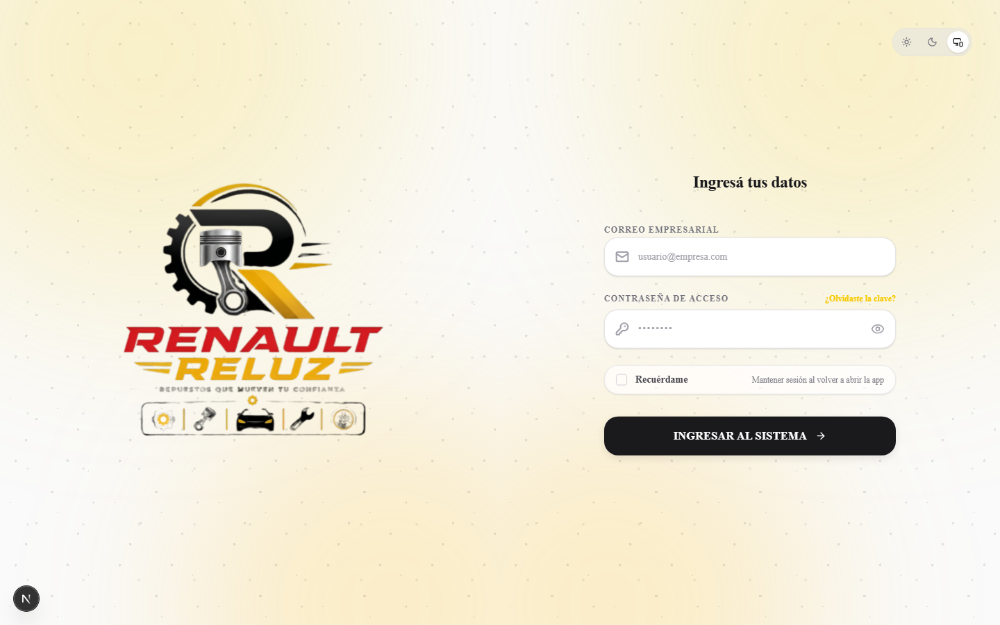

¡Bienvenido a **Renault Reluz ERP**! Este sistema te permite llevar el control total de tu casa de repuestos sin necesidad de ser experto en computación. Está pensado para que vos y tu equipo lo usen todos los días, sin complicaciones.

### ¿Qué podés hacer con esta herramienta?

- 📦 **Vender repuestos** con factura, varios métodos de pago y descuentos.
- 🛒 **Comprar mercadería** a tus proveedores y controlar qué se recibió.
- 📋 **Armar presupuestos** (cotizaciones) para tus clientes.
- 💰 **Cobrar a cuenta** (créditos) y registrar cada pago.
- 💵 **Llevar la caja** del día: abrir, registrar ventas y gastos, cerrar.
- 🚗 **Administrar productos, clientes y proveedores**.
- 📊 **Ver reportes** de ventas, gastos y stock.
- 👥 **Asignar permisos** a tu equipo según el rol de cada uno.

### Dos formas de usarlo

**En la nube (web)**: Abrís la app desde el navegador, en cualquier computadora, y los datos quedan guardados en un servidor. Ideal si tenés varias sucursales o si querés entrar desde tu casa.

**En tu computadora (escritorio)**: Instalás la app como un programa más de Windows. Los datos se guardan en tu propia máquina y, cuando hay internet, se sincronizan con la nube. Ideal si la conexión a internet es inestable o si querés trabajar sin depender de la red.

Ambas versiones se ven igual y funcionan igual. Los datos se mantienen sincronizados automáticamente.

### A quién está dirigido este manual

Este manual está escrito pensando en **dueños, gerentes y encargados administrativos** de la casa de repuestos. No es un manual técnico. Está escrito en lenguaje claro, paso a paso, con imágenes de la aplicación real.

> 💡 **Si sos cajero o vendedor**, consultá la sección específica de "Ventas" y "Caja". El resto del manual te puede servir de referencia.

---

## 2. Cómo empezar

### Si vas a usar la versión web

1. Asegurate de tener una conexión estable a internet.
2. Abrí el navegador (recomendamos **Google Chrome** o **Microsoft Edge** actualizados).
3. Escribí en la barra de direcciones la URL que te dio tu administrador (por ejemplo, `http://localhost:5000` si la app está instalada en la misma máquina, o la dirección del servidor).
4. ¡Listo! Vas a ver la pantalla de inicio de sesión.

### Si vas a usar la versión de escritorio (Windows)

1. Tu equipo de soporte te va a pasar el instalador (`Renault ERP Setup.exe`).
2. Hacé doble clic sobre el instalador.
3. Si Windows te pregunta "¿Permitir que esta app haga cambios?", decí **Sí**.
4. Seguí los pasos: aceptá los términos, elegí la carpeta donde se instala (por defecto está bien), esperá a que termine.
5. Cuando termine, vas a ver el ícono de **Renault ERP** en tu escritorio. Hacé doble clic para abrir.
6. La primera vez, la app se va a configurar sola y te va a llevar al inicio de sesión.

### Requisitos mínimos

| Componente        | Requisito                                                                               |
| ----------------- | --------------------------------------------------------------------------------------- |
| Sistema operativo | Windows 10 o superior (64 bits)                                                         |
| Memoria RAM       | 4 GB mínimo                                                                             |
| Disco             | 500 MB libres                                                                           |
| Internet          | Necesario para sincronizar (la app también funciona sin internet en versión escritorio) |
| Pantalla          | Se ve bien desde 1280×720 en adelante                                                   |

---

## 3. Iniciar sesión

Cada vez que abras la app, te va a pedir que inicies sesión con tu usuario y contraseña.

### Pasos para entrar

1. En la pantalla inicial, escribí tu **correo electrónico** (el que usaste cuando te dieron de alta).
2. Escribí tu **contraseña** (esos caracteres se ocultan con puntitos por seguridad).
3. Si querés que la app **recuerde tu sesión** la próxima vez, tildá la casilla **"Recuérdame"**.
4. Hacé clic en el botón **"Ingresar al sistema"**.

### ¿Qué pasa después?

- Si los datos están bien, vas a entrar al **panel principal** (Dashboard).
- Si algo está mal, vas a ver un mensaje de error en rojo. Verificá el correo y la contraseña.

### ¿Te olvidaste la contraseña?

1. En la pantalla de inicio, hacé clic en **"¿Olvidaste la clave?"** (el link amarillo arriba de la contraseña).
2. Escribí tu correo electrónico.
3. La app te va a enviar un correo con instrucciones para crear una contraseña nueva.
4. Revisá tu bandeja de entrada (y la carpeta de spam, por las dudas).
5. Cuando tengas la nueva contraseña, volvé a la pantalla de inicio y entrá normalmente.

> 🔒 **Consejo de seguridad**: nunca le pases tu contraseña a nadie, ni siquiera a tu jefe. Cada persona tiene que tener su propio usuario.

### Cambiar entre tema claro y oscuro

Arriba a la derecha de la pantalla de login, vas a ver un botón con forma de **sol** 🌞 o **luna** 🌙. Hacé clic para alternar entre el tema claro (fondo blanco) y el tema oscuro (fondo negro). Tu elección se guarda automáticamente.

---

## 4. Configuración inicial

> ⚠️ Esta sección aplica **solo la primera vez** que se instala la app. Una vez que el sistema está en uso, este paso ya no aparece.

Cuando se instala Renault Reluz ERP por primera vez (por ejemplo, en una máquina nueva o después de un formateo), aparece una pantalla llamada **"Setup"** que te guía para crear el primer usuario administrador.

### ¿Por qué es importante?

Este primer usuario tiene **permisos totales** sobre la app: puede crear otros usuarios, ver todos los reportes, modificar configuraciones. Por eso, te recomendamos que esta cuenta la use el **dueño o gerente general** de la casa de repuestos.

### Datos que te va a pedir

- **Cédula / DNI**: tu documento de identidad (es único, no se puede repetir entre usuarios).
- **Nombre**: tu nombre de pila.
- **Apellido**: tu apellido.
- **Email**: dirección de correo electrónico (es la que vas a usar para iniciar sesión).
- **Contraseña**: una contraseña segura (recomendamos al menos 8 caracteres, combinando letras, números y un símbolo).
- **Teléfono**: tu número de contacto.
- **Dirección**: tu dirección.

### Pasos

1. Completá todos los campos.
2. Volvé a escribir la contraseña en el campo "Confirmar contraseña" para asegurarte de que la escribiste bien.
3. Hacé clic en **"Crear administrador"**.
4. Si todo está bien, la app te va a llevar automáticamente a la pantalla de inicio de sesión.
5. Iniciá sesión con el email y contraseña que acabás de crear.

> 💡 **Si volvés a ver esta pantalla**, significa que el sistema se reinstaló o que se borró la base de datos. Contactá a tu equipo de soporte antes de continuar, para no perder información.

---

## 5. El panel principal

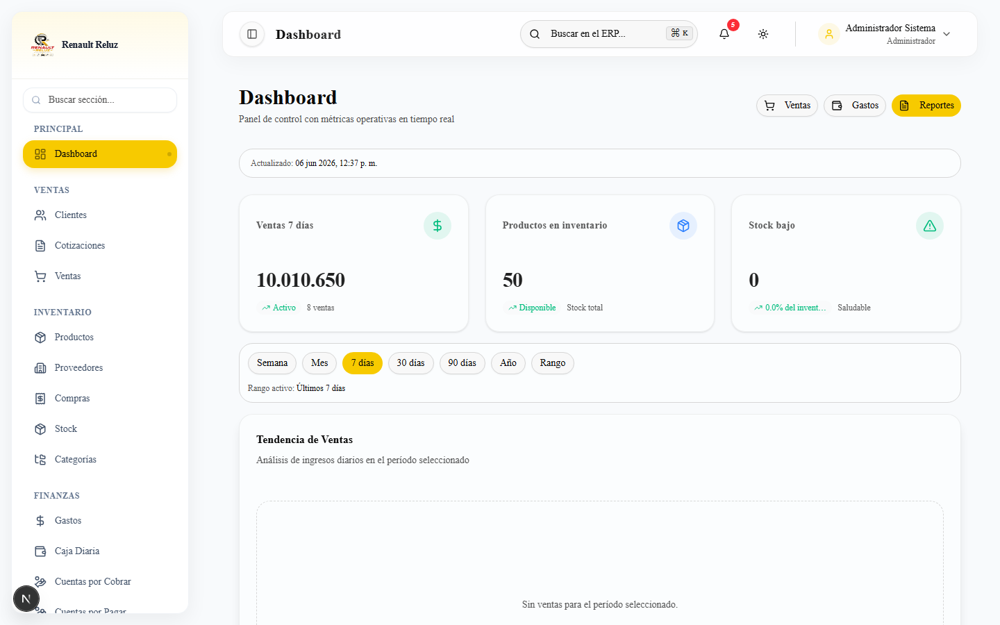

Cuando iniciás sesión, lo primero que ves es el **Dashboard** (panel principal). Es como la "ventanilla" del sistema: te muestra de un vistazo cómo está tu negocio **hoy** y en los últimos días.

### ¿Qué información encontrás?

En la parte superior, tenés tres **tarjetas con los números más importantes**:

- 💰 **Ventas (últimos 7 días)**: cuánto dinero entró por ventas en la última semana. La flecha verde o roja te dice si subiste o bajaste respecto al período anterior.
- 📦 **Productos en inventario**: cuántos repuestos diferentes tenés cargados en el sistema.
- ⚠️ **Stock bajo**: cuántos productos están por debajo del stock mínimo (estos son los que necesitás reponer urgente).

Debajo, tenés un **filtro de período** (botones: Semana, Mes, 7 días, 30 días, 90 días, Año, Rango). Hacé clic en el que quieras para cambiar el rango de fechas que se analiza.

Más abajo, vas a ver:

- 📈 **Tendencia de Ventas**: un gráfico de líneas que muestra cómo variaron las ventas día a día en el período elegido. Si ves picos, esos fueron tus mejores días. Si ves valles, esos fueron los más flojos.
- 🚨 **Alertas de stock bajo**: una lista de los productos que están por debajo del stock mínimo. Conviene revisarla seguido para no perder ventas por falta de mercadería.
- ⚡ **Accesos rápidos**: botones grandes que te llevan directo a las funciones más usadas: Ventas, Gastos, Reportes.

### La barra de navegación (sidebar)

A la **izquierda** de la pantalla tenés el menú principal, organizado en secciones. Los ítems que veas dependen de tu rol (los permisos de cada rol se explican más adelante).

| Sección            | Qué contiene                                               |
| ------------------ | ---------------------------------------------------------- |
| **PRINCIPAL**      | Dashboard                                                  |
| **VENTAS**         | Clientes, Cotizaciones, Ventas                             |
| **INVENTARIO**     | Productos, Proveedores, Compras, Stock, Categorías         |
| **FINANZAS**       | Gastos, Caja Diaria, Cuentas por Cobrar, Cuentas por Pagar |
| **ADMINISTRACIÓN** | Usuarios, Roles, Permisos, Sincronización                  |
| (abajo)            | Mi Perfil, Cerrar sesión                                   |

Hacé clic en cualquier ítem para ir a esa pantalla.

### La barra superior

Arriba de todo, tenés:

- 🔍 **Buscar**: escribí el nombre de cualquier producto, cliente, venta, etc. y la app lo busca por vos.
- 🔔 **Notificaciones**: la campana te avisa de eventos importantes (por ejemplo, productos con stock crítico).
- 🌞🌙 **Tema**: cambia entre claro y oscuro.
- 👤 **Tu nombre y rol**: haciendo clic ahí podés ir a tu perfil o cerrar sesión.

### ¿Cómo se actualizan los datos?

El panel se actualiza solo en **tiempo real** cada vez que hacés una venta, una compra o un cambio de stock. La fecha y hora de la última actualización aparecen abajo del título "Dashboard".

> 💡 **Tip**: si querés ver datos de otro período sin cambiar los filtros, usá los botones de Semana/Mes/7 días/30 días/etc. que están debajo de las tarjetas principales.

---

## 6. Productos

> 📦 **El corazón del sistema**: acá es donde cargás todos los repuestos que vendés.

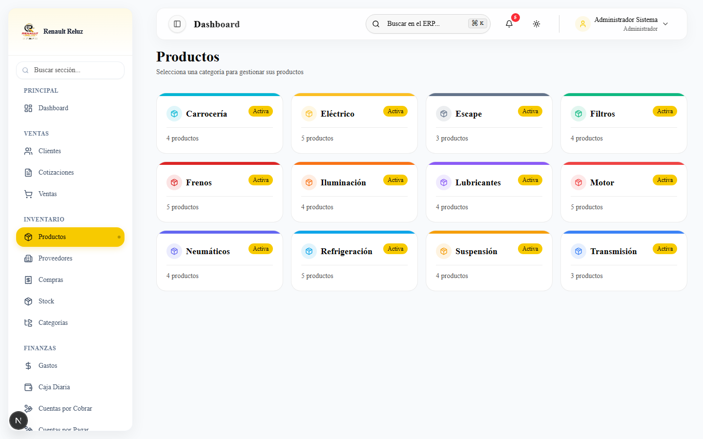

En esta pantalla ves **todos los productos** cargados en el sistema. La información está organizada en una tabla con varias columnas.

### ¿Qué información muestra cada producto?

| Columna            | Qué significa                                                                              |
| ------------------ | ------------------------------------------------------------------------------------------ |
| **Imagen**         | Foto del repuesto (si le cargaste una).                                                    |
| **Código**         | Código único del producto. Lo usás para buscarlo rápido.                                   |
| **Nombre**         | Nombre descriptivo (ej.: "Filtro de aceite").                                              |
| **Marca / Modelo** | Marca y modelo del vehículo al que aplica (ej.: "Renault / Logan").                        |
| **Categoría**      | A qué categoría pertenece (Motor, Frenos, etc.). Aparece con un color de fondo.            |
| **Stock**          | Cuántas unidades tenés disponibles. Si está en rojo, es porque está por debajo del mínimo. |
| **P. Compra**      | Precio al que vos lo comprás.                                                              |
| **P. Venta**       | Precio al que lo vendés al público.                                                        |
| **Proveedor**      | Empresa o persona que te lo vende.                                                         |

### Filtros y búsqueda

Arriba de la tabla tenés un **buscador**: escribí el nombre, el código o parte del nombre y la lista se filtra al toque.

También podés filtrar por **categoría** y por **proveedor** usando los desplegables. Combiná varios filtros para encontrar justo lo que necesitás.

### Cómo dar de alta un producto nuevo

1. Hacé clic en el botón **"+ Nuevo producto"** (esquina superior derecha).
2. Se abre un formulario. Completá los datos:
   - **Código**: un código único (ej.: "FILT-001", "FR-LOG-22"). No se puede repetir.
   - **Nombre**: nombre descriptivo del producto.
   - **Marca**: marca del vehículo o del repuesto (ej.: "Renault", "Bosch").
   - **Modelo**: modelo al que aplica (ej.: "Logan", "Kangoo", "Sandero"). Podés poner "Universal" si aplica a todos.
   - **Categoría**: elegí de la lista. Si no existe la categoría, primero tenés que crearla (ver [sección 8](#8-categorías)).
   - **Proveedor**: elegí de la lista. Si no existe, primero crealo (ver [sección 10](#10-proveedores)).
   - **Precio de compra**: a cuánto te lo venden a vos.
   - **Precio de venta**: a cuánto lo vendés al público. Por defecto la app sugiere un 30% más que el de compra, pero podés cambiarlo.
   - **Stock actual**: cuántas unidades tenés hoy.
   - **Stock mínimo**: cuántas unidades como mínimo querés tener. Cuando el stock baje de este número, vas a ver una alerta en el dashboard.
   - **Unidad**: "unidad", "litro", "kilogramo", "metro", etc.
   - **Imagen** _(opcional)_: una foto del producto.
3. Hacé clic en **"Guardar"**.
4. El producto aparece en la lista. Ya podés venderlo o asignarlo a una compra.

### Cómo editar un producto

1. En la lista, buscá el producto que querés modificar.
2. Hacé clic en el **menú de tres puntos** (⋮) a la derecha de la fila, o en el ícono de **lápiz** ✏️.
3. Se abre el mismo formulario con los datos cargados.
4. Modificá lo que necesites.
5. Hacé clic en **"Guardar"**.

### Cómo ver los detalles de un producto

1. Hacé clic en el **ícono de ojo** 👁️ (o en el nombre del producto, según la versión).
2. Se abre una ventana con toda la información: descripción, historial de precios, movimientos de stock, ventas en las que participó, etc.

### Cómo eliminar un producto

> ⚠️ **Cuidado**: eliminar un producto lo borra del sistema. Si tiene ventas o compras asociadas, no se va a poder eliminar (la app te avisa). En ese caso, podés **desactivarlo** para que no aparezca en las ventas nuevas, pero quede en el historial.

1. Hacé clic en el **menú de tres puntos** (⋮) → **"Eliminar"** (ícono de tacho de basura 🗑️).
2. La app te pide confirmación. Hacé clic en **"Sí, eliminar"**.

### Buenas prácticas

- 📌 **Ponele un código claro a cada producto**. Si tenés muchos repuestos, el código te ayuda a encontrarlos al toque.
- 🔍 **Mantené los precios actualizados**. Si subís el precio de compra, actualizá también el de venta.
- 📷 **Subí imágenes**. Le da profesionalismo y ayuda a que el vendedor o cajero identifique el repuesto rápido.
- 🚨 **Configurá bien el stock mínimo**. Es tu seguro contra quedarte sin mercadería sin darte cuenta.

---

## 7. Inventario

> 📋 **El libro de movimientos**: acá se registra cada vez que entra o sale mercadería del depósito.

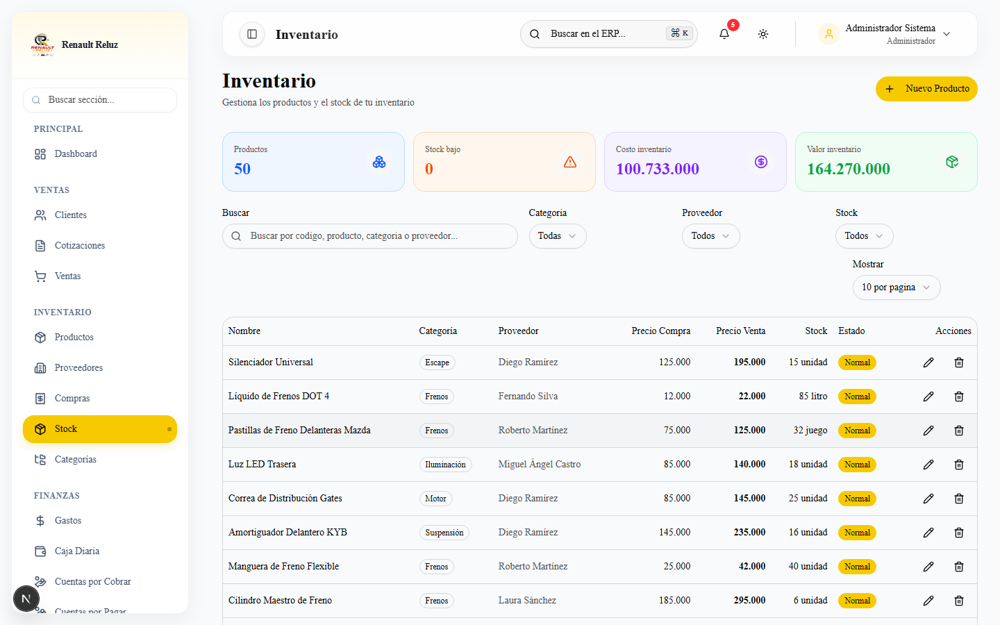

Mientras que en **Productos** ves el stock actual de cada artículo, en **Inventario** ves el **historial de movimientos**: cada vez que algo entró (por una compra), salió (por una venta) o se ajustó manualmente (porque contaste y había diferencia).

### ¿Qué información muestra?

| Columna              | Qué significa                                                                                                              |
| -------------------- | -------------------------------------------------------------------------------------------------------------------------- |
| **Fecha**            | Cuándo se hizo el movimiento.                                                                                              |
| **Producto**         | Qué repuesto se movió.                                                                                                     |
| **Tipo**             | Si fue **entrada** (⬆️, entró mercadería), **salida** (⬇️, se vendió) o **ajuste** (🔧, se corrigió el stock manualmente). |
| **Cantidad**         | Cuántas unidades se movieron.                                                                                              |
| **Stock resultante** | Cuánto quedó en el depósito después de ese movimiento.                                                                     |
| **Origen**           | De dónde viene el movimiento: una compra, una venta o un ajuste manual.                                                    |
| **Responsable**      | Qué usuario lo hizo.                                                                                                       |

### ¿Cuándo se registran movimientos automáticamente?

- ✅ Cuando hacés una **compra** y la marcás como "Recibida", se registra una **entrada** de stock.
- ✅ Cuando hacés una **venta** confirmada, se registra una **salida** de stock.
- ❌ Las **cotizaciones** NO mueven stock (solo cuando se convierten en venta).

### Cómo hacer un ajuste manual de stock

A veces contás la mercadería y el sistema no coincide con la realidad. Por ejemplo: perdiste una pieza, se rompió, o te la robaron. En esos casos, hacés un **ajuste manual**:

1. Hacé clic en **"+ Nuevo movimiento"** o **"+ Ajuste"** (esquina superior derecha).
2. Elegí el **producto**.
3. Elegí el **tipo de movimiento**:
   - **Entrada**: para sumar stock (ej.: encontraste mercadería que no estaba registrada).
   - **Salida**: para restar stock (ej.: se rompió una pieza).
   - **Ajuste**: para definir el stock exacto (ej.: contaste y hay 12 unidades, no 15 como dice el sistema).
4. Indicá la **cantidad** o el **stock final** (según el tipo).
5. Escribí un **motivo** (ej.: "Rotura", "Conteo físico", "Devolución de cliente"). Esto queda en el historial y te sirve para auditoría.
6. Hacé clic en **"Guardar"**.

### Filtros

Arriba de la tabla podés filtrar por:

- **Producto** específico.
- **Tipo** de movimiento (entrada / salida / ajuste).
- **Rango de fechas**.

### ¿Por qué es importante revisar el inventario seguido?

- 🕵️ **Detectar robos o pérdidas**: si algo se "pierde solo", vas a ver salidas raras.
- 📦 **Planificar compras**: viendo el historial, sabés qué productos se venden más y cuáles menos.
- 📊 **Auditoría**: en caso de dudas, podés reconstruir qué pasó con cualquier producto.

---

## 8. Categorías

> 🗂️ **Cómo agrupás tu mercadería**: las categorías te permiten organizar tus productos y gastos en grupos lógicos.

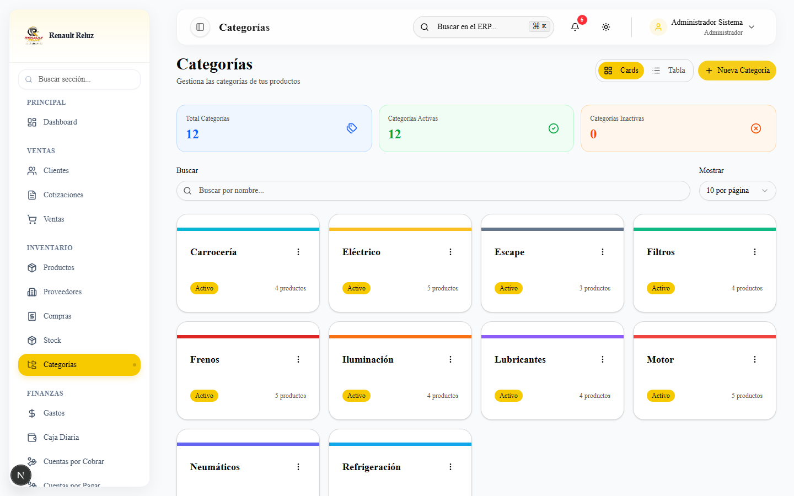

Las categorías te sirven para tres cosas:

1. **Filtrar rápido** el catálogo de productos (ej.: "mostrame solo los Frenos").
2. **Organizar visualmente** la app, porque cada categoría tiene un color distinto.
3. **Clasificar gastos** (alquiler, servicios, sueldos, etc.) y así poder analizar a qué se va la plata.

### Tipos de categorías

- **De productos**: agrupan repuestos. Ejemplos: Motor, Frenos, Suspensión, Transmisión, Eléctrico, Filtros, Lubricantes, Iluminación, Carrocería, Neumáticos, Escape, Refrigeración.
- **De gastos**: agrupan gastos del negocio. Ejemplos: Servicios, Alquiler, Salarios, Marketing, Transporte, Mantenimiento.

### Cómo crear una categoría

1. Hacé clic en **"+ Nueva categoría"**.
2. Completá:
   - **Nombre**: el nombre de la categoría (ej.: "Embrague").
   - **Tipo**: elegí si es para **productos** o para **gastos**.
   - **Color**: elegí un color de la paleta. Se usa para identificar visualmente la categoría en la app.
   - **Descripción** _(opcional)_: una nota interna.
3. Hacé clic en **"Guardar"**.

### Cómo editar o desactivar una categoría

- **Editar**: clic en el menú de tres puntos (⋮) → **"Editar"**. Cambiá lo que necesites.
- **Desactivar**: clic en **"Activar/Desactivar"**. La categoría queda oculta en los formularios pero sigue contando en los reportes históricos.
- **Eliminar**: solo se puede eliminar si la categoría **no tiene productos ni gastos asociados**. Si ya tiene, primero mové los productos/gastos a otra categoría.

> 💡 **Tip**: no crees categorías "por las dudas". Empezá con las básicas y agregá más a medida que las necesites. Es más fácil mantener 10 categorías bien definidas que 50 con una sola cosa adentro.

---

## 9. Clientes

> 👥 **Las personas y empresas que te compran**: acá llevás la base de datos de tus clientes.

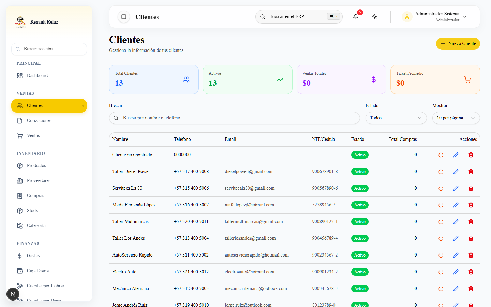

Cada cliente tiene una "ficha" en el sistema. Esa ficha guarda sus datos de contacto, el historial de compras, las deudas que tiene con vos y más.

### ¿Qué información tiene cada cliente?

- **Nombre**: nombre del cliente o razón social.
- **Teléfono**: para contactarlo.
- **Email** _(opcional)_: correo electrónico.
- **NIT / CUIT / DNI** _(opcional)_: número de identificación tributaria.
- **Dirección** _(opcional)_: dirección del cliente.
- **Total comprado**: la suma de todo lo que te compró a lo largo del tiempo.
- **Estado**: si está **activo** (puede comprar) o **inactivo** (no aparece en ventas nuevas, pero queda en el historial).

### Cómo agregar un cliente nuevo

1. Hacé clic en **"+ Nuevo cliente"**.
2. Completá el formulario. Lo único obligatorio es el **nombre** y el **teléfono**.
3. Hacé clic en **"Guardar"**.

> 💡 **Tip**: aunque el email, NIT y dirección sean opcionales, te recomendamos cargarlos. Sirven para hacer facturas, enviarle novedades y llevar un control más profesional.

### Cómo ver el historial de un cliente

1. En la lista, hacé clic en el nombre del cliente o en el ícono de "Ver" (👁️).
2. Se abre una ficha con:
   - Datos del cliente.
   - **Historial de ventas**: cada venta que le hiciste, con fecha, monto y estado.
   - **Cotizaciones**: presupuestos que le entregaste.
   - **Créditos**: si le vendiste a cuenta, ves la deuda pendiente, los pagos y el historial.
3. Desde ahí podés también **editar al cliente** o **crear una venta nueva** para él.

### Cómo desactivar un cliente

Si un cliente deja de comprarte (se fue del barrio, cerró el taller, etc.), no hace falta eliminarlo. Solo desactivá:

1. Hacé clic en el menú de tres puntos (⋮) → **"Desactivar"**.
2. El cliente deja de aparecer en las listas de ventas nuevas, pero todo su historial queda intacto.

### Búsqueda y filtros

- 🔍 **Buscador**: escribí el nombre, teléfono o NIT y la lista se filtra.
- 🎛️ **Filtros**: podés ver solo clientes **activos** o **inactivos**.

### Buenas prácticas

- 📝 **Cargá todos los datos posibles** desde el principio. Completar después es tedioso.
- 🔄 **Mantené actualizados** los teléfonos y emails. Si le mandás un recordatorio de pago y el email está mal, no llega.
- 💼 **Para empresas**: usá el campo NIT. La factura sale con los datos fiscales correctos.

---

## 10. Proveedores

> 🏢 **De quién comprás mercadería**: similar a Clientes, pero apuntando al otro lado de la cadena.

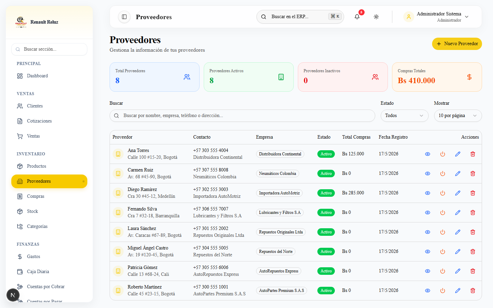

Cada proveedor es una empresa o persona a la que le comprás repuestos. Tener bien cargados los proveedores te permite:

- Registrar compras de forma rápida (ya tenés sus datos).
- Llevar el **historial de compras** que le hiciste a cada uno.
- Controlar las **deudas** (créditos con proveedores) y los pagos.
- Analizar **a quién le comprás más** y negociar mejores precios.

### Datos de un proveedor

- **Nombre**: nombre del contacto o razón comercial.
- **Empresa** _(opcional)_: nombre formal de la empresa.
- **Teléfono**: para contactarlo.
- **Email** _(opcional)_: correo electrónico.
- **Dirección** _(opcional)_: dirección del local o depósito.
- **Total comprado**: cuánto le compraste en total.

### Cómo agregar un proveedor

1. Hacé clic en **"+ Nuevo proveedor"**.
2. Completá los datos. Lo mínimo: **nombre** y **teléfono**.
3. Hacé clic en **"Guardar"**.

### Activar / desactivar proveedor

Si dejás de trabajar con un proveedor, podés **desactivarlo** (no aparece en compras nuevas pero queda en el historial). Para volver a activarlo, hacé clic en **"Activar"** desde la lista de inactivos.

### Eliminar proveedor

Solo se puede eliminar si no tiene **compras ni productos asociados**. Si los tiene, primero tenés que reasignar las compras a otro proveedor y los productos también.

### Relación con Productos

Cuando das de alta un producto nuevo (ver [sección 6](#6-productos)), tenés que asignarle un proveedor. Por eso es importante tener los proveedores cargados antes que los productos.

---

## 11. Ventas

> 🛒 **La operación más importante del día a día**: registrar cada venta que hacés.

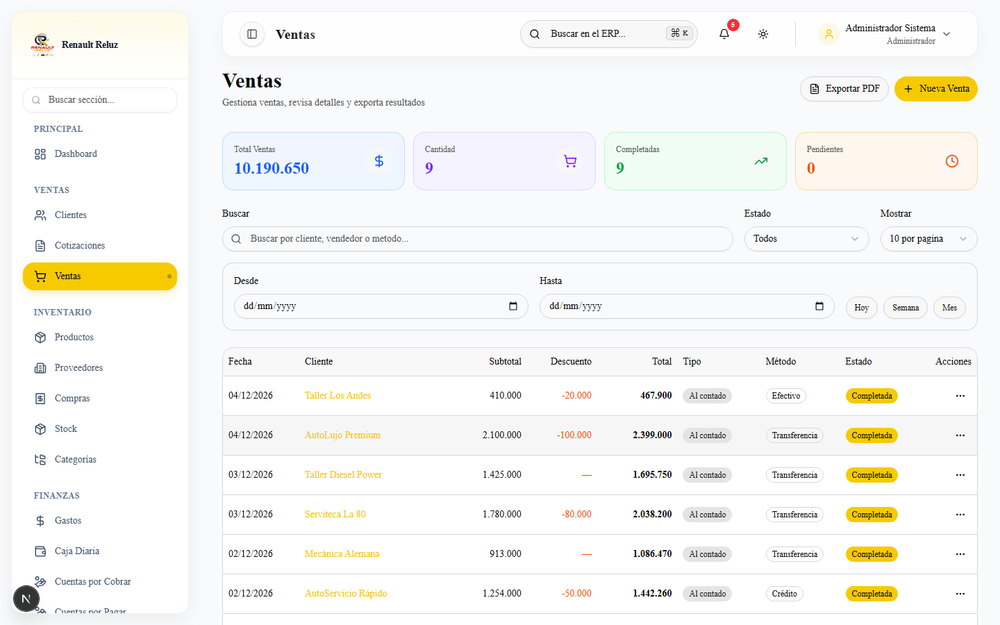

Esta es probablemente la pantalla que más vas a usar. Acá se registran todas las ventas, podés ver el historial, exportar facturas y controlar los pagos.

### ¿Qué información muestra el listado?

Arriba de la tabla tenés **cuatro tarjetas con estadísticas**:

- 💵 **Total Ventas**: suma de todas las ventas del período.
- 🛒 **Cantidad**: cuántas ventas se hicieron.
- ✅ **Completadas**: cuántas están finalizadas y cobradas.
- ⏰ **Pendientes**: cuántas están pendientes (por ejemplo, ventas a crédito sin cobrar).

La **tabla principal** muestra cada venta con:

| Columna       | Qué significa                                                           |
| ------------- | ----------------------------------------------------------------------- |
| **Fecha**     | Cuándo se hizo la venta.                                                |
| **Cliente**   | A quién le vendiste (hacé clic para ver su ficha).                      |
| **Subtotal**  | Suma de los productos sin impuestos ni descuentos.                      |
| **Descuento** | Si se aplicó algún descuento, aparece en rojo.                          |
| **Total**     | Lo que paga el cliente (subtotal + impuestos - descuentos).             |
| **Tipo**      | "Al contado" (se cobra en el momento) o "A crédito" (cuenta corriente). |
| **Método**    | Cómo pagó: efectivo, transferencia, QR, mixto.                          |
| **Estado**    | **Completada** (verde), **Pendiente** (amarillo), **Cancelada** (rojo). |
| **Acciones**  | Ver, editar, cancelar, imprimir.                                        |

### Filtros disponibles

- 🔍 **Buscar**: por nombre de cliente, vendedor o método de pago.
- 📅 **Desde / Hasta**: rango de fechas. También tenés atajos: **Hoy**, **Esta semana**, **Este mes**.
- 🎛️ **Estado**: Todos, Completadas, Pendientes, Canceladas.
- 📄 **Mostrar**: cuántas ventas ver por página (10, 25, 50, 100).

### Cómo registrar una venta nueva

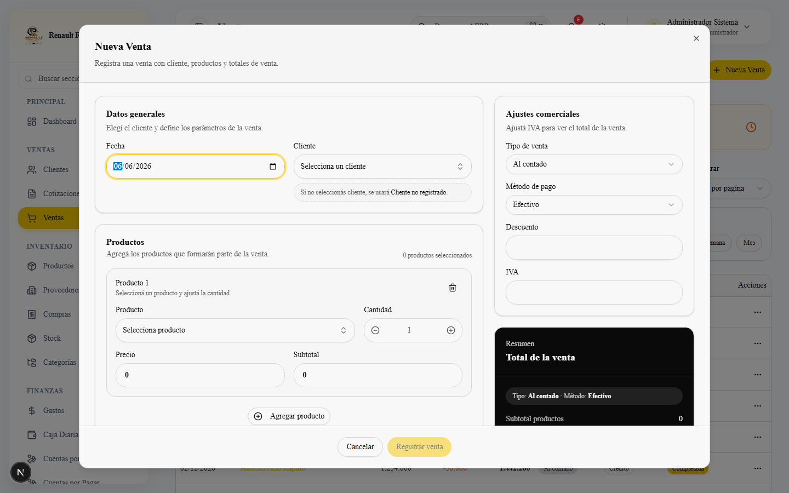

1. Hacé clic en el botón **"+ Nueva venta"** (esquina superior derecha).
2. Se abre un formulario. Pasos:
   1. **Elegí el cliente**: empezá a escribir el nombre y la app te sugiere. Si el cliente no existe, podés crearlo en el momento con el botón **"+ Nuevo cliente"**.
   2. **Agregá los productos**: en la sección de productos, empezá a escribir el nombre o el código. La app te muestra coincidencias. Seleccioná el producto e indicá la **cantidad**.
      - El **precio unitario** se completa solo con el precio de venta del producto, pero podés cambiarlo (por ejemplo, para hacer una oferta).
      - El **subtotal** se calcula automáticamente.
      - Para agregar más productos, hacé clic en **"+ Agregar producto"**.
   3. **Aplicá descuento** _(opcional)_: indicá un monto o porcentaje de descuento. Se aplica al subtotal.
   4. **Impuestos** _(opcional)_: la app calcula el IVA u otros impuestos según tu configuración.
   5. **Elegí el método de pago**:
      - **Efectivo**: el cliente paga con plata.
      - **Transferencia**: el cliente te transfiere.
      - **QR**: pago con código QR (MercadoPago, etc.).
      - **Crédito**: el cliente se lleva la mercadería y paga después (ver [sección 16](#16-créditos-a-clientes)).
      - **Mixto**: combinación de varios métodos. Por ejemplo, mitad efectivo y mitad transferencia. La app te deja indicar cuánto con cada uno.
   6. **Notas** _(opcional)_: observaciones sobre la venta (ej.: "Cliente retira mañana", "Paga en dos cuotas").
   7. **Revisá el total** abajo del formulario.
3. Hacé clic en **"Confirmar venta"**.
4. ¡Listo! La venta queda registrada, el stock se descuenta automáticamente, y (si pagaste en efectivo) se suma a la caja del día.

### ⚠️ Antes de vender: ¿la caja está abierta?

Para registrar ventas en **efectivo**, **transferencia** o **QR**, la caja del día tiene que estar **abierta**. Si no lo está, la app te avisa y no te deja continuar. Ver [sección 14](#14-caja-diaria) para más detalles.

### Acciones sobre una venta existente

En la columna **Acciones** (los tres puntitos ⋮) de cada fila, tenés:

- 👁️ **Ver detalles**: abre la venta con todos los productos, pagos y notas.
- ✏️ **Editar**: modificar la venta (solo si está en estado Pendiente).
- ❌ **Cancelar**: la venta queda marcada como cancelada, el stock se devuelve al inventario.
- 🖨️ **Imprimir / Exportar PDF**: genera una factura o comprobante para imprimir o mandar por WhatsApp al cliente.

### Exportar el listado de ventas

Si necesitás el listado completo en PDF (por ejemplo, para presentar a la contadora):

1. Hacé clic en **"Exportar PDF"** (esquina superior derecha).
2. La app genera un PDF con todas las ventas según los filtros aplicados.
3. Se descarga en tu computadora.

### Reportes rápidos desde aquí

Las cuatro tarjetas de arriba (Total Ventas, Cantidad, Completadas, Pendientes) son un mini-reporte. Si necesitás un análisis más profundo, andá a la sección [Reportes](#18-reportes).

### Buenas prácticas

- ⏰ **Registrá las ventas en el momento**. No las dejes para "más tarde", porque después no te acordás de los detalles.
- 💵 **Verificá el método de pago**. Es el dato que más se equivoca y el que más problemas trae a fin de mes.
- 📝 **Usá el campo de notas**. Anotá cosas que después vas a necesitar (ej.: "Pagó con billetes de baja denominación, verificar mañana").
- 🧾 **Imprimí o exportá la factura** siempre que el cliente la pida. Queda como comprobante.

---

## 12. Cotizaciones

> 📝 **Presupuestos sin compromiso**: le das un precio al cliente, pero no le cobrás hasta que acepte.

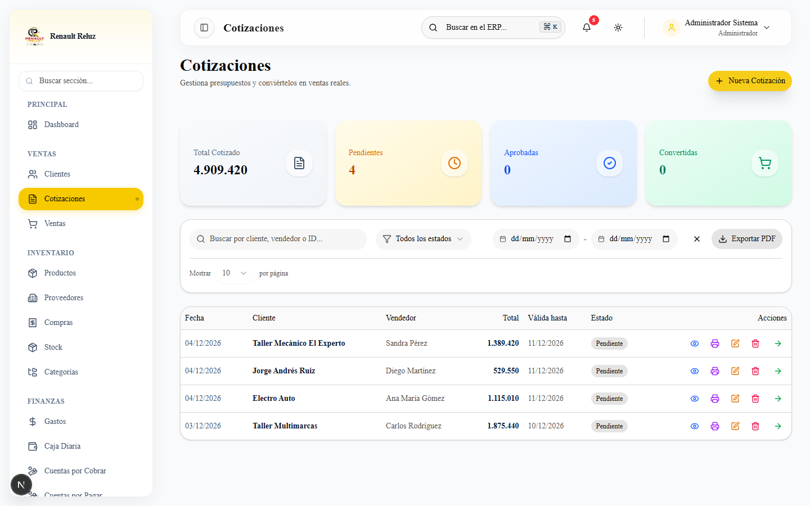

La cotización es como una "venta en pausa". Sirve para:

- 📞 **Cuando un cliente te llama y pregunta precios** pero todavía no se decidió a comprar.
- 🛠️ **Cuando un mecánico te pide un presupuesto** de varios repuestos para un arreglo.
- 💼 **Para empresas** que necesitan una aprobación interna antes de comprar.

La diferencia con una venta: la cotización **no descuenta stock** y **no genera caja**. Solo cuando el cliente dice "dale, lo compro" la convertís en venta.

### Estados de una cotización

- 🟢 **Activa**: la cotización es vigente (todavía no venció y no se convirtió en venta).
- 🟡 **Vencida**: pasó la fecha de validez y nadie la convirtió.
- 🔵 **Convertida**: ya se transformó en una venta. Queda en el historial para referencia.

### Cómo crear una cotización

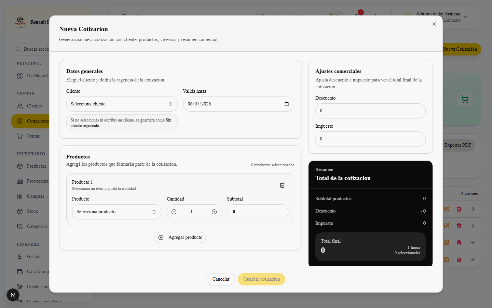

1. Hacé clic en **"+ Nueva cotización"**.
2. Completá:
   - **Cliente** _(opcional)_: si ya lo tenés cargado, elegilo. Si es un cliente nuevo o anónimo, podés dejarlo en blanco o escribir el nombre en "Cliente externo".
   - **Vendedor**: quién la armó (normalmente vos, pero podés cambiarla).
   - **Productos**: agregá los productos y cantidades, igual que en una venta.
   - **Descuento** e **impuestos** _(opcional)_.
   - **Válida hasta**: indicá hasta qué fecha la cotización es válida. Por defecto son 15 días. Pasada esa fecha, aparece como "Vencida" automáticamente.
   - **Notas** _(opcional)_: condiciones especiales, observaciones.
3. Hacé clic en **"Guardar cotización"**.

### Qué pasa cuando el cliente acepta

1. Abrí la cotización desde la lista (clic en 👁️ Ver).
2. Hacé clic en **"Convertir a venta"**.
3. La app abre la venta con los mismos productos y precios. Confirmá el método de pago y listo: la cotización queda como "Convertida" y la venta queda registrada.

> 💡 **Tip**: si el cliente acepta después de la fecha de vencimiento, igualmente podés convertirla. La app te avisa que está vencida pero te deja continuar.

### Otras acciones sobre cotizaciones

- ✏️ **Editar**: cambiar productos, cantidades o precios (solo si está Activa).
- 📋 **Duplicar**: crear una nueva cotización idéntica (útil para clientes similares).
- 🖨️ **Imprimir / PDF**: generar el presupuesto en PDF para mandar al cliente.
- 🗑️ **Eliminar**: borrar la cotización (cuidado, no se puede deshacer).

### Filtros de la lista

- **Estado**: Activas, Vencidas, Convertidas, Todas.
- **Rango de fechas**.
- **Cliente** o **vendedor**.

### Buenas prácticas

- 📅 **Poné siempre fecha de vencimiento**. Sin fecha, la cotización queda activa para siempre y nadie la cierra.
- 🖨️ **Mandá el PDF al cliente** por WhatsApp o email. Es más profesional que pasarle el número de memoria.
- 🔄 **No acumules cotizaciones viejas**. Las que ya no sirven, eliminalas o marcalas como tales.

---

## 13. Compras

> 📥 **Cuando vos le comprás a tu proveedor**: registrar el ingreso de mercadería a tu depósito.

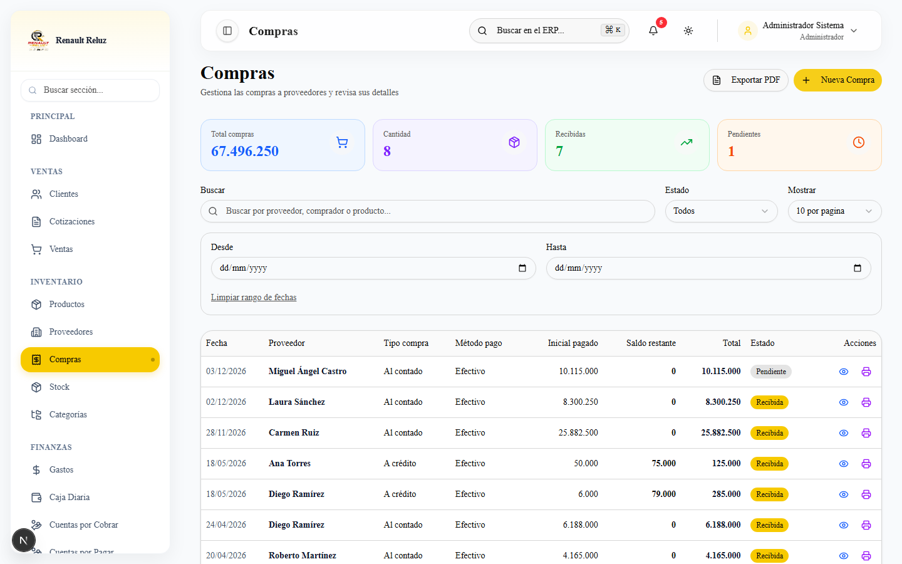

Cada vez que le comprás mercadería a un proveedor, tenés que registrar la compra en el sistema. Eso te permite:

- 📦 **Actualizar el stock** automáticamente (cuando la marcás como "Recibida").
- 💰 **Llevar el control de lo que pagaste** y a quién.
- 📊 **Saber a quién le comprás más** y cuánto gastás en mercadería por mes.
- 💳 **Registrar las deudas** con proveedores (compras a crédito).

### Estados de una compra

- 🟡 **Pendiente**: la compra está registrada pero todavía no recibiste la mercadería.
- 🟢 **Recibida**: ya tenés la mercadería en tu depósito. **El stock ya se actualizó**.
- 🔴 **Cancelada**: la compra no se concretó (por ejemplo, el proveedor no tenía stock).

### Cómo registrar una compra nueva

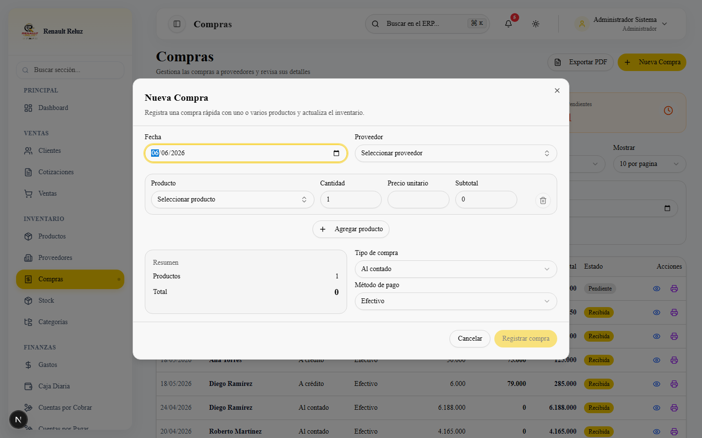

1. Hacé clic en **"+ Nueva compra"**.
2. Completá:
   - **Proveedor**: elegí de la lista. Si no existe, crealo en el momento.
   - **Fecha**: día de la compra.
   - **Productos**: agregá los productos que compraste, indicando cantidad y **precio de compra unitario**.
   - **Descuento** e **impuestos** _(opcional)_.
   - **Método de pago**:
     - **Efectivo**: pagás con plata de la caja.
     - **Transferencia**: le transferiste al proveedor.
     - **QR**: pagaste con código QR.
     - **Crédito**: te quedás debiendo. Queda registrado en "Créditos a proveedores" (ver [sección 17](#17-créditos-a-proveedores)).
   - **Notas** _(opcional)_: número de factura del proveedor, observaciones, fecha de entrega, etc.
3. Elegí el estado inicial:
   - **Pendiente**: la vas a recibir después. No descuenta el stock todavía.
   - **Recibida**: la mercadería ya está en tu depósito. **Suma el stock automáticamente**.
4. Hacé clic en **"Guardar compra"**.

### Cambiar el estado de una compra

Una compra Pendiente puede pasar a **Recibida** cuando efectivamente te entregan la mercadería:

1. Abrí la compra (clic en 👁️ Ver).
2. Hacé clic en **"Marcar como recibida"**.
3. Confirmá. El stock se actualiza en el momento.

Si por algún motivo la compra no se concreta, podés **cancelarla** (desde el menú de acciones).

### Acciones sobre una compra

- 👁️ **Ver detalles**: productos, totales, notas, quién la hizo.
- ✏️ **Editar**: modificar la compra (solo Pendientes).
- 📦 **Marcar como recibida**: si estaba Pendiente, pasarla a Recibida.
- 🖨️ **Imprimir / PDF**: exportar el comprobante.
- 🗑️ **Cancelar**: si no se concretó.

### ⚠️ Sobre la caja

Si la compra la pagás en **efectivo**, la caja del día tiene que estar **abierta**. El monto se descuenta automáticamente de la caja al confirmar la compra.

### Filtros de la lista

- 🔍 **Buscar**: por proveedor, número de factura, notas.
- **Estado**: Pendientes, Recibidas, Canceladas, Todas.
- **Rango de fechas**.

### Buenas prácticas

- 📋 **Cargá el número de factura** del proveedor en el campo de notas. Si después hay un reclamo, lo necesitás.
- 🕐 **Marcá como recibida apenas llegue la mercadería**. No la dejes "pendiente" por semanas, porque el stock no se actualiza.
- 💵 **Revisá los pagos** de las compras a crédito. Que no se te acumulen deudas sin darte cuenta.

---

## 14. Caja diaria

> 💵 **El corazón financiero del día**: la caja es donde se registra toda la plata que entra y sale en efectivo.

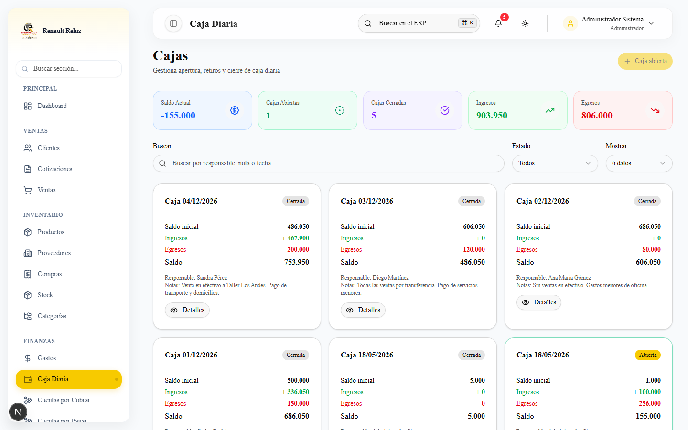

La caja funciona como una "bolsa virtual" de efectivo. Cada día, cuando abrís el local, abrís la caja con un monto inicial. A lo largo del día, cada venta en efectivo se suma, cada gasto se resta. Al final del día, cerrás la caja y hacés el arqueo (el conteo físico de la plata).

### Estados de la caja

- 🔴 **Cerrada**: el día no empezó. Tenés que abrirla.
- 🟢 **Abierta**: el día está en curso. Podés registrar ventas y gastos.
- 🟡 **Cerrada (histórico)**: días anteriores. Solo para consulta.

### Cómo abrir la caja al comenzar el día

1. Andá a **Caja Diaria** desde el menú lateral.
2. Si la caja está cerrada, vas a ver el botón **"Abrir caja"**.
3. Hacé clic. Se abre un formulario.
4. Indicá el **monto inicial**: cuánta plata hay en la caja al empezar (puede ser cero).
5. Opcionalmente, escribí una **nota** (ej.: "Apertura normal", "Incluye $5.000 de cambio").
6. Hacé clic en **"Confirmar apertura"**.
7. La caja queda abierta. Arriba vas a ver el saldo actual, los ingresos y los egresos del día.

### ¿Qué pasa durante el día?

Mientras la caja está abierta, la app registra automáticamente:

- ➕ **Ingresos**: cada venta cobrada en efectivo.
- ➖ **Egresos**: cada gasto pagado en efectivo, cada retiro de caja.
- 📊 **Saldo actual**: el monto inicial + ingresos - egresos.

> 💡 Las ventas con tarjeta, transferencia o QR **no** se contabilizan en la caja (van directo al banco).

### Cómo hacer un retiro de caja

A veces necesitás sacar plata de la caja para pagar algo en el momento (ej.: el flete, un arreglo chico). Eso se registra como **retiro**:

1. Desde la pantalla de Caja Diaria, con la caja abierta, hacé clic en **"Retiro de caja"** o **"+ Nuevo retiro"**.
2. Indicá el **monto** y un **motivo** (obligatorio, para auditoría).
3. Hacé clic en **"Registrar retiro"**.

> 💡 El motivo queda en el historial. Esto te sirve para entender después en qué se fue la plata si hay dudas.

### Cómo cerrar la caja al final del día

> ⚠️ **Es el paso más importante del día**. No te vayas del local sin cerrar la caja.

1. Hacé clic en **"Cerrar caja"**.
2. Se abre un formulario de cierre. Te pide:
   - **Monto declarado**: cuánta plata contaste físicamente en la caja.
   - **Notas** _(opcional)_: observaciones (ej.: "Faltante de $200, posible error de vuelto").
3. La app calcula la **diferencia** entre lo que dice el sistema y lo que declaraste.
4. Si todo está OK, hacé clic en **"Confirmar cierre"**.
5. La caja queda cerrada. Aparece en el historial como un "registro cerrado".

### ⚠️ ¿Qué pasa si la diferencia no da cero?

Puede pasar que sobre o falte plata. La app te avisa:

- **Sobra plata**: el sistema registró menos ingresos de los que realmente hubo (o un gasto de más). Revisá ventas y gastos del día.
- **Falta plata**: al revés, el sistema registró más ingresos de los que hubo (o falta registrar un gasto).

Lo importante es que la **diferencia quede asentada en las notas** para que después sepas qué pasó.

### Ver el historial de cajas

Podés ver todos los días anteriores con su apertura, ingresos, egresos, cierre y notas. Filtrá por fecha o por usuario que la abrió.

### ⚠️ Importante

Mientras la caja está **cerrada**, no podés:

- Registrar ventas en efectivo.
- Registrar gastos pagados en efectivo.
- Hacer retiros de caja.

Sí podés registrar ventas con tarjeta, transferencia o QR.

> 💡 **Tip**: si necesitás un adelanto o un gasto chico fuera del horario, abrí y cerrá la caja en el momento. Cada operación queda registrada con su horario.

---

## 15. Gastos

> 💸 **Adónde se va la plata que no es de mercadería**: alquiler, servicios, sueldos, fletes, etc.

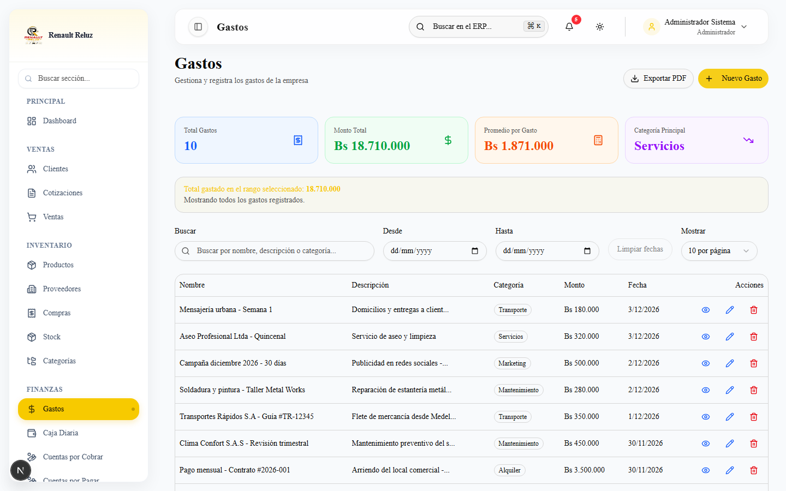

Los gastos son todas las salidas de dinero del negocio que **no son compras de mercadería** (las compras se registran aparte, en la sección Compras). Ejemplos típicos:

- 🏠 Alquiler del local
- ⚡ Servicios (luz, gas, agua, internet)
- 💼 Sueldos
- 📢 Marketing y publicidad
- 🚚 Fletes y transporte
- 🔧 Mantenimiento del local
- 🧾 Impuestos

### ¿Por qué es importante cargarlos?

Porque te permite ver con claridad **a dónde se va la plata**. Si solo registrás ventas, pensás que ganás mucho. Pero cuando sumás todos los gastos, te das cuenta de que la ganancia real es otra. Por eso, el reporte de gastos es uno de los más consultados.

### Cómo registrar un gasto

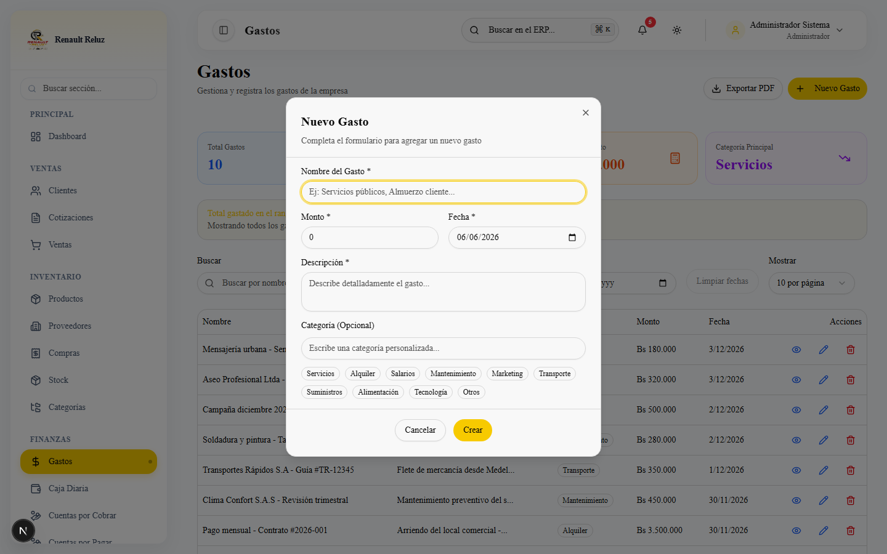

1. Hacé clic en **"+ Nuevo gasto"**.
2. Completá:
   - **Fecha**: cuándo se hizo el gasto.
   - **Descripción**: qué pagaste (ej.: "Pago de luz del mes de noviembre", "Flete desde Córdoba").
   - **Monto**: cuánto pagaste.
   - **Categoría**: de la lista (Servicios, Alquiler, Salarios, Marketing, Transporte, Mantenimiento, u otra).
   - **Responsable**: quién hizo o autorizó el gasto (por defecto, vos).
   - **Notas** _(opcional)_: número de factura, número de operación, etc.
3. Hacé clic en **"Guardar"**.

### ⚠️ Sobre la caja

Si el gasto se paga en **efectivo**, la caja tiene que estar **abierta** y el monto se descuenta automáticamente. Si se paga con tarjeta o transferencia, no impacta en la caja.

### Filtros

- **Categoría**: ver solo gastos de un tipo (ej.: todos los alquileres).
- **Rango de fechas**.
- **Responsable**.

### Buenas prácticas

- 📅 **Cargá los gastos el mismo día** que los hacés. Después no te acordás.
- 📋 **Guardá la factura o comprobante** (en papel o foto). Si te cuestionan un gasto, lo necesitás.
- 🏷️ **Usá bien las categorías**. Si todas las pusiste en "Otros", el reporte no te sirve para nada.

---

## 16. Créditos a clientes

> 💳 **Las ventas a cuenta que te tienen que pagar**: acá llevás el control de quién te debe y cuánto.

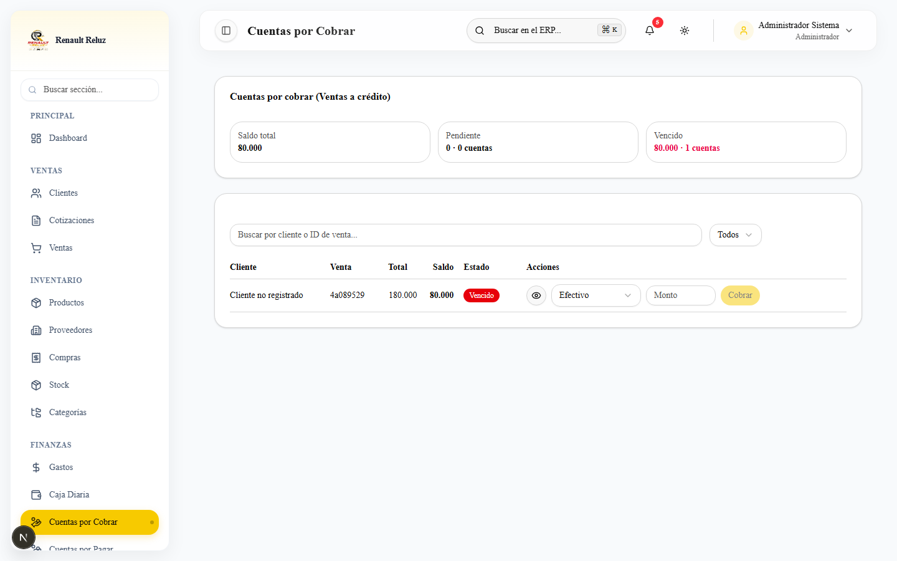

Un crédito se genera cuando le vendés a un cliente y elegís "Crédito" como método de pago. La mercadería se la lleva en el momento, pero te paga después (en una fecha acordada, o en cuotas).

### Estados de un crédito

- 🟡 **Pendiente**: el cliente todavía no pagó nada, o pagó solo una parte.
- 🟢 **Pagado**: el cliente pagó todo. El crédito está cerrado.
- 🔴 **Vencido**: pasó la fecha de vencimiento y todavía no se pagó. La app lo marca en rojo para que prestes atención.

### Información que muestra la pantalla

Arriba de la lista tenés **tarjetas resumen**:

- 💰 **Deuda total**: cuánto te deben todos los clientes juntos.
- 🔴 **Vencidos**: cuánto te deben los créditos que ya pasaron de fecha.
- 🟡 **Pendientes**: cuánto te deben los que todavía están a tiempo.
- 🟢 **Cobrados este mes**: cuánto cobraste en el mes en curso.

### Ver el detalle de un crédito

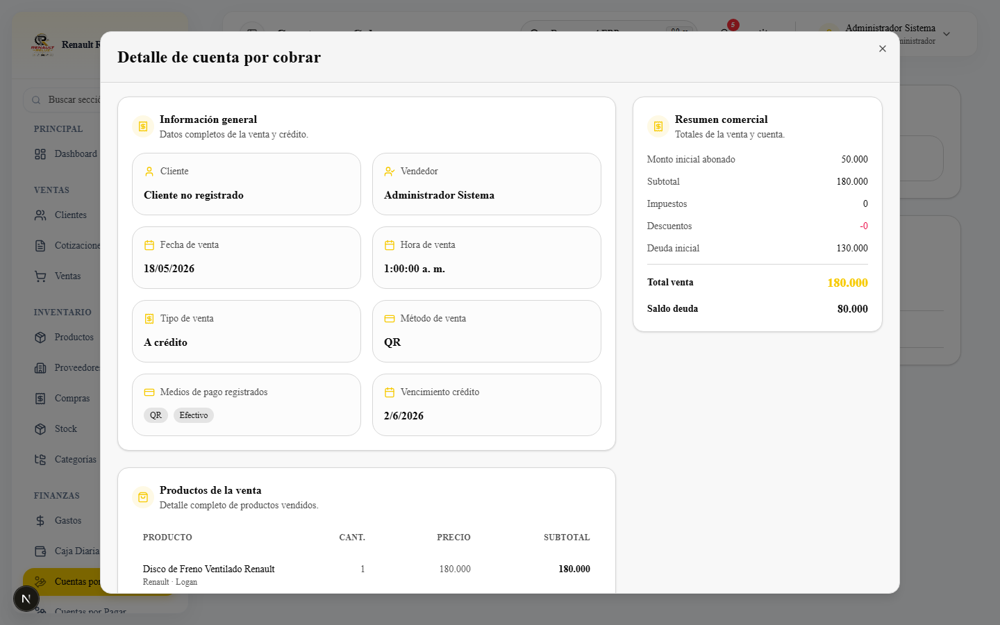

1. Hacé clic en el crédito que querés ver (o en el ícono 👁️).
2. Se abre la ficha con:
   - **Datos del cliente** y de la venta original.
   - **Monto total**, **saldo pendiente**, **fecha de vencimiento**.
   - **Línea de tiempo de pagos** (timeline): cada pago registrado, con fecha, monto y método.
3. Desde ahí podés registrar un nuevo pago o imprimir un recibo.

### Cómo registrar un pago (cobro)

> 💡 Es el momento en que el cliente te paga una parte (o todo) de la deuda.

1. Abrí el crédito (clic en 👁️ Ver).
2. Hacé clic en **"Registrar pago"** o **"+ Nuevo pago"**.
3. Se abre un formulario:
   - **Monto**: cuánto te paga. Por defecto aparece el saldo pendiente; podés cambiarlo si paga solo una parte.
   - **Fecha**: del pago.
   - **Método de pago**: Efectivo, Transferencia o QR.
   - **Referencia** _(opcional)_: número de transferencia, número de operación, etc.
   - **Notas** _(opcional)_: observaciones.
4. Hacé clic en **"Confirmar pago"**.
5. El pago aparece en la línea de tiempo del crédito. El saldo pendiente se actualiza.
6. Si el pago cubre toda la deuda, el crédito pasa a estado **Pagado** automáticamente.

### ⚠️ Sobre la caja

Si el cliente paga en **efectivo**, la caja del día tiene que estar **abierta** y el monto se suma automáticamente a la caja.

### Imprimir o exportar el recibo de pago

Después de registrar un pago (o en cualquier momento), podés generar un comprobante:

1. Hacé clic en **"Imprimir recibo"** o **"Exportar PDF"**.
2. Se genera un PDF con los datos del cliente, del crédito y del pago.
3. Descargá el PDF, imprimilo o mandáselo al cliente por WhatsApp.

### Filtros del listado

- **Estado**: Pendientes, Pagados, Vencidos, Todos.
- **Cliente**.
- **Rango de fechas** (por fecha de creación o de vencimiento).

### Buenas prácticas

- 📅 **Definí siempre la fecha de vencimiento** al crear el crédito. Sin fecha, la app no te avisa cuando se vence.
- 📞 **Llamá o mandale un WhatsApp** al cliente unos días antes del vencimiento. Es más cordial y reduce la mora.
- 🧾 **Dales recibo por cada pago**. Aunque sea un pago chico, dejá constancia.
- 🚫 **No acumules créditos viejos**. Si un cliente te debe hace 6 meses, cortale el crédito y pedíle que regularice.

---

## 17. Créditos a proveedores

> 🏦 **Lo que vos le debés a tus proveedores**: el otro lado de los créditos.

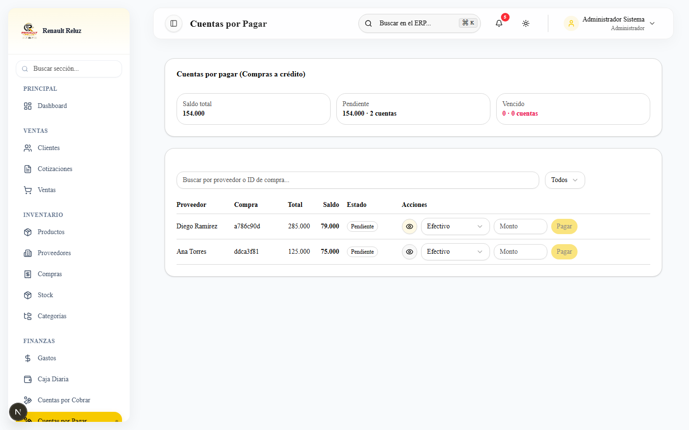

Funciona igual que los créditos a clientes, pero al revés: son las compras que hiciste y todavía no pagaste.

### ¿Cuándo se genera?

Cuando en una **compra** elegís el método de pago **"Crédito"**, la app crea automáticamente un crédito a proveedor con la fecha de vencimiento que indiques.

### ¿Qué podés hacer acá?

- 📋 **Ver todos los créditos pendientes** con cada proveedor.
- 💰 **Registrar pagos** cuando le pagás al proveedor.
- 🧾 **Imprimir recibos de pago**.
- 📊 **Ver el total adeudado** por proveedor.

### Registrar un pago al proveedor

1. Abrí el crédito (clic en 👁️ Ver).
2. Hacé clic en **"Registrar pago"**.
3. Indicá el **monto** y el **método de pago** (Efectivo, Transferencia, QR).
4. Hacé clic en **"Confirmar"**.

> ⚠️ Si pagás en efectivo, la caja del día tiene que estar abierta y se descuenta automáticamente.

### Filtros

Igual que en créditos a clientes: por estado, proveedor, fecha.

### Buenas prácticas

- 💳 **No abuses del crédito con proveedores**. Si te atrasás mucho, te pueden cortar el suministro.
- 📅 **Pagá antes del vencimiento**. Algunos proveedores cobran intereses o te penalizan.
- 🧾 **Guardá los comprobantes** de cada transferencia o pago que hagas al proveedor.

---

## 18. Reportes

> 📊 **La radiografía completa de tu negocio**: ventas, gastos, stock, productos más vendidos y más.

La sección de Reportes es donde obtenés la **visión panorámica** del negocio. No es solo para el dueño: también le sirve al gerente para tomar decisiones (qué productos comprar, en qué horario hay más ventas, cuándo conviene hacer promos).

### ¿Qué reportes hay?

En la parte superior de la pantalla tenés **pestañas** con los distintos tipos de reporte:

- 📈 **Ventas**: por día, semana, mes, año. Comparación entre períodos.
- 📉 **Compras**: cuánto compraste, a quién, en qué períodos.
- 💸 **Gastos**: en qué se va la plata, agrupado por categoría.
- 📦 **Productos**: los más vendidos, los menos vendidos, los que nunca se vendieron, los de mayor ganancia.
- 👥 **Clientes**: los que más compran, los que más deben, los nuevos.
- 💰 **Caja**: evolución diaria del efectivo.

### Filtros comunes a todos los reportes

- 📅 **Rango de fechas**: elegí desde-hasta, o usá los atajos (Hoy, Esta semana, Este mes, Este año).
- 📊 **Tipo de gráfico**: a veces podés elegir entre líneas, barras, torta.
- 📤 **Exportar**: bajá el reporte como **PDF** o **Excel** para mandárselo a la contadora o guardarlo.

### Reportes más usados (y para qué sirven)

#### Ventas

- **Para qué sirve**: ver la tendencia. Si suben, todo bien. Si bajan, hay que tomar acción.
- **Métricas clave**: total vendido, cantidad de ventas, ticket promedio (cuánto gasta cada cliente en promedio), mejor día de la semana.

#### Compras

- **Para qué sirve**: controlar el gasto en mercadería y ver a qué proveedores se les compra más.
- **Métricas clave**: total comprado, cantidad de órdenes, principales proveedores, productos más comprados.

#### Gastos

- **Para qué sirve**: entender en qué se va la plata que NO es mercadería.
- **Métricas clave**: gasto total, principales categorías, comparación mes a mes.

#### Productos

- **Para qué sirve**: saber qué productos rotan bien y cuáles son "lengua muerta" (que ocupan lugar en el depósito y no se venden).
- **Métricas clave**: top 10 más vendidos, top 10 menos vendidos, productos sin ventas en X meses, productos con stock crítico.

#### Clientes

- **Para qué sirve**: identificar a tus mejores clientes y a los que más te deben.
- **Métricas clave**: top 10 clientes por monto, clientes con créditos vencidos, clientes nuevos del mes.

### Comparación entre períodos

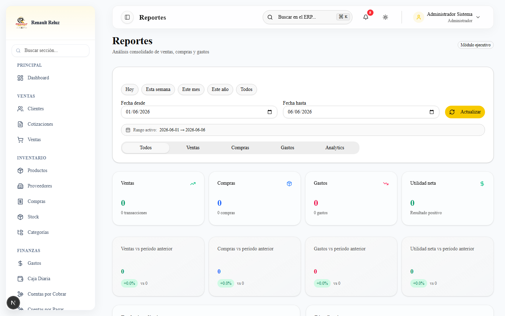

En la parte superior de cada reporte, a veces tenés la opción de **comparar dos períodos** (ej.: este mes vs. el mes pasado). Te muestra una flecha verde (subió) o roja (bajó) según la variación.

### Cómo exportar un reporte

1. Aplicá los filtros que querés.
2. Hacé clic en **"Exportar"** (esquina superior derecha).
3. Elegí el formato: **PDF** (visual, para presentar) o **Excel** (analizable, para la contadora).
4. Se descarga el archivo. Listo para mandar por email o imprimir.

### Buenas prácticas

- 📅 **Mirá los reportes al menos una vez por semana**. Es mejor detectar un problema a tiempo.
- 🗓️ **Hacé un "cierre mensual"**. Exportá los reportes del mes y guardalos en una carpeta. Después te sirve para la declaración de impuestos.
- 📊 **No te quedes solo con el reporte de ventas**. Los gastos y el stock bajo también son señales de alerta.
- 💡 **Tomá decisiones con datos**. Si un producto no se vende hace 6 meses, considerá hacer una promo o dejar de comprarlo.

---

## 19. Sincronización

> ☁️ **Mantener la misma información en la nube y en tu computadora**: este es el módulo de sincronización.

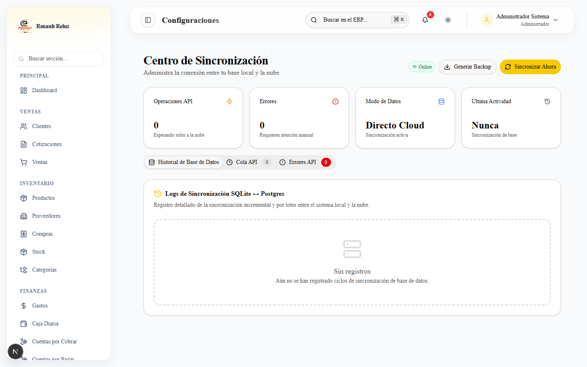

Esta sección es **técnica por naturaleza**, pero acá te la explicamos en simple.

### ¿Qué es la sincronización?

Renault Reluz ERP puede funcionar de **dos maneras**:

1. **En la nube (web)**: los datos viven en un servidor. Si tenés varias computadoras, todas se conectan al mismo servidor y ven la misma información.
2. **En tu computadora (escritorio)**: los datos viven en tu propia máquina. Funciona perfecto sin internet.

La **sincronización** es el proceso por el cual los datos que cargaste **sin internet** (en la versión escritorio) se suben a la nube cuando volvés a tener conexión. Y al revés: si trabajaste en otra máquina, los cambios se bajan a la tuya.

### ¿Cuándo se sincroniza automáticamente?

- 🟢 **Cada vez que se abre o cierra la app** (si hay internet).
- 🟢 **Periódicamente durante el uso** (cada X minutos, según la configuración).
- 🟢 **Manualmente** cuando vos lo decidas, desde esta pantalla.

### ¿Cómo sé si hay datos pendientes de sincronizar?

En la parte superior de la pantalla de Sync vas a ver:

- 📊 **Operaciones pendientes**: cuántas cosas (ventas, productos, clientes, etc.) todavía no se subieron a la nube.
- 🕐 **Última sincronización**: cuándo fue la última vez que se sincronizó.
- 📡 **Estado de conexión**: si estás conectado a internet o no.

### Cómo sincronizar manualmente

1. Asegurate de tener **conexión a internet**.
2. Hacé clic en el botón **"Sincronizar ahora"** (esquina superior derecha).
3. La app empieza a subir/bajar datos. Una barra de progreso te muestra cómo va.
4. Cuando termina, te dice cuántas operaciones se sincronizaron correctamente y si hubo algún error.

### El log de sincronización

Abajo de la pantalla tenés el **log** (historial de sincronizaciones). Cada vez que se sincroniza, queda registrada:

- 📅 Fecha y hora.
- 👤 Qué usuario la disparó (o si fue automática).
- 📤 Operaciones subidas.
- 📥 Operaciones bajadas.
- ⚠️ Errores (si los hubo).

Es como la "caja negra" de la sincronización. Si alguna vez algo no aparece como debería, mirá el log.

### ⚠️ Conflictos

A veces pasa que dos personas modificaron lo mismo al mismo tiempo (ej.: el vendedor A cambió el stock de un producto, y el comprador B también, en dos máquinas distintas). Cuando se sincroniza, la app detecta el conflicto y aplica una regla para resolverlo (por ejemplo, "gana la última modificación"). Si querés ver si hubo conflictos, están marcados en el log.

### ¿Necesito sincronizar?

- 👤 **Si usás solo la versión web**: no, la app sincroniza sola con el servidor.
- 🖥️ **Si usás la versión escritorio con internet**: dejá la sincronización automática activada y listo.
- 🖥️ **Si usás la versión escritorio sin internet**: sincronizá manualmente cuando vuelvas a tener conexión.

> 💡 **Tip**: sincronizá al final del día, antes de irte. Así te asegurás de que todos los datos del día quedaron en la nube.

---

## 20. Usuarios

> 👥 **Quién puede entrar a la app**: el módulo de administración de usuarios.

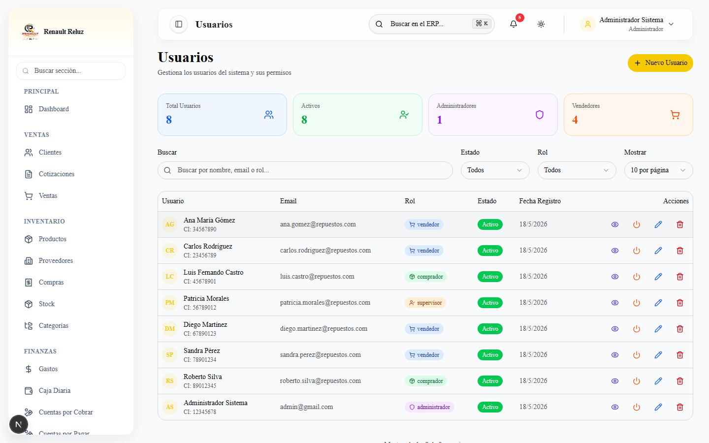

> ⚠️ **Solo el rol Administrador puede ver y modificar usuarios.** Si no ves esta sección en el menú, es porque tu usuario no tiene permisos para entrar.

### ¿Para qué sirve?

- Dar de alta nuevos usuarios (vendedores, cajeros, otros administradores).
- Asignarles un **rol** (que define qué pueden hacer).
- Desactivar usuarios que ya no trabajan con vos.
- Ver quién hizo cada movimiento (auditoría).

### Datos de un usuario

- **CI / DNI**: documento de identidad (único, no se repite entre usuarios).
- **Nombre y apellido**.
- **Email**: se usa para iniciar sesión.
- **Contraseña**: la que usa para entrar. (No se muestra nunca, ni siquiera al administrador.)
- **Teléfono** y **dirección**.
- **Rol**: Administrador, Vendedor, Compras, Supervisor u otro rol personalizado.
- **Estado**: Activo (puede entrar) o Inactivo (no puede entrar, pero su historial queda).

### Cómo crear un usuario nuevo

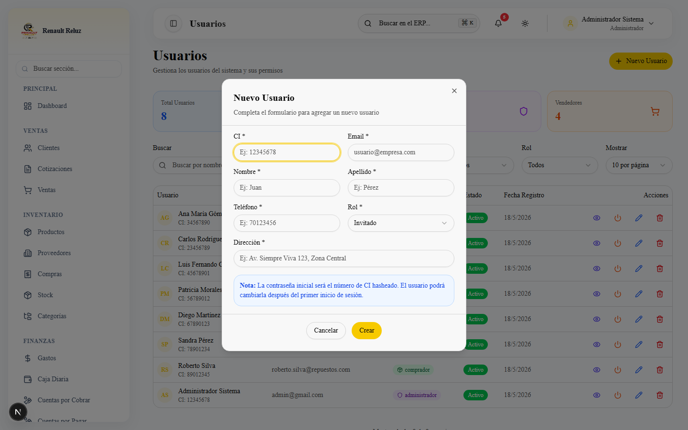

1. Hacé clic en **"+ Nuevo usuario"**.
2. Completá los datos personales.
3. Elegí el **rol**. Cada rol tiene permisos distintos, explicados en [sección 21](#21-roles).
4. Definí una **contraseña inicial**. El usuario va a tener que usarla la primera vez; después puede cambiarla desde su perfil.
5. Hacé clic en **"Guardar"**.

### Cómo editar un usuario

1. Hacé clic en el menú de tres puntos (⋮) → **"Editar"**.
2. Modificá lo que necesites. El email y la contraseña son delicados, tené cuidado al cambiarlos.
3. Hacé clic en **"Guardar"**.

> 💡 Si necesitás resetearle la contraseña a un usuario, desde la edición podés asignarle una nueva. Avisale al usuario para que la cambie en su primer ingreso.

### Desactivar vs. eliminar

- **Desactivar**: el usuario no puede entrar más, pero su nombre sigue apareciendo en ventas y operaciones que hizo en el pasado. **Es la opción recomendada** cuando alguien deja de trabajar.
- **Eliminar**: se borra completamente. **Solo se puede si el usuario no tiene ventas, compras ni operaciones asociadas.** En la mayoría de los casos, mejor desactivá.

### Cambiar el rol de un usuario

Si un vendedor ascendió a supervisor, o un comprador pasó a vendedor:

1. Editá el usuario.
2. Cambiá el campo **Rol** por el nuevo.
3. Guardá.

Los permisos del nuevo rol se aplican de inmediato en su próximo inicio de sesión.

---

## 21. Roles

> 🎭 **Agrupar permisos para no configurarlos uno por uno**: un rol es un conjunto de permisos con un nombre.

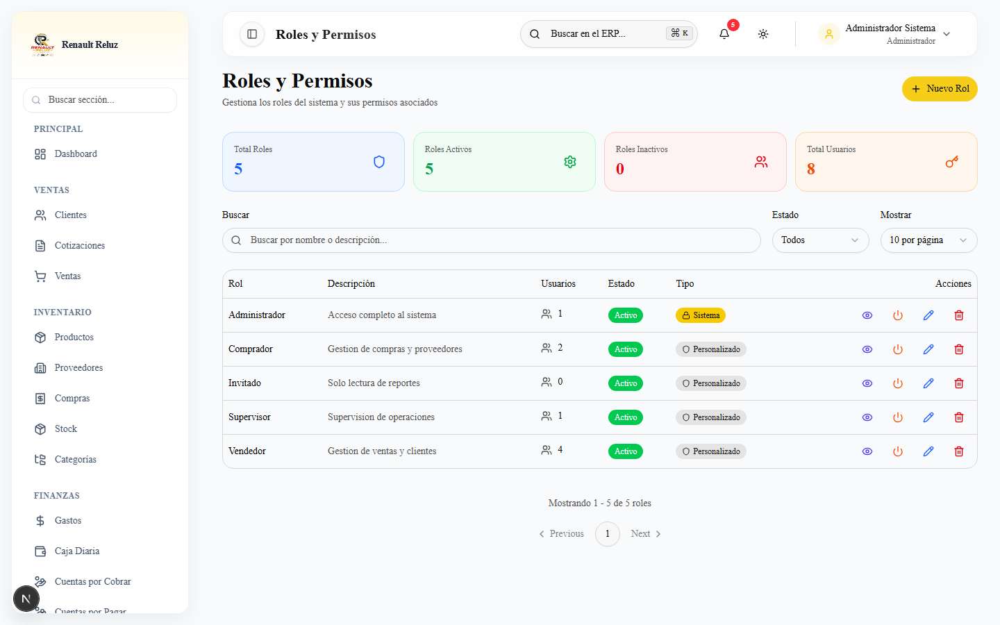

En lugar de configurar permiso por permiso a cada usuario, le asignás un **rol**. Los roles más comunes son:

| Rol               | Para qué se usa                                                               |
| ----------------- | ----------------------------------------------------------------------------- |
| **Administrador** | Dueño o gerente general. Tiene todos los permisos.                            |
| **Vendedor**      | Persona que atiende clientes y registra ventas.                               |
| **Compras**       | Persona que registra compras a proveedores.                                   |
| **Supervisor**    | Encargado de un sector. Ve más cosas que un vendedor pero menos que el admin. |
| **Invitado**      | Acceso muy limitado, solo para demostraciones o pasantes.                     |

### Roles del sistema vs. roles personalizados

La app viene con **4 roles predefinidos** (Administrador, Vendedor, Compras, Supervisor). Estos no se pueden eliminar (son los "roles del sistema").

Pero podés **crear tus propios roles** con permisos a medida. Por ejemplo, un rol "Cajero de turno mañana" o un rol "Solo lectura de reportes".

### Cómo crear un rol personalizado

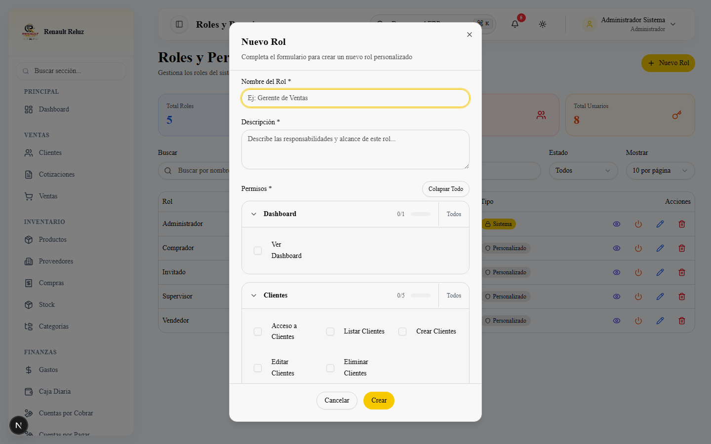

1. Hacé clic en **"+ Nuevo rol"**.
2. Indicá:
   - **Nombre**: cómo se va a llamar (ej.: "Vendedor de mostrador").
   - **Descripción**: para qué se usa.
   - **Color**: identificador visual.
   - **Permisos**: tildá las casillas de las acciones que el rol puede hacer. Por ejemplo:
     - ✅ Crear ventas
     - ✅ Ver reportes
     - ❌ Eliminar productos
     - ❌ Administrar usuarios
3. Hacé clic en **"Guardar rol"**.

### Eliminar un rol personalizado

1. Hacé clic en el menú de tres puntos (⋮) → **"Eliminar"**.
2. La app te va a pedir que primero **reasignes los usuarios** que tengan ese rol a otro rol.
3. Confirmá la eliminación.

> ⚠️ Los roles del sistema (Administrador, Vendedor, Compras, Supervisor) **no se pueden eliminar**, solo desactivar.

---

## 22. Permisos

> 🔐 **El detalle fino de qué puede hacer cada rol**: cada acción de la app se puede habilitar o deshabilitar por separado.

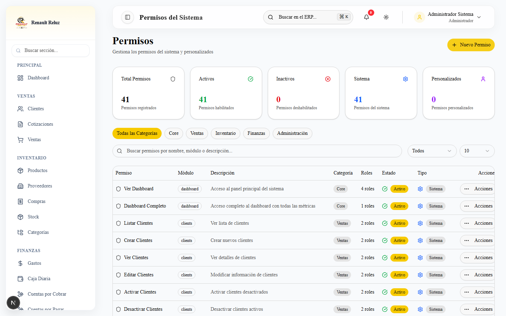

La pantalla de Permisos muestra, para cada rol, qué acciones puede hacer y cuáles no. Es como una **matriz de roles × acciones**.

### ¿Qué tipo de acciones se controlan?

A grandes rasgos:

- **Productos**: ver, crear, editar, eliminar, ver precios.
- **Clientes**: ver, crear, editar, eliminar.
- **Proveedores**: ver, crear, editar, eliminar.
- **Ventas**: ver, crear, editar, cancelar, ver de otros usuarios.
- **Compras**: ver, crear, editar, cancelar.
- **Caja**: abrir, cerrar, ver, hacer retiros.
- **Créditos**: ver, registrar pagos.
- **Reportes**: ver, exportar.
- **Usuarios y roles**: administrar.
- **Sincronización**: forzar.

### ¿Cómo se modifican los permisos?

1. Elegí el rol que querés modificar.
2. La pantalla te muestra la lista de permisos con checks verdes (permitido) o rojos (denegado).
3. Tildá o destildá lo que quieras cambiar.
4. Hacé clic en **"Guardar cambios"**.

> ⚠️ **Cuidado**: si le quitás permisos al rol Administrador, podrías quedarte sin nadie que pueda hacer tareas críticas. Te recomendamos crear un nuevo rol personalizado antes que modificar el de Administrador.

### ¿Por qué es importante configurar bien los permisos?

- 🔒 **Seguridad**: el vendedor no necesita ver cuánto ganás. El cajero no necesita poder eliminar productos. Cada uno ve solo lo que necesita.
- 🚫 **Evitar errores**: si alguien sin experiencia tiene permiso de eliminar ventas, puede borrar ventas reales por accidente.
- 📋 **Auditoría**: si cada usuario tiene sus permisos claros, cuando hay un error sabés exactamente quién pudo haber sido.

### Buenas prácticas

- 👤 **Asigná el rol más restrictivo que sirva**. Si el vendedor no necesita ver reportes, no le des ese permiso.
- 📝 **Documentá los permisos** que tiene cada rol. Anotalo en una hoja para tu referencia.
- 🔄 **Revisá los permisos periódicamente**. Si cambia la estructura del equipo, actualizá los roles.

---

## 23. Mi perfil

> 👤 **Tus datos personales y configuración de la cuenta**.

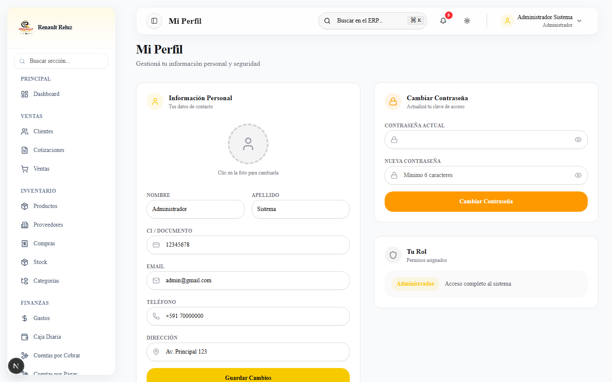

En esta pantalla podés:

### Ver y editar tus datos personales

- **Nombre, apellido, teléfono, dirección**: son los datos que ven los demás usuarios cuando hacés una venta, compra, etc.
- **Foto de perfil**: hacé clic en el ícono de cámara para subir una foto tuya.

### Cambiar tu contraseña

1. Hacé clic en **"Cambiar contraseña"**.
2. Escribí tu **contraseña actual** (por seguridad).
3. Escribí la **nueva contraseña** dos veces.
4. Hacé clic en **"Guardar"**.

> 🔒 **Importante**: tu nueva contraseña tiene que tener al menos 8 caracteres y conviene que combine letras, números y símbolos. No uses tu nombre ni tu fecha de nacimiento.

### Cerrar sesión

1. Hacé clic en tu **nombre de usuario** (esquina superior derecha).
2. Hacé clic en **"Cerrar sesión"**.

O desde la pantalla de perfil, abajo, hay un botón **"Cerrar sesión"**.

Cuando cerrás sesión, la próxima vez que abras la app te va a pedir usuario y contraseña de nuevo. Útil si compartís la computadora con otras personas.

> 💡 **Tip**: si dejás la app abierta y te vas, cualquiera que se siente en tu computadora puede entrar. Cerrá sesión cuando termines, especialmente si la máquina es compartida.

---

## 24. Backups y actualizaciones

Este capítulo es para quien administra el sistema (rol **Administrador**). Explica cómo guardar y recuperar una copia de los datos y qué pasa con ellos cuando la app se actualiza.

### ¿Dónde se hace un backup?

Andá a **Configuración → Backup y Restauración**. Ahí encontrás dos bloques: **Generar backup** y **Restaurar desde backup**.

### Los dos formatos de backup

Hay dos formatos y los dos se pueden restaurar tanto en la web como en la app de escritorio.

| Formato                | Cómo se genera                                        | Dónde se restaura               | Qué es                                                                                                                                   |
| ---------------------- | ----------------------------------------------------- | ------------------------------- | ---------------------------------------------------------------------------------------------------------------------------------------- |
| **JSON** (recomendado) | En **web y escritorio**. Botón **Backup JSON**.       | En **web y escritorio**.        | Archivo de texto legible con todos los registros del sistema (clientes, ventas, productos, compras, caja, etc.). Es el formato portable. |
| **Copia SQLite (.db)** | Sólo en **escritorio**. Botón **Copia SQLite (.db)**. | En **escritorio** y en **web**. | Imagen completa de la base local. En los dos entornos se convierte automáticamente al mismo formato interno antes de restaurar.          |

> 💡 **Tip**: si trabajás en escritorio y querés migrar los datos a la web (o al revés), usá el **JSON**. Funciona igual en los dos entornos.

### Cómo generar un backup

1. Entrá a **Configuración → Backup y Restauración**.
2. Hacé clic en **Backup JSON**.
   - En la **web** el archivo se descarga a tu carpeta de descargas con un nombre tipo `renault-backup-web-2026-11-11T10-30-00-000Z.json`.
   - En **escritorio** se abre el diálogo de Windows para elegir dónde guardarlo.
3. Guardalo en un lugar seguro (pendrive, carpeta de red, nube).

En escritorio, además, podés usar **Copia SQLite (.db)**: guarda una foto completa de la base local, útil para volver atrás rápido si algo sale mal.

### Cómo restaurar un backup

1. Entrá a **Configuración → Backup y Restauración**.
2. En **Restaurar desde backup** elegí la opción que corresponda:
   - **Escritorio**: **Restaurar backup JSON** (selector de archivos) o **Restaurar copia SQLite (.db)**.
   - **Web**: **Seleccionar archivo .json o .db** y después **Restaurar base de datos**.
3. Confirmá en el cartel de advertencia.

> ⚠️ **Atención**: restaurar **reemplaza todos los datos actuales** por los del archivo. La acción no se puede deshacer. Antes de restaurar, generá un backup de lo que tenés ahora.

La restauración funciona **igual en web y en escritorio**: la copia `.db` se convierte al formato interno y se aplica de una sola vez. Si algo falla a mitad de camino, se cancela completa y tus datos quedan como estaban. No hace falta reiniciar la aplicación.

### Detalles que conviene saber

- **Permisos**: sólo los usuarios con permiso de **Sincronización** o **Reportes (total)** pueden restaurar un backup.
- **Tamaño**: en la **web** el archivo no puede superar los **25 MB**; en **escritorio** el límite es **256 MB**, porque la copia se lee del disco de la misma computadora y no viaja por internet. En ambos casos el backup admite como máximo **50.000 registros** por tipo de dato. Si tu negocio es muy grande, dividí el respaldo o archivá datos viejos.
- **Quién hizo la restauración**: queda registrado en el log del sistema.
- **Si el archivo está dañado**, la app no toca nada: la restauración se cancela completa y tus datos quedan como estaban.

### Qué pasa con los datos cuando se actualiza la app (escritorio)

- **Tus datos no se borran al actualizar.** Clientes, ventas, productos, compras, caja y usuarios se conservan.
- La base limpia se crea **sólo la primera vez** que se abre el perfil en esa computadora (instalación nueva).
- Si el esquema de la base cambia entre versiones, la app aplica **migraciones automáticas** al arrancar. Antes de migrar guarda una copia del archivo (`renault.db.pre-migration-backup-…db`) en la carpeta de datos de la app.

### La cuenta `admin@gmail.com` y las actualizaciones

- En **cada actualización o reinstalación** la app garantiza que exista el usuario **`admin@gmail.com`** con la contraseña **`admin123`**. Si alguien le había cambiado la contraseña, **vuelve a `admin123`** después de actualizar. Los demás usuarios y sus contraseñas no se tocan.
- En un arranque normal (misma versión, sin actualizar) **no se modifica ninguna contraseña**.
- Por eso: si querés una cuenta de administrador con contraseña propia y estable, creá otro usuario con rol **Administrador** y usá ese para el día a día. La cuenta `admin@gmail.com` queda como acceso de emergencia.

> 🔐 **Recomendación**: después de instalar una versión nueva, entrá con `admin@gmail.com` / `admin123`, cambiá la contraseña desde **Mi perfil** y avisale al equipo. Tené en cuenta que la próxima actualización la va a volver a dejar en `admin123`.

---

## 25. Preguntas frecuentes (FAQ)

### ¿Olvidé mi contraseña. Qué hago?

En la pantalla de login, hacé clic en **"¿Olvidaste la clave?"**. Te va a pedir tu email y la app te manda un correo con instrucciones. Si no te llega, revisá la carpeta de spam. Si sigue sin llegar, contactá al administrador del sistema para que te resetee la contraseña manualmente.

### ¿Por qué no me deja registrar una venta?

Lo más probable es que la **caja del día esté cerrada**. La app no te deja registrar ventas en efectivo (ni gastos) sin caja abierta. Andá a **Caja Diaria** y abrila primero.

### ¿Por qué un producto no aparece cuando lo busco?

Puede ser porque está **desactivado** (su dueño lo dio de baja). Pedile al administrador que revise el estado del producto. También puede ser que lo estés buscando con un nombre distinto al que tiene cargado: probá con el código o parte del nombre.

### ¿Puedo modificar una venta ya hecha?

Depende del estado:

- **Pendiente**: sí, la podés editar.
- **Completada**: solo el administrador la puede modificar.
- **Cancelada**: no se puede modificar.

Si necesités cambiar algo de una venta completada, la mejor opción es **cancelarla** y crear una nueva con los datos correctos.

### ¿Cómo elimino un producto que ya no vendo?

Antes que eliminarlo, considerá **desactivarlo**. Si el producto tiene ventas o compras asociadas, no se puede eliminar (la app te avisa). Desactivarlo hace que no aparezca en ventas nuevas pero quede en el historial.

### ¿Por qué la caja me da una diferencia al cerrar?

Porque el efectivo físico no coincide con lo que dice el sistema. Las causas más comunes:

- Un **gasto chico** que no se registró.
- Un **error de vuelto** al cobrar una venta.
- Una **venta no registrada** (se cobró pero no se cargó al sistema).

Anotá la diferencia en el campo de notas al cerrar la caja. Si pasa seguido, es una señal de que algo no está bien y hay que revisar.

### ¿Qué pasa si pierdo conexión a internet?

Si estás usando la **versión escritorio**, la app sigue funcionando normalmente. Los datos se guardan en tu máquina. Cuando vuelva la conexión, sincronizá manualmente desde la pantalla de Sync.

Si estás usando la **versión web**, no vas a poder trabajar hasta que vuelva la conexión (la app te avisa).

### ¿Puedo usar la app desde el celular?

Sí, la versión web se puede abrir desde el navegador del celular. La pantalla se adapta automáticamente. La versión de escritorio es solo para Windows por ahora.

### ¿Cómo cambio de tema claro a oscuro?

Arriba a la derecha, hacé clic en el botón con forma de **sol** 🌞 (estás en tema oscuro) o **luna** 🌙 (estás en tema claro). La app cambia al toque y se acuerda para la próxima vez.

### ¿Por qué no me deja hacer algo? (mensaje de "no tiene permisos")

Porque tu usuario tiene un rol con permisos limitados. Por ejemplo, el rol Vendedor no puede eliminar productos. Si necesitás hacer algo que no podés, pedile al administrador que revise tu rol o que lo haga él mismo.

### ¿Se puede imprimir una factura?

Sí. En la lista de ventas, hacé clic en el menú de acciones (⋮) → **"Imprimir"** o **"Exportar PDF"**. La factura sale con los datos de la venta, tu empresa, el cliente y el detalle de los productos. La podés imprimir directamente o guardar como PDF para mandar por WhatsApp al cliente.

### ¿Cómo hago un backup de los datos?

Andá a **Configuración → Backup y Restauración** y usá **Backup JSON**: sirve tanto en la web como en la app de escritorio. Si estás en escritorio también podés generar una **Copia SQLite (.db)**. Cualquiera de los dos formatos se puede restaurar después, en web o en escritorio. El paso a paso está en el capítulo [Backups y actualizaciones](#24-backups-y-actualizaciones).

### No encuentro una opción. ¿Dónde está?

Si el menú lateral no muestra una sección, es porque tu rol no tiene permiso para acceder. Por ejemplo, "Usuarios" solo lo ven los Administradores. Si creés que deberías tener acceso, pedile al administrador del sistema que revise tus permisos.

---

## 26. Glosario de términos

Términos usados en esta app y en este manual, ordenados alfabéticamente.

| Término                         | Significado                                                                                   |
| ------------------------------- | --------------------------------------------------------------------------------------------- |
| **Administrador**               | Rol con permisos totales sobre la app. Por lo general lo tiene el dueño o gerente.            |
| **Al contado**                  | Venta que se cobra en el momento (no a crédito).                                              |
| **A crédito**                   | Venta en la que el cliente paga después, con fecha de vencimiento.                            |
| **Backup**                      | Copia de seguridad de los datos. Puede ser un archivo JSON portable o una copia `.db`.        |
| **Categoría**                   | Agrupación lógica de productos (Motor, Frenos...) o de gastos (Alquiler, Servicios...).       |
| **Categoría de gasto**          | Tipo de gasto: Servicios, Alquiler, Salarios, Marketing, Transporte, Mantenimiento.           |
| **Categoría de producto**       | Tipo de repuesto: Motor, Frenos, Suspensión, Transmisión, etc.                                |
| **Cierre de caja**              | Operación de fin de día: contar el efectivo físico y registrar el saldo.                      |
| **Cobro**                       | Pago que te hace un cliente para cancelar una deuda.                                          |
| **Código de producto**          | Identificador único de un producto (ej.: "FILT-001").                                         |
| **Comisión**                    | Porcentaje del vendedor sobre cada venta que concreta.                                        |
| **Compra**                      | Operación en la que vos le comprás mercadería a un proveedor.                                 |
| **Contraseña**                  | Clave secreta que usás para iniciar sesión.                                                   |
| **Cuentas por cobrar**          | Lo que te deben los clientes (sinónimos: créditos a clientes).                                |
| **Cuentas por pagar**           | Lo que vos le debés a los proveedores (sinónimos: créditos a proveedores).                    |
| **Cotización**                  | Presupuesto que se le entrega a un cliente. No descuenta stock. Sinónimo: presupuesto.        |
| **Crédito (a cliente)**         | Venta que el cliente paga después. Aparece en la sección "Créditos".                          |
| **Crédito (a proveedor)**       | Deuda con un proveedor. Aparece en "Créditos de compras".                                     |
| **Dashboard**                   | Pantalla principal con métricas y resumen del negocio.                                        |
| **Descuento**                   | Reducción del precio, expresada en monto o porcentaje.                                        |
| **Detalle de venta**            | Ventana con toda la información de una venta: productos, pagos, notas.                        |
| **Devolución**                  | Cuando un cliente te devuelve un producto. Se registra como un movimiento de stock (entrada). |
| **Efectivo**                    | Plata en mano.                                                                                |
| **Estado de caja**              | Abierta, cerrada o cerrada (histórico).                                                       |
| **Estado de compra**            | Pendiente, recibida o cancelada.                                                              |
| **Estado de cotización**        | Activa, vencida o convertida.                                                                 |
| **Estado de crédito**           | Pendiente, pagado o vencido.                                                                  |
| **Estado de venta**             | Completada, pendiente o cancelada.                                                            |
| **Fecha de vencimiento**        | Fecha límite para pagar un crédito. Pasada esa fecha, el crédito se marca como "vencido".     |
| **Gasto**                       | Salida de dinero que no es compra de mercadería. Ej.: alquiler, servicios, sueldos.           |
| **Historial**                   | Lista de operaciones pasadas de un cliente, producto, etc.                                    |
| **Inventario**                  | Conjunto de productos en tu depósito, con su stock actual.                                    |
| **IVA / Impuestos**             | Porcentaje que se suma al subtotal (en Argentina, usualmente 21%).                            |
| **KPI** (Indicador clave)       | Métrica importante para tomar decisiones (ej.: ventas del mes, ticket promedio).              |
| **Login**                       | Inicio de sesión.                                                                             |
| **Método de pago**              | Cómo se paga: efectivo, transferencia, QR, crédito, mixto.                                    |
| **Mixto (pago)**                | Venta cobrada con más de un método. Ej.: mitad efectivo, mitad transferencia.                 |
| **NIT / CUIT / DNI**            | Identificación tributaria o personal del cliente o proveedor.                                 |
| **Offline**                     | Sin conexión a internet. La versión escritorio puede trabajar offline.                        |
| **Pago a cuenta**               | Pago parcial de un crédito.                                                                   |
| **Pendiente (venta)**           | Venta registrada pero no cobrada.                                                             |
| **Permisos**                    | Configuración que define qué acciones puede hacer cada rol.                                   |
| **Producto**                    | Cada repuesto individual que vendés.                                                          |
| **Proveedor**                   | Empresa o persona a la que le comprás mercadería.                                             |
| **QR**                          | Código QR para pagos (MercadoPago, etc.).                                                     |
| **Recibir (compra)**            | Marcar una compra como "Recibida" para que se sume al stock.                                  |
| **Reporte**                     | Vista analítica de los datos: ventas, gastos, productos, etc.                                 |
| **Rol**                         | Agrupación de permisos que se le asigna a un usuario.                                         |
| **Setup**                       | Configuración inicial de la app, la primera vez que se instala.                               |
| **SKU**                         | Sinónimo de "código de producto".                                                             |
| **Stock**                       | Cantidad de unidades de un producto disponibles para la venta.                                |
| **Stock bajo**                  | Producto que está por debajo del stock mínimo configurado.                                    |
| **Stock mínimo**                | Cantidad a partir de la cual el producto dispara una alerta.                                  |
| **Sync / Sincronización**       | Proceso de subir/bajar datos entre la base local y la nube.                                   |
| **Tema claro/oscuro**           | Apariencia visual de la app. Se cambia con el botón sol/luna.                                 |
| **Timeline de pagos**           | Línea de tiempo que muestra cada pago hecho sobre un crédito.                                 |
| **Transferencia**               | Pago electrónico entre cuentas bancarias.                                                     |
| **Unidad**                      | Cómo se mide un producto: unidad, litro, kilogramo, metro, etc.                               |
| **Usuario**                     | Cada persona que usa la app, con su cuenta propia.                                            |
| **Vendedor**                    | Rol del usuario que registra ventas.                                                          |
| **Venta**                       | Operación en la que vos le vendés un producto a un cliente.                                   |
| **Venta al contado**            | Venta cobrada en el momento.                                                                  |
| **Venta a crédito**             | Venta cobrada después.                                                                        |
| **Vencimiento (de cotización)** | Fecha hasta la que la cotización es válida.                                                   |
| **Vencido**                     | Crédito o cotización que pasó la fecha de vencimiento sin ser pagado/convertido.              |

---

**Versión del manual: 1.1** · Última actualización: noviembre 2026
**Software: Renault Reluz ERP** · Para consultas, contactá a tu administrador del sistema.
